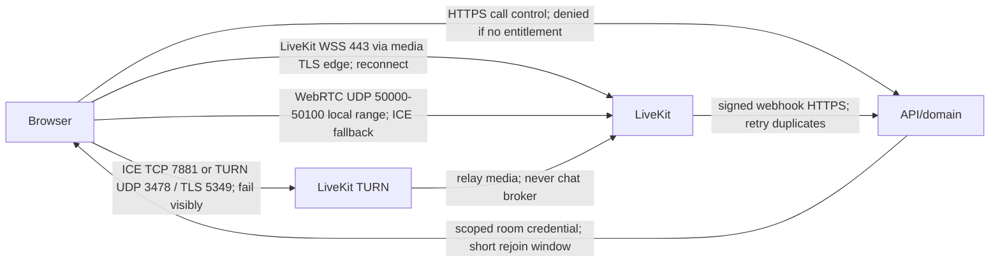

# Implementation plan — messaging and calling

**Latest local UI checkpoint (2026-10-24, supersedes running-process notes below): the requested Telegram-style redesign of supported screens/interactions is implemented and locally verified. The affected set passed 28 browser, 42 unit, 4 setup-guard and 1 lifecycle cases, with final build/type/lint checks and running-app smoke. App intentionally running at http://localhost:5173, private API/gateway/worker 3010/3011/3012 plus an owned callback-capable media fixture; another project owns 3000 and must be preserved. Existing 3-account and 9-migration fingerprints matched before restoration; test fixtures were removed and storage CORS restored. See [redesign evidence](docs/ui-redesign-evidence.md) and the last checkpoint for exact process/owner/resume instructions. Other Phase 09 external acceptance gates remain open.**

**Current execution checkpoint (2026-10-24): source through `fe744a3` is committed. The app is running locally at http://localhost:5173 with calls enabled and push disabled. Integrated journey passed (1); unchanged accessibility repeat passed (4) after a retained Chromium network-suspension failure. API/gateway/worker readiness and rendered login smoke passed. Fixed native push verifier browser-cache import order; actual Firefox enrollment still times out. Connected GitHub workflow lookup returned 404; no staging/production/device target was supplied. External gates and prior reliability risks remain open. See [latest execution evidence](docs/phase-09-local-run-evidence.md); its checkpoint supersedes historical process/resume instructions below.**

**Latest status (2026-10-22): Phase 09D full isolated local setup/demo/audit passed. Local end-to-end forced TURN now passes in an owned provider fixture. The latest three-user media measurement passed with no HTTP errors; earlier intermittent call-refresh 503 cause remains unconfirmed and larger chat/combined profiles remain generator-censored. Preserve the uncommitted RabbitMQ correction and all subsequent work on 6dc6c5e. Phases 09A/B are committed. Native push enrollment/provider/display, hosted Linux CI/webhook routing, manual accessibility/devices and production validation remain open. Full Phase 09/product readiness is not certified. The final checkpoint supersedes historical resume instructions.**

This file is the implementation source of truth. The attached `Codex_Implementation_Prompt.md` remains unchanged. Status words have distinct meanings: **planned**, **implemented**, **verified**, **environment-blocked**. A phase is verified only when every acceptance gate has passed against the required environment. Documentation describes the intended system unless explicitly listed as implemented in the progress section.

## Repository inspection and assumptions

Inspected 2026-10-13 (Asia/Calcutta): the directory initially contained only the implementation brief, no package manifests, application source, Git repository, or applicable ancestor/root `AGENTS.md`. Initialized local Git; do not automatically commit or publish. Host: Windows, PowerShell, Node 22.15.0, npm 10.9.2, Docker CLI 29.7.2, Compose 5.5.0, Python 3.12.10. PowerShell blocks npm.ps1; use npm.cmd/pnpm.cmd. Docker initially had no reachable daemon; subsequently located and started the installed user-local Docker Desktop. Local engine and baseline services now verified; credential-file access is avoided with workspace-local Docker config and installed-plugin discovery. Use workspace-local package caches. Do not change machine-wide execution policy.

Local development only is authorized. No deployment, paid services, external accounts, or public listeners. Container dependency ports bind loopback. Local HTTP/cookies and single-node dependencies are explicit development exceptions; production must reject those defaults. A real browser and runnable Linux-container Docker engine are required for later integration gates. The repository is a substantial project; no phase-number advancement based solely on stubs.

## Scope and definition of done

Responsive web: auth/verification/reset/session management; profile/privacy/search; direct/group memberships and moderation; text/replies/edit/delete/reactions/receipts/attachments; replay/offline/multi-tab; consent-based push; reporting/blocking; retention/deletion; LiveKit voice/video/group calling/screen share. Each visible action must have a real authorized implementation, loading/error/recovery behavior, and tests. Final acceptance requires an integrated multi-user browser journey, failure drills, a clean local setup, measured evidence, accessibility review, and documented limitations.

Excluded: native clients, federation, E2EE, recording, transcription, AI, billing, enterprise SSO. TLS/WebRTC encryption is transport encryption. E2EE later would require client key distribution/recovery, membership rekeying, encrypted search/attachments, new moderation constraints and scanner policy; no claim that adding a flag provides it.

Initial configurable **product limits, not capacity claims**: 4,000 Unicode code points per message; 50 members/group; 8 attachments/message; 25 MiB/file; image JPEG/PNG/WebP, PDF, plain UTF-8 text only (no SVG/HTML/archive); 10 sessions/account; 4 connections/session; 12 participants/call; 120 minutes/call; 50 history items/page, hard maximum 100; 64 KiB socket payload; 256 live durable events/buffer; 30s authoritative session recheck; 30s presence TTL/10s heartbeat; 15–30s jittered connected reconciliation; 2 minute room token; 60s signed download; 15 minute upload; 1 GiB attachment reservation/account initially. Content retention defaults unlimited pending policy selection; durable events 90d then consistent snapshot; completed outbox/effects 180d with DLQ replay capped to the same horizon. Unpublished work has no TTL.

## Stack decisions and official references

Exact npm versions will be queried from the registry before installation and stored in manifests + pnpm lockfile; exact container tags go in Compose and `docs/architecture/versions.md`. Prefer Node 24 LTS for CI/production; the host Node 22 LTS may be used only where all selected engines permit it. Select a stable TypeScript release supporting Nest legacy decorators; validate this rather than assume the latest compiler supports them.

| Component | Decision / tradeoff | Official reference |
| --- | --- | --- |
| Web | React/Vite, Router, TanStack Query, Tailwind; native accessible controls initially, reusable primitives as screens arrive; no fabricated chat records | https://vite.dev/guide/ ; https://react.dev/ ; https://tanstack.com/query/latest/docs/framework/react/overview ; https://tailwindcss.com/docs/installation/using-vite |
| Server | Nest + Fastify, thin controllers; API/gateway/worker separately runnable with shared domain, same language/database | https://docs.nestjs.com/techniques/performance ; https://nodejs.org/en/about/previous-releases |
| Mongo | Official driver (one approach only): explicit transactions, BSON Long, collection validators/index migrations, no implicit ORM hooks | https://www.mongodb.com/docs/drivers/node/current/crud/transactions/ ; https://www.mongodb.com/docs/manual/core/transactions-production-consideration/ |
| Chat | Socket.IO, supported Redis adapter, WebSocket-only initially (no polling affinity requirement, excludes networks blocking WebSocket); REST replay is correctness mechanism | https://socket.io/docs/v4/delivery-guarantees/ ; https://socket.io/docs/v4/using-multiple-nodes/ ; https://socket.io/docs/v4/redis-adapter/ |
| Redis | Ephemeral routing/presence/cache/limits only; Pub/Sub loss repaired by Mongo replay | https://redis.io/docs/latest/develop/pubsub/ |
| RabbitMQ | Confirm channel, persistent publication, independent durable fanout/notification/media queues, manual ACK/prefetch, quorum production design | https://www.rabbitmq.com/docs/confirms ; https://www.rabbitmq.com/docs/quorum-queues |
| Objects | Garage S3-compatible private store, maintained downloadable Docker distribution and AGPLv3 reviewed; isolate behind S3 port. Single-node dev is not redundant; confirm required signing/checksum/version semantics in Phase 05 | https://garagehq.deuxfleurs.fr/ ; https://garagehq.deuxfleurs.fr/documentation/quick-start/ ; https://garagehq.deuxfleurs.fr/_releases.html |
| Inspection | ClamAV isolated container + signature detection + constrained transformation process; scanner failure never approves | https://docs.clamav.net/manual/Installing/Docker.html ; https://cheatsheetseries.owasp.org/cheatsheets/File_Upload_Cheat_Sheet.html |
| Calls | Self-hosted LiveKit, React/client and TS server SDK; optional Cloud env adapter; no media in chat broker | https://docs.livekit.io/transport/self-hosting/ ; https://docs.livekit.io/reference/ ; https://docs.livekit.io/transport/self-hosting/ports-firewall/ |
| Email/push | Email provider port + Mailpit; standards push/service worker/private VAPID in Phase 06 | https://mailpit.axllent.org/docs/ ; https://developer.mozilla.org/en-US/docs/Web/API/Push_API |
| Telemetry/test | Pino redaction, OTel, Prometheus; optional Grafana. Vitest/domain, real-service integration, Playwright/browser, load/fault harness | https://opentelemetry.io/docs/languages/js/ ; https://vitest.dev/ ; https://playwright.dev/docs/intro ; https://cheatsheetseries.owasp.org/cheatsheets/WebSocket_Security_Cheat_Sheet.html |

## Structure and ownership

| Path | Ownership |
| --- | --- |
| apps/web | Browser UI, IndexedDB queue/cursors, replay reducer, SDK call panels, service worker; imports contracts only (never config/domain server clients) |
| apps/api | REST transport, cookie/CSRF guards, service wiring, upload/call authorization, raw LiveKit webhook ingress |
| apps/gateway | Socket.IO origin/session guards, runtime validation, bounded routing, subscription entitlement, heartbeats/draining |
| apps/worker | Relay, separate broker subscriptions, notification adapter, retention/reconciliation; scanning in isolated process/container |
| packages/contracts | Browser-safe strict Zod DTOs, string sequence codec, versioned commands/events/errors |
| packages/domain | Auth/authorization rules, transaction orchestration, state machines, Mongo repositories/migrations, external ports; server-only |
| packages/config | Server-only validated env, limits/timeouts, production safety checks |
| packages/observability | Server-only log redaction, correlation, metrics, tracing bootstrap |
| infra/compose | Local pinned services, initialization, loopback bindings, health probes, optional profiles |
| infra/observability | Optional telemetry configs/dashboard/alerts |
| tests/integration, tests/e2e, tests/load | Real-service invariants, independent browsers, reproducible capacity/failure evidence |
| docs/architecture, docs/runbooks | ADRs, schemas/contracts, networking/security, incidents/restore/draining |

## Trust boundaries and network paths

```mermaid
flowchart LR
  B[Untrusted browser] -->|HTTPS assets/API; errors retried by command ID| E[Same-origin TLS edge]
  E -->|REST; bounded dependency timeout| A[API]
  E -->|chat WSS only; reconnect then replay| G[Gateways]
  A -->|authenticated commands; reject forbidden| D[Shared domain]
  G -->|same policy; room is no proof| D
  D -->|snapshot / majority+journal transaction; ACK after commit| M[(Mongo replica set)]
  M -->|outbox lease; expired lease reclaim| W[Relay/worker]
  W -->|persistent publish + confirm; duplicate on crash| Q[(RabbitMQ)]
  Q -->|fanout subscription; ACK after routing attempt| R[(Redis)]
  R -->|ephemeral hints; loss repaired by replay| G
  B -->|authorized replay through watermark; expired cursor snapshot| A
```





Production static/REST/chat WSS share origin and a TLS edge. LiveKit signaling uses separate host with TLS; direct media requires correctly advertised public IP and firewall UDP range (or configured UDP mux), ICE TCP, and TURN. TURN/TLS normally presents 443 publicly (map to configured server port with its own L4 endpoint/certificate); an ordinary HTTP CDN cannot forward UDP. Local Windows Docker NAT is not evidence of public/LAN/TURN connectivity. Phase 07 will verify real networking and certificates against selected LiveKit version. Never publish local config publicly. Production: single region, >=2 API/gateway/worker instances, 3 voting Mongo data nodes across failure zones, >=3 Rabbit quorum nodes, protected Redis HA, redundant private object service, separately budgeted LiveKit nodes. Region outage still unavailable; active rooms may fail and require rejoin on media node loss.

## Message send and recovery

```mermaid
sequenceDiagram
  participant B as Browser
  participant A as API/Gateway
  participant M as Mongo
  participant W as Relay/Broker/Fanout
  B->>B: Persist clientMessageId + payload; if local persistence fails disclose loss risk
  B->>A: send.v1 (cookie identity, command ID)
  A->>M: Transaction: entitlement guards, dedup, counter, message, event, outbox
  M-->>A: Majority journal commit OR explicit failure/ambiguous timeout
  A-->>B: Accepted canonical result; lost ACK reconciled with same ID
  W->>M: Lease outbox; recover expired claims
  W-->>B: Live hint may duplicate/disappear; not a delivery receipt
  B->>A: Replay after applied cursor through watermark, plus inbox discovery
  A-->>B: Ordered authorized events OR CURSOR_EXPIRED + snapshot procedure
  B->>B: Apply/dedup atomically with cursor; repair gaps even while connected
```

Sequences: signed positive BSON 64-bit Long counters, wire/IndexedDB canonical decimal strings (`0` allowed for initial cursor), browser comparison BigInt, max 9223372036854775807. Never Number conversion; reject overflow/noncanonical strings. Event offset differs from message creation position/count. Receipts point to visible message creation sequence, not edit events. Unread = visible new messages by other users with creation sequence > read cursor; edits/reactions do not add unread. Delivered is device acknowledgement of contiguous applied message positions, not maximum sparse observed offset. Read advances monotonically after visible messages applied/viewed; per-user aggregates distinguish group recipient status. Hidden events carry authorized sequence-only redacted envelopes so gaps are distinguishable without content leakage.

Command creation unique `(conversationId,senderId,clientMessageId)`; canonical normalized-payload digest includes reply and attachments. Repeated same digest returns original message even if current content edited; different digest returns conflict. Mongo driver convenient transaction API with deadline/commit timeout, primary snapshot reads, majority+journal writes, retries only through supported mechanisms; no external effects in callbacks. UUID event/command IDs allocated outside retry callback. Every recoverable edit/delete/reaction/receipt/membership mutation produces event+outbox atomically; deletions retain tombstones. Counter serializes bounded group mutations; do not claim arbitrary group throughput.

Authorization ordering: each mutation acquires a real write on conversation guard and active membership guard in transaction, then reads entitlement. Removal writes the same conversation/member guard before closing visibility interval. Direct send/block/call/download authorization additionally writes canonical sorted pair guard; block operation writes same guard. Thus overlapping operations serialize by committed guard writes; cached reads cannot prove ordering. Group blocks suppress directed invitations/calls/presence and notify UI that blocked users may remain in shared groups; block does not erase lawful shared-group history. Direct blocked pairs reject new messages/calls/download grants; prior history still available to existing participants per retention, presence hidden. Fanout rechecks current entitlement; strict sensitive reads/download grants use guard policy too. Already issued download/room bearer credentials have documented remaining validity windows. Rejoin starts a new visibility interval; no access during absence or before first membership. Group removal disables live subscriptions and credentials; later rejoin does not restore earlier expired download grants.

Replay: subscribe+bound live buffer, capture authorized watermark, replay ordered events to watermark, apply state and cursor in one IndexedDB transaction, then merge buffered events and repair gaps. Overflow disconnects/resets recovery, never advances cursor. Periodic jittered authoritative high-watermark/inbox checks repair Redis loss while connected. Per-user durable inbox event sequence discovers new conversations/removals; expiry triggers versioned authoritative inbox snapshot with snapshot watermark. Conversation snapshot uses consistent Mongo snapshot at watermark; page sessions bounded/expiring. IndexedDB keys scoped user; logout clears sensitive stores, BroadcastChannel conveys account-scoped invalidations/event IDs only, no credentials. Presence is approximate per device TTL; revalidate sessions 30s and on commands, fail closed for protected writes on Mongo outage. Socket per-session quotas, 64 KiB input, 256-event buffer, discard typing first, close slow consumers and recover. Gateway SIGTERM stops admission, announces reconnect, bounds drain time.

## Attachment flow/state

```mermaid
sequenceDiagram
  participant B as Browser
  participant A as API/domain
  participant S as Private S3
  participant W as Isolated scanner
  B->>A: Reserve quota; membership/pair guard; reject excess
  A-->>B: Generated quarantine key + short scoped upload; no read permission
  B->>S: Upload bounded bytes; failure leaves reservation for expiry
  B->>A: Finalize owned upload
  A->>S: HEAD size/type/owner metadata; mismatch rejects (not approval)
  A->>A: Transaction uploaded + durable Mongo scan job/action (idempotent)
  W->>S: Bounded GET into captured buffer; check exact SHA/length
  W->>W: Signature + actual ClamAV + isolated decoder; failure stays private
  W->>S: Approved fresh key; never same upload key
  W->>A: Guarded ready metadata + lease/quota transaction
  B->>A: Authorized download ready only; removal rejects new grants
  A-->>B: 60s private bearer URL; already issued URL persists up to expiry
```

States pending -> uploaded -> processing -> ready/rejected; pending/uploaded expire; any state -> deleting -> deleted through idempotent jobs. Reserve quota and scan-job commit in Mongo. Never approve based on Content-Type/extension. Garage has no object versioning. Worker captures capped bytes, verifies the reserved SHA, scans/transforms those captured bytes, and writes a fresh server-only approved key per lease; signed PUT remains restricted to the original quarantine key. Finalize only queues checks. Association commits the message event/outbox transaction; file status uses bounded owner polling. PDF no active inline rendering, all downloads attachment; images pixel cap/transformation in sandbox, no arbitrary shell/parser paths. Scanner unavailable/errors/timeouts retain quarantine, no production bypass. Cleanup of reservations, abandoned/rejected files, original+derived objects, and orphans uses bounded metadata and prefix inventory; download URL checks current visibility intervals and object readiness.

## Call control/state

Call state scheduled/ringing -> active -> ending -> ended; ringing -> cancelled/declined/timed_out. Participant invited -> accepted -> joining -> joined -> left/removed. Compare-and-set generation/state and transaction guard serialize accept/cancel/timeout; first eligible device acceptance wins lease while same user retries are idempotent. Use unique call UUID and room incarnation; never reuse names. Backend issues identity-bound minimal grants only to authorized accepted participants, enforces capacity/reservations/duration, session validity, moderator removal. Token expiry does not evict connected users: remove via provider + reconcile; old tokens may rejoin for remaining <=120s unless provider-supported stronger admission strategy is verified. Ending deletes room and blocks token issuance; cannot assert absolute prevention of old-token recreation until tested provider semantics/room admission policy. Webhook signature requires raw body; write unique provider inbox before ACK, reconcile duplicates/out-of-order against provider room and domain generation. User sees media/device/permission/autoplay/reconnect issues, camera and screenshare are separate tracks. Room-empty grace 30s then reconcile before end; worker duration enforcement. No media persistence; no recording. Metrics depend on exposed SDK stats, unexposed TURN counters are documented unavailable.

## Durable model, indexes, constraints, retention and migration ownership

All collection records have schemaVersion, createdAt, updatedAt where mutable; IDs are UUID strings unless external token hash. Validators reject unexpected critical types; application Zod is additional validation. Separate arrays only for explicitly bounded small fields, never messages/members/receipts/outbox. Indexes below are **design** until corresponding migration is implemented and integration-tested. Domain migrations run explicitly, idempotent tracked versions, create validators/indexes before routes start accepting relevant writes; no automatic destructive index drops. Additive expand/backfill/contract only after old version retirement; test old+new DTO compatibility.

| Collection | Fields / key indexes / retention | Phase |
| --- | --- | --- |
| users | emailCanonical + usernameCanonical unique, passwordHash, displayName, avatarId, verifiedAt, privacy, role, authVersion, deletionState; bounded indexed username prefix range (no unbounded regex). Soft deletion releases identifiers per documented tombstone policy; scrub PII in 06 | 01 |
| sessions | tokenHash unique, userId, expiresAt, revokedAt, csrfHash, authVersion, deviceLabel; `(userId,revokedAt,expiresAt)`, TTL expiresAt cleanup only (expiry enforced on read) | 01 |
| authTokens | hash unique, purpose, userId, expiresAt, usedAt; one-use CAS + password/session transaction; TTL expiry | 01 |
| conversations | kind, canonical directPair unique partial, title, nextEventSeq Long, messageCount, guardVersion, activeCallId; no messages array; no TTL | 02/03 |
| memberships | `(conversationId,userId)` unique, role, state, guardVersion, current interval, read cursor; visibilityIntervals separate indexed `(conversationId,userId,startSeq)`; no absence access | 02 |
| pairGuards / blocks | canonical pair guard ID/version; `(blockerId,blockedId)` unique; blocked state and guard transaction; retained until account removal | 02 |
| messages | conversationId, senderId, clientMessageId, originalDigest, creationSeq Long, text, replyId, bounded attachmentIds, editedAt, deletedAt; unique idempotency triple; unique `(conversationId,creationSeq)`; compound descending cursor; tombstone over retention | 03 |
| conversationEvents | eventId unique, conversationId, sequence Long, kind, actor, payload, visibility, createdAt; unique `(conversationId,sequence)`; 90d with explicit earliestAvailableSeq/snapshot protocol | 03/04 |
| inboxEvents | unique `(userId,sequence)`, user feed guard/counter, conversation reference, kind; bounded retention + snapshot | 02/04 |
| conversationReceipts | unique `(conversationId,userId)`, exact delivered/read message positions and deliveredFrom applied range; monotonic guarded account-level aggregate across devices, bounded rows | 04 |
| messageReactions | unique `(messageId,userId,reaction)`; six-type enum/current-member count bound, event in same transaction | 04 |
| mutationCommands / replayFloors / syncSnapshots | unique user/action digest/result; exact conversation/inbox floors with explicit expiry reset; owner-bound pinned snapshots with 120s TTL/read expiry, four live tickets/user | 04 |
| attachments | ownerId, conversationId, reservedBytes, sourceKey, approvedKey, size/approvedSize, sha256/approvedSha256, state/error, sourceCleaned, messageId, uploadExpiresAt/expiresAt; `(state,expiresAt)`, objectKey unique; no automatic metadata TTL before object cleanup | 05 |
| attachmentQuotas / attachmentCommands / attachmentJobs | guarded logical byte reservation/account, user/action digest/reference, one job/file with server-time leaseOwner/leaseUntil/attempts/candidateKey; unique indexed generated keys, bounded claim/expiry/cleanup; no metadata/command TTL before later retention policy | 05 |
| outbox | eventId unique, topic/version, payload/reference, status, availableAt, leaseOwner, leaseUntil, attempts, publishedAt; `(status,availableAt,leaseUntil)`; only completed retention, no TTL pending | 03 |
| consumerEffects | unique `(consumer,eventId,effectVersion)`, result/completedAt; transaction with DB effect; 180d, replay requires retained effects | 03/06 |
| reports / audit | reporterId + commandId unique, input digest, visible conversation/message reference, enum reason, open/dismissed/removed; daily per-user admission; append-only queue-read/decision audit; no body copies; pseudonymous reference retention | 06 |
| pushSubscriptions / pushJobs | endpointHash globally unique and `(userId,sessionId)` unique; encrypted endpoint/auth/p256dh, max 30d expiry; device jobs unique event/device, current authority checks, 30s leases, five attempts, five-minute expiry, inspectable outcomes; 404/410/revocation cleanup | 06 |
| calls / callParticipants | callId unique, conversationId, room incarnation unique, state, deadlines, version; participant unique `(callId,userId)`, invitation/action key unique; `(state,deadline)` worker reconciliation; history 90d initial | 07 |
| webhookInbox | provider/eventId unique, raw-body digest, validated payload, state, attempts, availableAt; persist before ACK, complete retention 180d | 07 |
| deletionJobs / migrations | unique account/job generation; scoped idempotent stages/manifests; migration ID unique, lease/checksum; retain evidence without PII | 00/06/08 |

## API, socket and event contracts

`/api/v1`; strict input schemas strip no attacker identity silently (reject unknown fields). Problem `{code,message,requestId,retryable}` without internal errors/PII; HTTP 401/403/409/413/429/503 distinctly. Browser mutations cookie + exact Origin + session-bound CSRF header; JSON only/payload cap. Request ID generated if invalid, never accept arbitrary log injection. Opaque random session stored hash only; HttpOnly Secure SameSite=Lax same-origin, local HTTP exception. Argon2id parameters benchmarked in Phase 01 against memory/time/concurrency budget; email/reset generic responses, one-use hashed tokens, quotas fail closed on Redis failure.

| Contract family | Planned endpoints / socket commands | Gate |
| --- | --- | --- |
| Foundation | GET health/live, health/ready, health/dependencies; no private payloads; readiness specific to process role | 00 |
| Identity | POST auth/register,login,logout,verify,reset/request,reset/confirm,password; GET auth/session, sessions; DELETE sessions/:id, sessions/all; GET/PATCH me | 01 |
| Social | GET users?prefix&cursor; POST conversations/direct,groups; GET inbox/sync, conversations/:id/messages; POST invite; PATCH role; DELETE member, leave; PUT/DELETE blocks/:user | 02 |
| Durable chat | POST conversations/:id/messages; GET command/:clientId, events?after&through, snapshot; PATCH/DELETE message; PUT receipt/reaction; send.v1, subscribe.v1; ACK canonical result only | 03/04 |
| Disposable chat | typing.v1 + approximate presence; rate bounded no durable delivery promise; event.v1 envelope `{v,eventId,conversationId,sequence,kind,payload}` runtime-validated | 04 |
| Attachments | POST attachments (reserve), :id/finalize,retry,delete,download; GET attachments?conversationId; strict action IDs + CSRF, owner polling, ready refs through existing message snapshots/events | 05 |
| Safety/notification | GET/PATCH safety/notifications; POST/DELETE safety/subscriptions; POST safety/reports; GET safety/moderation/access,reports; POST safety/moderation/reports/:id; POST safety/deletion (password + DELETE); generic notifications | 06 |
| Calling | POST conversation calls, call accept/decline/cancel/join-token/end/remove; GET call history; POST webhooks/livekit raw verified; call events durable | 07 |

No placeholder success routes. Phase 00 defines only foundation and minimal send/event primitives; later endpoints are plans. Schema evolution v1 additive; incompatible commands use v2 and supported one-release overlap.

## Production challenge matrix

| Challenge | Concrete fix / owner / phase | Required failure test | Remaining limitation |
| --- | --- | --- | --- |
| Durable acceptance/idempotency | unique triple + original digest + majority transaction, domain 03 | concurrent retries, lost ACK after commit, changed-payload conflict | transport not exactly once |
| Counter precision/order | Long/string/BigInt codec + guarded counter, contracts/domain 00/03 | >2^53, overflow, concurrent events | bounded group contention |
| Membership/block races | shared write guard inside txn; gateway entitlement recheck, domain 02–04 | concurrent removal/block/send/download/subscription | prior bearer windows |
| Event replay/retention | every mutation event + watermark snapshots/inbox feed, domain/web 03–04 | edit/delete offline, expiry, unseen new group | expired history per policy |
| Browser durability/multi-tab | user-scoped IndexedDB + applied cursors + BroadcastChannel, web 04 | refresh pending, storage denied, live overlap/overflow, account switch | browser storage eviction possible |
| Connected live loss | periodic jittered watermark repair, gateway/web 04 | Redis interruption with socket connected | eventual display lag |
| Broker outage/duplicate pub | CAS leases, confirms, stable IDs, admission cap, worker 03 | confirm-before-mark crash, broker down/recovery | bounded backlog; accepts before fanout |
| Consumer effects/DLQ | independent queues, manual ACK, transaction effect dedup, bounded retry, worker 03/06 | poison payload/crash/replay-horizon | external provider ambiguous duplicates |
| Security/session/CSRF | hashed opaque session + origin/CSRF + authVersion + expiry checks, domain/API/gateway 01/04 | revoked/expired/forged origin/session, Mongo/Redis fail | revalidation bound for idle sockets |
| Secrets/privacy/moderation | server import boundary, redacted logs, CSP, privilege guards/audit, all/06 | leaked-bundle scan, horizontal/vertical attacks | abuse prevention needs operations |
| Attachment access/overwrite | private split keys, immutable verified bytes, ready-only URLs, domain 05 | expired/foreign upload, overwrite after approval | 60s issued-download revocation bound |
| Malicious files/scanner outage | signatures + ClamAV/resource isolation, worker 05 | EICAR/spoof/oversize/pixel bomb/scanner error | scanner not proof of harmlessness |
| Orphans/retention/deletion | idempotent manifests + reconciliation, worker 05/06 | failed object delete + retry/restore | backup PII retained to expiry |
| Call race/revocation | CAS lifecycle + identity/room incarnation + provider remove/reconcile, domain 07 | accept/cancel/timeout, reuse/end/rejoin/removal | issued token window/provider semantics |
| Webhooks | verified raw signatures + unique inbox + reconcile, API/worker 07 | duplicate/out-of-order/invalid signature | provider outage delays convergence |
| Actual media/TURN | official SDK + dedicated networking, web/infra 07 | 2-browser voice/video/screenshare and forced relay | NAT/hardware validation environment dependent |
| Device/media/node failure | denial/autoplay UX, visible reconnect/rejoin, web 07/08 | permission deny, screen stop, network/node loss | no transparent room migration claim |
| Overload/slow clients | limits, payload/buffer/pool budgets, jittered retry, all 04/08/09 | slow clients, reconnect storms, queue saturation | limits not benchmarks |
| Dependency failure/draining | role readiness/timeouts, no cascading liveness restart, all 00/08 | each dependency stop + SIGTERM | local single nodes not HA |
| Logs/traces/metrics | correlation/redaction, OTel, Prom alerts/dashboard, observability 00/08 | secret log negatives and alert fault drill | unexposed provider metrics unavailable |
| Schema upgrades | explicit additive migration, v1 overlap, domain/contracts 00/08 | old/new release concurrent run | breaking changes require staged retirement |
| Restore/RPO/RTO | snapshots/oplog/object inventory + application restore drill, infra 08 | auth/index/object/reconciliation check restored | majority doesn't cover region/destruction |
| Complete UI/product | real data, accessible states, virtualized history, all/09 | multi-user feature audit + keyboard/a11y | no production-ready claim without evidence |
| Cost | validated quotas, max call duration, storage/egress/queue alarms, config/08 | quota races + admission threshold | no budget/pricing inferred |

## Dependency failure, threat and operations policy

| Failure | Allowed / rejected behavior | Recovery / user experience |
| --- | --- | --- |
| Mongo | liveness and static page allowed; protected durable commands/read authorization fail closed | retry/reconcile ambiguous ID, readiness 503; never success on failed commit |
| Redis | durable authorized history remains available; approximate presence unavailable; critical limits fail closed (later measured conservative local fallback optional) | replay repairs fanout, authoritative session checks still active |
| RabbitMQ | accepted durable messages while admission backlog budget permits; notifications/live delayed | outbox leases recover, oldest-age alerts, explicit pending display |
| Objects | text unaffected; reservation may succeed with quota held, upload/finalize/checks/download fail when storage is unavailable | preserve reservations/jobs, exponential bounded retry/reconcile |
| Scanner | no ready transition/download for pending media | quarantine and bounded Mongo job retries/failed ledger; visible processing/error |
| LiveKit | text unaffected; reject room allocation/join with unavailable | persisted lifecycle reconciliation, visible rejoin, no claimed active-node survival |
| Email/push | durable account/notification jobs, generic auth responses; push optional | retry with provider ID if available, possible external duplicates, in-app fallback |
| IndexedDB | user may send only with explicit non-durable local queue disclosure | reconcile accepted command IDs; no refresh-safe promise |

Threat model covers hostile authenticated users, forged command identity, guessed IDs, CSRF/socket hijack, injection/XSS, quota abuse, stolen bearer URLs, malicious uploads, revoked users, privileged abuse, and compromised dependency identities. Controls: exact origin, session identity only, guard transactions, text rendering/no HTML, JSON schemas and query construction, CSP/security headers, quota/rate failures closed, split storage IAM, broker routing permissions, workload least privilege, hashed reset/session tokens, redact credentials/body/URLs. Production secrets provided at runtime, never VITE variables. Local default secrets rejected in production config. Security review gates feature tests; no complete-security claim.

Operational targets (not measured results): single-region service availability 99.9% monthly for authorized durable REST; p95 acceptance <300ms and replay catch-up <5s at benchmarked load excluding provider/email/media network. Report measurement boundary and injected outage time separately. Mongo majority acknowledgement RPO target 0 for single member loss; regional/destructive restore RPO determined by tested backup/PITR cadence (initial target <=15 minutes) and RTO target <=4h, neither yet proven. Daily encrypted snapshots + continuous oplog where supported, versioned private object backups/inventory; restore in isolated environment, validate indexes/permissions/auth revocation, message/event continuity, attachments, orphan/outbox replay and call reconciliations. Logs no bodies/tokens, short configurable retention. Account deletion removes sessions/tokens/push/profile, scrubs the deleting user's authored bodies/files equally in direct and group history, preserving pseudonymous tombstones and other members' content, schedules media/cache/projection removal; backup copies expire on backup schedule and deletion manifests reapply after restore.

Runbooks to deliver: setup, broker/DLQ replay (authenticated admin + audit + bounded horizon, never blindly expire dedup), revocation, scanner/attachments, LiveKit/TURN, draining, dependency incident, additive migrations, backup/restore, retention/deletion. Local minimum planning budget 4 CPUs/8 GiB free RAM, disk >=10 GiB; scanner/media/telemetry profiles add load. Measure rather than assert machine requirements suffice. Pools and timeouts: Mongo maxPoolSize 20/process (sum across replicas before scale); selection 3s, command 5s, txn deadline 10s; worker prefetch 16; bounded job concurrency 4; retries exponential jitter 1s–60s/max 5 then DLQ, outbox publication lease 30s; relay has no finite TTL and admission alerts before disk exhaustion.

## Ordered phases and acceptance gates

Run commands from root with pinned pnpm (`pnpm.cmd` on PowerShell). Only use scripts that exist for implemented phases; later phase-specific commands must be added with their tests. Standard gate: `pnpm lint`, `pnpm typecheck`, `pnpm test`, `pnpm build`. Real tests must fail on missing services rather than silently skip.

| Phase | Deliverables / prerequisite | Gate and exact validation command target |
| --- | --- | --- |
| 00 | Plan before application code; pinned workspace/strict TS/lint/build; foundation contracts/config/domain/observability; honest API/web foundation; separately runnable gateway/worker; Compose replica init/storage/broker/mail plus optional media/scanner profiles; CI skeleton | standard gate; `pnpm infra:config` (all-profile syntax); `pnpm infra:up`; `pnpm test:integration:foundation` (baseline Mongo/Redis/Rabbit/Garage/Mailpit health + real replica txn commit/rollback); `pnpm test:foundation:http` (live/ready); frozen clean lock install. Optional scanner/media runtime integration remains unverified until 05/07 |
| 01 | After 00 verified: auth, email flows, sessions/profile, CSRF/origin/rate guards, real auth UI | standard + `pnpm test:integration:auth` + `pnpm test:e2e:auth`; real browser auth, reset/verify Mailpit, revoked/expired negatives; hash budget recorded |
| 02 | After 01: direct/groups/roles/blocks, history index migration, real chat shell/inbox | `pnpm test:integration:conversations`, `pnpm test:e2e:conversations`; cross-user/guard races, bounded pagination/rejoin |
| 03 | After 02: atomic sends/events/outbox, relay, Rabbit queues/retry/DLQ, idempotent effects | `pnpm test:integration:messaging`, `pnpm test:failure:outbox`; concurrent duplicate sends, commit-before-ACK, confirm-before-mark duplicate, backlog recovery |
| 04 | After 03: Redis adapter multi-gateways, offline/replay/inbox, edits/reactions/receipts/presence | `pnpm test:integration:sync`, `pnpm test:e2e:sync`, `pnpm test:failure:gateway`; overlap/overflow/connected loss/multi-tab/cursors/slow consumer |
| 05 | After 04: private S3 upload/finalization, real scan/transforms/download/cleanup | `pnpm test:integration:attachments`, `pnpm test:e2e:attachments`; spoof/EICAR/quota/overwrite/scanner failure/revocation window |
| 06 | After 05: real push/privacy/report/moderation/retention/deletion | `pnpm test:integration:safety`, `pnpm test:e2e:safety`; privilege/fallback/effect/deletion reconciliation |
| 07 | After 06: LiveKit SDK room UI, lifecycle/token/webhook, direct/group media/screenshare | `pnpm test:integration:calls`, `pnpm test:e2e:calls`, `pnpm test:e2e:calls:relay`; independent browsers, devices and real restrictive network; fake tracks labeled |
| 08 | After 07: full telemetry/alerts/draining, compatibility, restore and owned verification lifecycle | `pnpm test:integration:operations`, `pnpm test:failure:dependencies`, `pnpm test:upgrade`, `pnpm test:restore`, `pnpm test:e2e:upgrade`, `pnpm test:integration:e2e-lifecycle`; fault alerts, restored consistency, actual release/media recovery and cleanup |
| 09 | After 08: polish/a11y/demo/profile-avatar privacy and upload/benchmark/deploy docs/evidence audit | `pnpm test:e2e`, `pnpm test:a11y`, `pnpm test:load:chat`, `pnpm test:load:media`, `pnpm audit --prod`; clean setup audited, findings handled explicitly |

Capacity methodology: disclose hardware/OS/container/runtime versions and topology, independent generator location, warmup/duration, connections/users/msg rate/group mix/payload size/history depth, error classes and sample counts, p50/p95/p99 acceptance/delivery/replay, pool/saturation/event-loop/memory, broker oldest age. Separate chat and media trials, then combined; media tracks resolution/bitrate/participants/TURN fractions/RTT/jitter/loss/bandwidth where SDK exposes them. Increase until objectives fail, report observed knee only for tested configuration. Same-machine smoke is no production benchmark. No results yet.

## Progress and exact resume point

### 2026-10-13 — Phase 00 foundation verified

- Completed before application implementation: full brief/repository/ancestor instructions inspection, architecture/ordered phase plan, official documentation and registry checks. Original brief preserved; no existing application replaced, no public deployment, no account changes.
- Implemented: 9-project pnpm workspace (root + four apps + four packages), strict TypeScript 6.0.3, pinned packages/lockfile/build allowlist, lint/browser import boundaries; exact string/BigInt/BSON Long sequence codec; strict send/event/problem/readiness primitives; validated limits/types/production-safe config; Nest/Fastify foundation health/security headers; React/Router/Query/Tailwind foundation with real readiness request and error/loading states; gateway/worker liveness with honest 503 functional readiness; redacted Pino logs/process metrics/OTel API seam; pinned local services and optional media/scanner configuration; CI skeleton, README/versions/setup runbook/test ownership notes.
- Verified commands: `pnpm build`; `pnpm typecheck` including scripts and test sources; `pnpm lint`; `pnpm test` (**32 tests**); `pnpm test:foundation:http` (**3 tests**); `pnpm infra:config`; `pnpm infra:up` plus repeat initialization; `pnpm test:integration:foundation` (**6 tests**, repeated after digest-pinned container recreation); `pnpm install --frozen-lockfile --offline --state-dir .cache/pnpm-state` in populated checkout; `pnpm audit --prod --audit-level high` (**no known vulnerabilities returned**). Compiled gateway and worker entry points manually started and returned live 200 / ready 503, then stopped.
- Real-service evidence: Mongo writable replica primary, majority+journal transaction commit/rollback across two test collections, >2^53 Long persistence; Redis auth/TTL; Rabbit confirms/persistent publication to three independent quorum test queues/manual ACK; both private S3 areas write/read/delete and unauthenticated rejection; Mailpit HTTP/SMTP greeting; positive API readiness. All five baseline Docker probes healthy. Fresh containers retained replica/storage volumes; baseline Compose now pins observed image digests. These checks prove foundation only, not Phase 03 message dedup/crash guarantees or production HA.
- Clean-checkout check: frozen installation and application build PASS from an isolated copy without node_modules/dist, reusing a workspace-local package/metadata cache. Explicit Tailwind source scope gives matching final web asset hashes in both copies. See evidence file for corrected attempts. This is a Windows setup check, not a remotely executed Linux CI run.
- Corrected failed checks: Zod boolean output defaults; explicit Node type visibility; exported API return annotation; malformed sequence safeParse throwing due unchecked BigInt conversion; pnpm 12 `.npmrc`/allowlist changes; Docker plugin discovery under isolated config; idempotent approved-bucket setup; deprecated Prometheus client migration. No unresolved failure in the scoped Phase 00 gates.
- Status at the first session boundary: **Phase 00 verified (foundation scope)**; later phases were then planned. Latest status is below; the full application is not complete.
- Unverified/deferred: remote CI execution; actual browser rendering/a11y; optional LiveKit/ClamAV runtime and media/scanning integration; exported traces/dashboard/alerts; auth/messaging/calls/retention/notification features; production target/version/networking/security/capacity/restore behavior. Their later gates remain required. OTel API without SDK/exporter is explicitly not exported tracing.
- Local state: Docker Desktop and five loopback baseline containers running; persistent development volumes retained. App servers from HTTP/process tests stopped. No `.env` with real secrets created. pnpm CLI in `.cache/pnpm-cli`; store/cache inside repository. pnpm's machine operation-lock access still needs sandbox escalation despite local caches. No current feature blocker; later browser/media environment capability must be checked when needed.

### Phase 01 - verified locally (2026-10-13)

Implemented: browser-safe auth/profile/session contracts; bounded Argon2id pool; opaque hash-only sessions, session-bound HMAC CSRF, exact Origin/JSON/runtime guards; Redis atomic expiring limits/deadlines/queue bounds/fail-closed mutations; guarded Mongo registration/session quota/rotation/revocation/password/token/profile mutations; DB-enforced normalized unique identities; one-use hashed verification/reset tokens; dedicated AES-GCM-encrypted durable email jobs and leased SMTP worker; explicit 001_auth validators/indexes; shared verified/moderator authorization; functional register/login/verify/reset/profile/privacy/session/password UI, account-cache clearing and credential-free BroadcastChannel invalidation; ordinary development fixtures; real Chromium suite and CI/setup/runbook updates.

Unverified login permits profile/session management only. Future messaging/calls must invoke requireVerified; protected moderation also invokes requireModerator. Generic registration/reset responses avoid account-existence responses; public username conflicts are explicit. Mutations write user/session guards in transactions; login compares the earlier verified hash again under the guard. Reset/password change increments authVersion and revokes every device. Read-only requests already overlapping revocation can complete under earlier authorization; subsequent authoritative reads reject revoked sessions. Future gateway consumes hints and shares authoritative policy in 04.

Token collection contains hashes only. Related mutation, encrypted email payload and durable job commit together. Separate worker sends after commit under CAS owner lease, then marks completion/clears payload after provider acceptance. SMTP acceptance-before-mark crash can duplicate email; fixed Message-ID is not provider idempotency. Expired/exhausted jobs become dead. No broker atomicity claim for this Mongo job path; 03 adds broker/outbox projection. Keyring/replay/retention/alerts and fault drills remain 06/08. Applied 001 migration now returns before replacing a later validator; real additive-validator regression test passes. Global coordinated migration runner/upgrade drills remain next/later phases.

Evidence: docs/phase-01-evidence.md and docs/runbooks/auth.md. Passed all-app build, all-source typecheck, lint/import boundaries, 35 unit tests, 3 HTTP regressions, 6 baseline real-service regressions, 14 auth real-service tests, 2 actual Chromium tests, explicit local migration, development seed smoke and production dependency audit (no known vulnerabilities returned). Desktop/mobile screenshots visually inspected; complete a11y/browser matrix is still 09. Original brief/foundation preserved; no public deployment, paid service or external provider used.

Argon2id measurement: Windows, Node 22.15.0, i5-13450HX, 16 logical CPUs, 15.78 GiB RAM; m=64 MiB/t=3/p=1, five hashes 165.13-191.75ms after one warmup, two-hash batch 184.84ms, report-time RSS 131.88 MiB. Cap 2 concurrent hashes/API process (theoretical hash working-memory budget 128 MiB); reject overload instead of unbounded queuing. Not an auth throughput/SLO benchmark; remeasure on deployment hardware.

Current local state: five baseline containers loopback/healthy; chat has 001_auth and ordinary alice_dev/bob_dev fixture registrations/pending verification jobs. Initial seed password was process-only; use actual Mailpit reset to choose your own. Test DBs cleaned, synthetic Mailpit messages retained locally, browser test API/worker/Vite stopped. CLI/store/browsers remain workspace-local. Production HTTPS/SMTP, remote CI, gateway/messaging/attachment/call/retention/restore/capacity behavior unverified. Privacy preferences are saved; presence/search effects await 02/04. Avatar remains null until 05.

### Phase 02 - design decisions

Repository and existing phases inspected; Git worktree initially clean. Existing Docker Desktop restarted because the daemon was stopped. Decisions: verified accounts only for conversations/search/blocks. New contact/invitation requires discoverable verified target; overlapping privacy changes use transaction snapshot eligibility (no instant privacy-cutoff claim). Strict member-removal ordering uses actual conversation/member guard writes; direct block/contact permission uses canonical pair guard. Rejoining restores earlier legitimately visible intervals plus new interval, never absence/before-first-join history. Pending invitations reserve group capacity for 72 hours; expiry enforced on accept/queries and cleaned durably by worker. Owners must transfer before leaving a nonempty group; last-owner leave archives it. Metadata mutations create ordered conversation events and reference-only outbox records in the same transaction, even though relay/Socket.IO is still Phase 03/04. Inbox is a per-user Long feed plus indexed authoritative snapshot; no unbounded membership arrays. Initial inbox/contact/block quotas are validated product bounds, not capacity claims. Chat shell exposes actual conversation/member controls and authorized history; no send/call/attachment success before corresponding phases.

### Phase 02 - verified locally (2026-10-16)

Implemented: strict shared conversation DTOs and extracted sequence primitives; explicit coordinated migration runner and additive 002 validators/indexes; transactional verified-account search/direct/group/role/invitation/block policy; canonical pair uniqueness; client-keyed group creation with original digest; guard-serialized ownership/removal/block changes; separate historical visibility intervals; exact Long history/inbox pagination and durable per-user discovery feed; atomic metadata event/outbox/inbox effects; expiry maintenance in the worker; real responsive inbox/search/group/member/block controls and authorized history/empty states. Shared account state was extracted without changing the login destination. Seed and browser setup now use the coordinated runner. No new dependencies, no replacement of existing work, no commit or deployment.

Phase-specific policies and observed limitations are in docs/runbooks/conversations.md; check-by-check results and corrections are in docs/phase-02-evidence.md. Outbox rows are reference-only and pending until 03. The current admission count is a soft threshold under independent concurrent transactions; 03 must strengthen it before claiming bounded overload admission. Browser polls authoritative inbox/detail every 10 seconds; 04 owns socket eviction, IndexedDB replay and consistent multi-page snapshot reconciliation. Each inbox page has a transaction watermark, not one pinned snapshot across arbitrary pages. No feed retention/expiry protocol yet. History uses compound keysets/visibility lookup and a 3-second query budget; large invisible-gap scan capacity has not been measured. Migration lease has server time/renewal/preflights and owner/epoch release, but DDL itself is not fenced; paused-process and mixed-release drills remain 08.

Initial product bounds: 50 active/unexpired-pending group members, 500 active/unexpired-pending conversations per account, 500 outbound blocks; configuration maxima 50/1,000/1,000. Invitation default 72h, maximum 168h. Unverified accounts remain confined to account/session management. Hidden usernames cannot receive new contact/invitations, while existing authorized relationships remain. Direct blocked history remains readable; new direct commands and directed invitations are guarded. Shared-group authorization is preserved. Rejoin restores legitimate earlier intervals and a new interval, excluding absence/before-first-join. Current state reconciliation is required after ambiguous control responses; only direct creation and keyed group creation have the specific replay guarantees described above.

Verified gates: final all-app build, all-source typecheck, lint/browser import boundaries; 37 unit tests; 16 conversation real-service tests; 14 auth real-service regressions; 3 HTTP and 6 baseline service regressions; 1 three-user Chromium conversation journey including actual rename/role/ownership/removal/block controls and mobile, plus 2 auth Chromium regressions. Final loaded desktop/mobile captures visually inspected. Explicit development migration succeeded; real tests exercise migration rerun/lease conflict/expiry and strict validation. Remote CI is configured but not executed. No new dependencies were added; no new audit result claimed.

Current local state: existing baseline containers remain available on loopback, development chat DB has 001_auth/002_conversations and prior ordinary account fixtures preserved. Isolated test databases dropped and Playwright API/worker/Vite stopped on successful teardown; synthetic Mailpit mail and ignored .cache browser/screenshots remain. Changes are uncommitted. No unresolved failing Phase 02 gate. Earlier review quota interruption of one migration attempt was resolved through the normal approval path on continuation. Phase 03 has not begun; phases 03-09 (seven phases) remain.

### Phase 03 - verified locally (2026-10-16)

Preserving all uncommitted Phase 02 changes. Baseline services healthy on explicit infra:up. Implementation decisions before code: additive 003 migration; global outbox admission guard serializes exact indexed pending/claimed counts with all new event writers and publication completion (no counter backfill drift). This initial bounded global contention is intentional, not a throughput claim. Upgrade must quiesce pre-003 writers; mixed-release deployment drills remain 08. ACK is stable identity/sequence/event reference, without a retained original message body. Original normalized digest and unique command persist independently of later text edits. Validate the raw hard limit, normalize NFC and CRLF to LF, then apply the configured limit and digest. Reply targets must belong to the conversation and a caller-visible interval; attachments fail explicitly until 05.

Broker envelopes carry versioned immutable event references only, never message bodies. Namespace includes database name to isolate dev/tests. Relay claims with server-time CAS lease and unique claim owner, validates committed event, publishes persistent/mandatory with bounded confirms, then marks published under admission guard. Fanout and notification queues are independent quorum subscriptions. Consumers validate canonical references, commit effect marker plus local reference job atomically, then ACK. Retry handoff is confirmed before ACK into bounded TTL quorum retry queues with at-least-once dead-letter routing; exhausted/malformed work goes to independent DLQs. Local effect dedup does not mean exactly-once broker/external delivery. Markers and unpublished work have no TTL; replay rejects older-than-effect-horizon events and requires authenticated moderator/audit via explicit operator CLI. Worker reconnection/backoff and shutdown bound pending work. Phase 04 consumes fanout references into live gateways; Phase 06 sends notifications after consent/current-authorization checks.

Verified implementation: additive 003 preserves existing pending 002 control records and optional later validators; MessageService/REST accepts text/replies with stable command references/digest, guards and exact Long positions; strict transactional global outbox admission and per-subscription projection admission; server-time leased persistent/mandatory confirmed relay; body-free versioned broker references; separate quorum subscriptions, transactional effect/job markers, confirmed TTL retry/DLQ handoff; verified moderator/audit/horizon-limited replay CLI; worker messaging readiness and outbox/consumer metrics; independent account maintenance and broker reconnect, interruptible sleeps/10-second shutdown deadline; real text/reply composer with in-page stable-ID ambiguous-result retry and polled persisted history. Existing authentication, social UI, development fixtures and original brief preserved. Only dependency change: link existing pinned/cached amqplib 2.2.0 into server domain and update lockfile.

Passed: baseline infra health, explicit 001/002/003 development migration, cached lock update/install, all-app build, all-source typecheck, lint/import boundaries, 39 unit tests, 8 messaging integration, 12 broker/worker fault, 16 conversation integration, 14 auth integration, 3 HTTP, 6 baseline real-service, 1 two-user messaging Chromium journey, 1 three-user conversation Chromium journey, 2 auth Chromium tests. Total 102 tests in the final scoped suites. Production dependency audit returned no known vulnerabilities. Final desktop/mobile messaging captures visually inspected. See docs/phase-03-evidence.md and docs/runbooks/messaging.md for exact boundaries/corrections. Remote CI configured, not executed.

Fault scope: actual child exit after broker confirm/before outbox mark; stale lease fencing/reclaim; duplicate publication and effect-commit-before-ACK disconnect; mandatory unroutable; malformed/forged/expired references; transient schema-fault recovery and bounded exhausted TTL retries/DLQ; audited moderator/horizon replay; concurrent projection admission; actual quorum pressure NACK with durable retention/recovery; local Rabbit stop/restart with continued bounded Mongo acceptance and real compiled-worker SMTP maintenance plus live 200/ready 503. Quorum queue threshold permits documented in-flight overshoot; Mongo admission is strict. The earlier soft Phase 02 outbox admission limitation is superseded for upgraded writers.

Corrections: strict collection metadata/ID typing, type-only imports and browser-safe test crypto; local cold-start allowance 60s and post-migration functional-worker check. A quorum pressure test initially assumed strict max+1 rejection; corrected to require actual NACK and recovery. A sequential conversation browser email timeout exposed maintenance/broker-backoff coupling; independent loops plus real Rabbit-stopped/Mailpit check and all final browser regressions passed. Two automatic approval timeouts happened before execution, then authorized normal-path retries succeeded. No bypass or unresolved environment block.

Current local state: baseline services remain healthy/available on loopback (Rabbit restored after faults); development chat DB has 001/002/003 and prior ordinary accounts preserved. Browser/API/worker test processes stopped, isolated DBs/topologies removed; final Rabbit queue inventory empty. Synthetic Mailpit messages and ignored caches/screenshots remain. No commit, deployment, real account/provider action or privileged default seed. Fanout/notification reference jobs await 04/06. Global admission guards intentionally contend; no load/SLO claim. No event/effect/command retention or production cluster/partition/restore/drain proof. Upgrade requires pre-003 writers quiesced. Browser draft/retry is in-page only, history is polling; no live socket/offline/delivered/read claim yet. Full product is incomplete. Six phases (04-09) remain.

### Phase 04 implementation checklist (historical start; completed below)

1. Read latest plan, docs/phase-03-evidence.md and docs/runbooks/messaging.md; inspect Git status and preserve all existing uncommitted work/brief. Put pinned pnpm on PATH; check existing services before starting anything. Do not recreate the workspace, reset volumes, discard prior changes or deploy. Use explicit migrations and additive 004_sync; applied 001/002/003 must remain immutable as upgrade history.
2. Verify current official Socket.IO/client/Redis-adapter and IndexedDB APIs/versions; pin required new packages and update lockfile. Replace gateway foundation with a real independently runnable Socket.IO gateway, WebSocket-only, exact WEB_ORIGIN and cookie sessions, strict browser-safe schemas/payload caps and shared domain authorization. Add same-origin Vite/edge websocket proxy. Do not put credentials in socket URLs or browser storage. Document WebSocket-only compatibility tradeoff. Handshake/commands use session-bound CSRF/Origin and verified identity; no actor/member claims from payloads.
3. Implement shared session/membership/pair authorization for subscriptions and commands. A room name is never proof of access. Enforce distributed per-session connection quotas, authoritative session checks at most every configured 30s and on protected commands; fail closed on critical dependency errors. Revocation/removal/block invalidations are hints plus authoritative recheck. Ensure blocked direct new commands remain denied while allowed prior history is preserved; shared-group policy stays explicit. Add least-privilege fanout routes across two actual gateway processes using supported Redis adapter; Redis is ephemeral, not durable truth.
4. Add additive schemas/indexes for replay retention floors/snapshot versions, edits/deletes/reactions/receipts, worker fanout leases/state and durable client reconciliation as required. Existing conversationEvents are ordered metadata/reference records; preserve all prior event kinds/Long precision and messageCommands original digest/reference results. Implement authorized ordered event replay through a captured watermark, including safe body hydration and visibility windows. Invisible positions during absence/before first join must not leak bodies or cause infinite gap repair. Explicit cursor progress/retention-expiry/reset semantics are required.
5. Implement bounded/expiring consistent conversation snapshots and authoritative inbox snapshot + feed reconciliation. Current per-page inbox snapshot is not one pinned multi-page snapshot: replay from the first watermark to discover concurrent earlier-key inserts/removals, or implement a bounded pinned snapshot protocol. Apply membership/role/block changes and newly discovered conversations durably; never rely only on socket notifications. Retention/cursor-expiry tests use isolated fixtures, not host clock changes. Large invisible gaps/history query capacity is still unmeasured; do not claim a large-history SLO.
6. Extend Phase 03 fanoutJobs additively with CAS leases/completion/retry and current entitlement checks, publish bounded reference hints through Redis to both gateways, and preserve local effect dedup. Redis publish-before-mark can duplicate, disconnected/connected PubSub can lose hints: client REST replay/high-watermark/inbox repair is the correctness mechanism. Reconcile while still connected, not just on reconnect. Pending notificationJobs stay for 06 consent/current-authorization handling; do not send provider notifications prematurely or silently delete pending work to free limits.
7. Implement user-scoped IndexedDB pending commands, messages/projections and applied cursors; persist a client message UUID/payload before first send, and apply event data + cursor atomically. Subscribe with bounded live buffer, capture watermark, replay through it, apply and merge deduplicated buffered events in sequence. Overflow/disconnect resets recovery without advancing cursor. Periodic jittered authoritative reconciliation repairs missed Redis delivery. Storage-denied/evicted mode must clearly disclose non-durable local drafts; logout/account switch clears sensitive stores. BroadcastChannel carries only scoped invalidations/event references, never credentials; coordinate multi-tab pending sends/replay without duplicate logical effects.
8. Implement guarded transactional edit/delete tombstones, reactions and monotonic delivery/read receipts with stable retry IDs/version checks and event/outbox/inbox records committed together. Preserve original send digest/accepted result after edits/deletion. Define delivered as the tested client-applied boundary and read as deliberate visible read progress, separate from accepted. Add bounded typing and approximate per-device TTL presence, privacy/block rules, rate limits, multi-device aggregation and honest reconnect UI. No fake online/delivery/read indicators. Keep DOM/history/live buffers bounded; add appropriate windowing for growing history.
9. Add test:integration:sync, test:e2e:sync and test:failure:gateway. Required real gates: two gateways/Redis adapter and independent users; malformed/forged socket/Origin/CSRF/session/role inputs; quotas/revocation/expiry/removal/block races; subscribe/replay/live overlap, duplicate/out-of-order/gap handling and no cursor-before-state; overflow recovery; Redis loss while clients remain connected; new-conversation/removal inbox discovery; expired cursor/snapshot reconciliation; offline edit/delete/reaction/receipt repair; refresh-safe pending send and lost ACK; simultaneous tabs/account switch; storage denial; slow consumer bounds and graceful gateway restart. Reuse real API/Mongo/Rabbit paths, never present a fake socket/provider as working.
10. Run standard build/typecheck/lint/unit, all relevant 00-03 regressions, actual sync/failure/browser gates and inspect desktop/mobile states. Record exact results/limits in docs/phase-04-evidence.md and update this plan only after acceptance passes. Then Phase 05 is private upload/finalize/scanner/attachment work, followed by 06 safety/notifications/retention, 07 actual LiveKit calling, 08 ops/restore/upgrade/faults, 09 polish/a11y/capacity/deployment evidence. Never mark those planned features verified early.


### Phase 04 - verified locally (2026-10-16)

Git starts clean at 0f7555c; phases 00-03 preserved. Baseline services healthy. Plan before code: implement 004_sync additively; body-free ordered replay hints with explicit scan cursor across invisible intervals, retention-floor/reset protocol, user-bound expiring materialized inbox/conversation snapshots (bounded latest 100 messages and at most configured 1,000 inbox entries). Older history remains separately authorized; do not claim an unbounded pinned full-history snapshot. Mongo snapshots capture each bounded projection and watermark together. Socket.IO WebSocket-only, exact Origin + cookie/CSRF, Redis adapter and per-session expiring connection leases; body-free hints trigger authorized HTTP reconciliation, never push private bodies based on room membership alone. Fanout job CAS leases publish hints to a database-scoped Redis channel; each gateway revalidates current per-user entitlement, and periodic authoritative inbox/watermark reconciliation repairs PubSub loss. No transport recovery claim from the Redis adapter itself.

Client plan: bounded live-hint buffer, durable user-scoped IndexedDB projections/cursors applied together, per-command expiring transaction leases across tabs, credential-free invalidation broadcasts, persistent pending sends/mutations before first attempt, visible storage-unavailable fallback and account-cache purge. Initial UI retains at most 100 visible messages per window rather than growing the DOM without bound. Queued commands survive reload, but offline account authorization failure does not expose private caches before reconnect. Durable edits/deletes/reactions/monotonic receipts use shared guards and events/outbox/inbox. Presence/typing remain ephemeral, bounded and privacy-aware. The completion below records the executed gates for this implemented policy.


Phase 04 complete: real cookie/CSRF/Origin-authenticated Socket.IO gateways with Redis adapter; shared connection leases, four-command in-flight bound and session-scoped rates; authoritative membership/session checks, inbox counter hints and graceful drain; leased real Redis fanout; reference replay with invisible-position cursor progress and explicit floor reset; owner-bound expiring materialized inbox/conversation snapshots; atomic IndexedDB latest projections/cursors, persistent actions, multi-tab claims and credential-free invalidations; bounded current/older history, unread counts and guarded edit/delete/reaction/receipt actions; disposable privacy/block-aware typing and per-device TTL presence. Receipts use a bounded account-level aggregate with applied delivery ranges and explicit read-through progress, superseding the earlier per-device receipt table design. Latest projections are capped at ten/user; visible messages at 100/window and inbox entries at 50/page. The public browser hint budget is validated 1..256 (default 256); the pressure browser fixture tests eight.

Verified: build, all-source typecheck, ESLint/browser import boundary, 39 unit tests, 13 sync integration tests, 7 gateway failure tests, 14 auth + 16 conversation + 8 messaging + 6 foundation + 3 HTTP regressions, 12 broker fault tests, 6 sync + 2 auth + 1 conversation + 1 messaging browser journeys: **128 tests total**. Invalid browser-buffer settings rejected; production dependency audit passed. Cross-process Redis fanout, restart/drain, Redis loss, stale fanout leases, protected-command pressure, lost HTTP acceptance, offline send/edit/delete/reaction/read repair, connected publication loss, cursor expiry, stale-tab snapshot ordering, logout store purge and different-account isolation, storage denial, live removal and actual buffer overflow/recovery are covered. Desktop/mobile captures were opened and inspected. Details, earlier failed attempts and corrections: docs/phase-04-evidence.md. Product/operational boundaries: docs/runbooks/synchronization.md. CI gates configured; no remote CI run claimed.

Current state: development DB has 001/002/003/004 and both prior ordinary accounts; baseline Mongo/Redis/Rabbit/Garage/Mailpit healthy and loopback-only. Rabbit restored after the fault drill. Checked isolated test DB prefixes are empty; test app/fault-proxy listeners stopped. Synthetic Mailpit messages and ignored caches/screenshots remain. No commit, deployment, real external provider action or default privileged account. All Phase 04 changes remain uncommitted for review. No private media, scanner approval, provider notifications, safety/deletion/retention or LiveKit calling claim; those are not implemented yet. No offline authenticated-history/installable-app, production HA/security/capacity, restore, rolling-upgrade, TLS/edge or broad-browser guarantee. Five phases (05-09) remain.

### Phase 05 implementation checklist (historical; latest status below)

1. Read this latest plan, Codex_Implementation_Prompt.md, docs/phase-04-evidence.md and docs/runbooks/synchronization.md. Inspect Git status first and preserve all uncommitted Phase 04 changes and user work. Put workspace-pinned pnpm on PATH; verify/reuse the five existing local services and 001-004 schema. Do not reset volumes, rewrite applied migrations, create a privileged seed, commit or deploy without user instructions.
2. Inspect current private Garage buckets/SDK and optional ClamAV profile. Verify the current official S3/Garage, scanner and image-transform APIs and supported stable versions before pinning new dependencies. Start the actual local scanner with the existing infra command and verify its readiness/signatures/isolation; no scanner bypass or clean-file placeholder. Record environment limitations honestly.
3. Add explicit additive 005 attachment validators/indexes, account reservation counters/guards, idempotent reservation/finalization commands, object identities and durable scan/cleanup jobs with unique claim owners, bounded retries and recovery. Define pending -> uploaded -> processing -> ready/rejected -> deleting/deleted states and quotas (8/message, 25 MiB/file, 1 GiB/account), enforcing resource admission atomically.
4. Implement verified-member authorized upload reservations and narrowly scoped private quarantine uploads with unique non-reused keys, expiry and byte/type limits. Bind immutable object bytes before scan/finalize; verify object version/checksum semantics against Garage, or copy to a separate client-unwriteable processing key and hash it. Do not treat declared Content-Type, extension, ETag or upload completion as approval.
5. Implement authorized, idempotent finalize that validates actual object identity/bytes and commits a durable scan job. A still-valid upload URL must not overwrite approved/processing bytes. Recheck shared membership/pair guards and ownership, coordinate competing finalize/delete/expiry and release reservations exactly once through durable state transitions.
6. Implement real isolated scanning, MIME/magic verification, capped streaming/hash checks, pixel/decode limits and safe image transforms. Deny SVG/HTML/archive and spoofed/disallowed files; images only JPEG/PNG/WebP, plus PDF and UTF-8 plain text. Preserve originals in private quarantine as policy requires; produce approved immutable objects only after actual clean validation. PDFs use forced attachment download, not active inline preview.
7. Integrate only ready attachments into transactional send/reply state and outbox/replay/snapshots. Validate same-conversation ownership/visibility and attachment count/size; serialize deletion and message association. Preserve original send digest/idempotency and existing text/reply/edit/delete behavior. Add actual responsive upload/progress/processing/rejected/download UI; no decorative success path before ready.
8. Implement authenticated current-authorized download grants and at most 60s narrowly scoped signed URLs, with explicit bearer-window limitation after removal/block/logout. Apply history visibility/rejoin policy and private approved bucket rules. Downloads must never expose quarantine, unscanned, rejected, foreign, expired or deleted objects.
9. Add bounded durable cleanup for abandoned reservations, rejected/orphaned objects and deletion stages; do not TTL-delete metadata before object cleanup. Test restart/lease expiry, quota recovery, missing objects and storage/scanner failures. Keep pending work/markers durable and observable; retain exact failure/retry policy.
10. Add/run test:integration:attachments and test:e2e:attachments with actual private S3, scanner and browser paths. Required negatives include guessed/foreign IDs, pre-join/removed/blocked access, MIME spoofing, EICAR, over-quota/oversized uploads, overwrite after finalize, scanner/storage outages, retry duplicates, image decompression limits, cleanup and the documented signed-URL revocation window. Run standard checks and all relevant 00-04 regressions, inspect desktop/mobile states, update docs/phase-05-evidence.md/runbook/README and this plan after verified gates. If incomplete, record exact failed/remaining tasks; then 06 is safety/notifications/retention, 07 LiveKit calls, 08 operations/restore/upgrades/faults, 09 polish/a11y/capacity/deployment evidence.


### Phase 05 - implementation decisions (historical)

Started clean at c1a9ba5; preserved 001-004 and the existing five healthy local services. Attachment architecture before code: reservation binds exact byte length and SHA-256; narrow signed PUT targets only a generated quarantine key and its original expiry. Garage has no object versioning, so processing reads bounded bytes, verifies the expected digest, scans those captured bytes, then writes a new server-only approved key unique to its lease. No approved/download path reads mutable quarantine. Finalization is a durable queued acceptance, never clean-file approval. Mongo guards serialize quota, ready-file association, owner removal and deletion. Separate bounded scan jobs use server-time leases and retain transient scanner/storage failures; expired/abandoned/deleting records remain until object cleanup and reservation release finish. Orphan reconciliation is bounded and database-prefix scoped. Signed downloads are ready/current-authorized only and force safe attachment disposition with a documented <=60s bearer window.

Images will be transformed in a dedicated resource-limited container using a one-job-at-a-time child process, no storage/database credentials, a private internal network, read-only root, dropped capabilities and bounded input/pixels/output/time. Worker and API event loops do no image decode. ClamAV is real, loopback-only and separately resource bounded; failure leaves quarantine inaccessible. Planned checks include actual signed PUT conditions/CORS, immutable approved bytes after quarantine overwrite, EICAR/spoof/pixel/quota negatives, scanner/storage outage and lease retry, visibility/removal/block/download windows, cleanup and browser upload/send/download journeys. Existing 00-04 regressions remain gates. The checks below supersede this initial unverified implementation checkpoint.


### Phase 05 - verified locally (2026-10-16)

Implemented private attachments end to end: strict contracts and additive 005 validators/indexes; guarded quota reservations and user/action digests; narrow exact-byte/type/owner signed quarantine PUT/CORS; durable idempotent finalize/scan jobs; captured SHA-bound bytes, actual isolated ClamAV and resource-limited Sharp image container plus fixed-route proxy; immutable per-lease approved keys; guarded ready-only message association with existing command/event/outbox; authorized history/snapshot file references and forced downloads; message-delete cleanup; bounded retries/failed ledger/lease recovery, source/deletion/orphan reconciliation, exact-once quota release and backlog metrics; real upload/progress/processing/rejection/select/send/download browser flow and server-side staged-file recovery. Text, auth, broker and live loops remain independent of attachment dependency outages. Uploads accept JPEG/PNG/WebP, PDF and UTF-8 plain text; image output WebP, safe .pdf/.txt names, no inline PDF/active preview.

Passed all-app build, all-source typecheck, lint/import boundaries, frozen offline lock installation, all-profile Compose config, baseline/CORS initialization, actual scanner/image build/start and eight healthy containers, explicit/repeated development migration and preservation of both ordinary fixture accounts. **143 tests passed in the final scoped suites:** 39 unit, 3 HTTP, 6 baseline integration, 14 auth, 16 conversation, 8 messaging, 13 sync, 7 gateway failure, 12 outbox failure, 14 attachment integration, 11 Chromium tests (2 auth/1 conversation/1 messaging/6 sync/1 attachment). Workspace production audit: no known vulnerabilities returned; standalone processor audit: zero vulnerabilities. CI updated, not remotely run. Final desktop/mobile attachment captures visually inspected, with no horizontal overflow in the measured 390px viewport. Evidence: docs/phase-05-evidence.md; operational policy: docs/runbooks/attachments.md.

Verified fault scope includes actual signed PUT size/type/key rejection and CORS, clean real formats/EICAR/spoof/active/archive/hash/pixel checks, logical quota and association/delete races, prejoin/removed/blocked/foreign access, approved bytes unchanged after quarantine overwrite, real scanner/storage connection failures, explicit exhausted retry, actual child exit after approved PUT followed by fenced reclaim and orphan cleanup, ready-source/late-upload/abandoned/deleted cleanup, missing approved object, actual short signed-URL expiry and the already-issued bearer window. Fixture deadlines/leases are advanced in isolated test databases; host time is never changed. Scanner signature/version observed 1.5.4/28155, 2026-10-16; fresh signatures and future malware detection are not guaranteed by this observation. Default URLs are at most 60s from signing; revocation cannot recall downloaded bytes or a grant already authorized before a racing revocation.

Corrections and boundaries are recorded in the evidence. Initial failed processor lock/build, host access to internal-only Docker networking, old unsupported-attachment assertion and Garage expiry status were corrected and retested. Final scanner has a separate Docker network with signature-update egress; decoder remains on internal-only networking without DB/storage credentials. Local API/worker still share the development S3 identity; production least-privilege IAM, TLS/kernel isolation, container OS scanning, saturation, restore/upgrades and remote CI remain 08/09 gates. Logical quota does not claim a physical provider hard cap during orphan/crash reconciliation. Metadata/action/tombstone retention and account-deletion integration are 06/08. Profile avatar upload remains unimplemented and is explicitly assigned to 09 with its own visibility policy; the historical 01 'until 05' note is superseded. Midstream upload cancellation and every UI control branch are implemented but not separately browser-certified; broaden coverage in 09. No calling or notification-provider success is claimed.

Current state: Phase 05 changes are uncommitted; original brief/applied 001-004 migrations and user work preserved. Development schema is 001-005; ordinary Alice/Bob fixtures retained. Eight local dependency containers healthy with persistent volumes preserved; browser app processes stopped. Workspace pnpm/browser caches remain .cache. There is no outstanding failed Phase 05 acceptance gate and no production deployment. Continue with Phase 06 below.

### Exact next actions for Continue - Phase 06

1. Inspect Git status and preserve all current Phase 05 work; read the brief, latest plan, docs/phase-05-evidence.md and docs/runbooks/attachments.md. Use workspace-pinned pnpm, reuse local service volumes/schema 001-005, and stop any user dev servers only if needed for isolated browser ports. Do not rewrite 001-005 or commit/deploy without instructions.
2. Inspect current notificationJobs, authEmailJobs, user/privacy/deletion/session models, moderator guards/audit/replay, sync snapshots/IndexedDB purge and attachment cleanup. Verify current official Web Push/service-worker/notification APIs and maintained library versions before choosing pinned additions. Define the provider acceptance/duplicate boundary and unsupported/denied/unavailable browser fallback; never send real external notifications without authorized consent.
3. Design and implement additive 006 safety/notification/retention validators/indexes and validated product limits. Add authenticated per-device push subscriptions with bounded quota/expiry, user preferences and explicit browser permission opt-in. Keep secrets and message bodies out of provider payload/logs; use generic/reference notifications with current recipient/member/pair/privacy revalidation and click-time authoritative fetch. Use the existing durable notification intents with transactional effect/job markers, server-time leases, bounded attempts/backoff, expiry and inspectable failed outcomes; preserve in-app unread/fallback when push is unavailable.
4. Implement visible reports against currently authorized conversation/message references, bounded abuse admission and protected moderator report/audit workflow. Enforce verified moderator authority in the backend, append auditable decisions/references and test ordinary-user/forged-ID/removed-member privilege negatives. Do not expose bodies to arbitrary reporters/moderators without an explicit documented policy. User blocking already exists; preserve its direct/group and signed-download semantics.
5. Define configurable message/event/tombstone/object/action retention and account-deletion group-history policy before destructive work. Implement authenticated deletion request + immediate session/version revocation and durable resumable cleanup. Cover PII/identity release, sessions/tokens/email/push subscriptions/preferences, reports/audit privacy policy, message bodies/reactions/receipts, sync snapshot/cache invalidation, pending jobs and attachment source/approved/orphan reconciliation. Used attachment expiresAt is the unused staging deadline, not permission to delete live message files. Never TTL/drop metadata or release bytes before object cleanup; keep dedup/replay horizons consistent and document backup retention/restore limitations for 08.
6. Add real browser notification preference/permission/error/fallback and report/moderation/deletion UI. Use actual API state; test at least two independent users, revoked access, generic notification privacy, provider retry ambiguity, duplicate job/effect handling, explicit consent denial and in-app fallback. A deterministic local notification-provider fault fixture is allowed if clearly labeled; do not claim actual public push-provider delivery without executing it.
7. Add test:integration:safety and test:e2e:safety plus deletion/restart/failure coverage on real Mongo/Redis/S3/current workers. Verify cleanup/quota resumes after dependency failure, no privilege escalation, stale sessions/URLs behave within the documented boundary, group history follows policy and local private stores clear. Run build/typecheck/lint/unit, relevant 00-05 regressions and audits. Record exact counts/results/limits in docs/phase-06-evidence.md/runbook/README and this plan; leave incomplete work explicitly unverified with precise resume tasks.
8. After verified 06: 07 is actual LiveKit direct/group calls, screenshare/lifecycle/webhooks/TURN; 08 is telemetry/alerts/drain/upgrade/restore/faults and production isolation; 09 is polish, profile avatars with appropriate authorization, accessibility, full feature/browser audit, clean setup, demo, capacity and deployment evidence. No later phase is verified early.


### CI follow-up - Phase 04 messaging test (2026-10-17)

User-provided GitHub Actions log fails at tests/e2e/messaging.spec.ts waiting for the transient composer notice containing 'original IDs'. The shared sync notice can be replaced by automatic receipt acceptance or the successful send retry, so that text is not a durable assertion of message retry behavior. The EPIPE proxy warnings are separate from the reported assertion failure.

The messaging browser test now verifies the first real POST committed with HTTP 200, discard that response, record all transmitted clientMessageIds, wait for the retried POST's actual HTTP 200 response and require its full canonical result to match the original. Require at least two attempts, one unchanged ID, removal of that send from the pending queue, exactly one visible message, and persisted history after reload. No sleeps, retry-setting changes, security-limit relaxation or production messaging changes were added. Fresh-navigation history assertions now allow a bounded 25-second recovery window while retaining exact counts. Existing Phase 05 work is preserved; Phase 06 has not started.

Validation: **five consecutive repetitions passed**, exit 0 (2.8m), of `pnpm exec playwright test --config tests/e2e/messaging.config.ts --repeat-each=5`, with the existing retry count of zero. Real local Mongo/Redis/Rabbit/S3 and a disposable Mailpit instance were used; SMTP_PORT=1026/MAILPIT_URL=http://127.0.0.1:8026 avoided changing the existing mail store. Full workspace typecheck, lint/import boundaries, final tools/test-source typecheck, targeted ESLint and all-profile Compose config passed. Earlier verification-email setup failures and the exposed five-second cold-navigation timeout are recorded honestly in docs/phase-04-evidence.md; those attempts are not counted as passing suites. Temporary setup diagnostics were restored exactly, both disposable mail containers were removed, and all eight original dependencies remain healthy. Phase 05 work is preserved; this follow-up is uncommitted and locally verified. GitHub Actions has not been rerun, so remote CI success remains unverified. Next implementation: Phase 06, using the exact tasks above.

### Phase 06 implementation in progress - 2026-10-17

Starting from a clean tree at 59c8390. Architecture: additive 006 migration; shared SafetyService with guarded report/moderation/device consent APIs; encrypted, session-bound push subscriptions and per-device delivery records expanded transactionally from existing notificationJobs; separate bounded worker with server-time fenced leases, current entitlement rechecks, generic payloads and documented external duplicate window. Browser opt-in/service worker always opens the authorized inbox and never caches private API data. Existing unread counts are the fallback. Push defaults off; public provider delivery requires explicit consent and private VAPID configuration.

Deletion policy: immediate auth-version/session revocation and durable resumable account job; remove the deleting user's authored bodies/files/reactions/receipts in both direct and group history, retain pseudonymous message/command/event tombstones and other members' messages. Transfer group ownership deterministically to an active remaining member or archive an empty group. Remove private identity/subscription/token/email data; object cleanup must finish after outstanding upload grants expire before final completion or quota release. Reports contain references/reason enums only, with moderator audited dismissal/removal, no copied message bodies or reporter free text. Retain restricted pseudonymous report/audit references for abuse accountability. Backups/downloaded copies and already issued credentials have explicit separate boundaries.

Ordered gates: (1) schemas/policies and API domain invariants; (2) durable notification worker and consent UI/service worker; (3) reporting/moderation UI and authorization tests; (4) resumable deletion/content retention and object-failure tests; (5) independent browser journeys and relevant regressions/build/lint/audit; (6) evidence/runbooks/status update. Each gate remains unverified until executed; exact remaining tasks will be recorded before stopping.

### Phase 06 implementation and verified scope - 2026-10-17

Implemented additive 006, SafetyService/API, notification intent expansion/device worker, permission/preferences/service worker UI, reports/protected moderation/audits, password-confirmed immediate account revocation plus resumable content/file cleanup, group ownership transfer/archive, content retention/replay floors/physical completed-event retention and operator inspection/retry. Runbook: docs/runbooks/safety.md; evidence: docs/phase-06-evidence.md. No change to the original brief or applied 001-005 migrations. Development schema is 001-006, and both ordinary Alice/Bob fixture accounts are preserved. Everything added in this phase is uncommitted.

Final safety integration: 19 tests passed on actual Mongo/Redis/Rabbit/private S3/ClamAV, including an actual worker child exiting after its persisted claim, fenced reclaim, real failed object-store connection/quota retention, operator-CLI retry, group-owner transfer/archive, prejoin/removal/block/CSRF/moderator negatives, duplicate effects/jobs, admission rollback and snapshot/retention continuity. Public provider sends are injected deterministic fixtures. Four safety browser journeys passed: independent users/report/moderator removal/account deletion/all-session/private-store purge; real native denial/in-app fallback; unsupported environment; explicitly simulated positive permission/enrollment with an actual registered service worker and real API subscription/disable. Native positive permission remains denied on this host even after a context grant; no public push request was made. **These checks verify their recorded scope, not native provider delivery.**

Earlier failed fixture/typecheck/native-positive-permission attempts and a sync test scheduling race are documented in the evidence. The expired-replay browser test now blocks snapshot recovery until it observes an actual server CURSOR_EXPIRED, avoiding a valid in-flight snapshot racing ahead of that assertion. Auth browser mail helpers honor MAILPIT_URL, matching other suites. Application retry settings/security limits were not relaxed.

### Exact next actions for Continue - Phase 06 verification boundary, then 07

1. Preserve all uncommitted Phase 06 work. Read docs/phase-06-evidence.md and docs/runbooks/safety.md; inspect Git status before modifying files. Do not rewrite migrations 001-006, reinitialize infrastructure or commit/publish without instructions. Use the workspace-pinned pnpm and preserve development fixture accounts/volumes.
2. Native positive push permission, standards-provider enrollment/acceptance/display, real background delivery/notification clicks, browser restart and Safari/iOS remain unverified. This host reports native denial even after a scoped permission grant. Do not weaken the application or silently relabel the permission/subscription fixture as native success. Keep push disabled by default and preserve real unread fallback. A consented compatible browser/provider setup or a local standards-compatible TLS/provider harness is needed to close this boundary; no external sends or new credentials are authorized by an implementation-only continuation. Progress on the local harness/review/testing is authorized without asking permission.
3. If further 06 work is needed, cover additional concurrent deletion/mutation and UI failure branches; current tests already cover actual process exit, expired lease, storage failure, exhausted retry/operator CLI and owner-only archival. Keep tombstones/command digests/restricted pseudonymous reports/audit and attachment reconciliation metadata per documented policy. Account completion does not certify global orphan inventory completion or backup erasure. Production IAM/TLS/admin provisioning, richer alerts/capacity, backup expiry/restore deletion reapplication and finite metadata compaction remain 08/09; do not claim them now.
4. Keep the Phase 06 native-provider gate open until executed. At the next explicit Phase 07 request, it can be carried as an unverified limitation while implementing 07: inspect current call placeholder/config, verify current official LiveKit client/server/React APIs and pinned versions, design additive 007 validators/indexes/events, durable call/participant lifecycle with membership/pair/session guards and idempotency, room incarnation/capacity/duration/token and webhook raw-signature/inbox reconciliation. Then actual direct/group voice/video/screenshare UI with error/reconnect/permission/autoplay state and real media/network tests. Calling and TURN are not implemented or verified. No paid service/deployment/public listener or external messages without authorization.
5. 08 remains telemetry/alerts, drains, least privilege, upgrade/restore/failure drills; 09 remains polish/a11y/profile avatar privacy, full integrated audit, clean setup, capacity and deployment evidence. Never count local fixtures or unexecuted production gates as verified features.

Final scoped verification includes 39 unit, 3 HTTP, 6 foundation, 14 auth, 16 conversation, 8 messaging, 13 sync, 14 attachment, 12 outbox-failure, 7 gateway-failure and 19 safety integration tests. Browser: 4 safety, 2 auth, 1 conversation, 1 messaging, 6 sync and 1 attachment passed. Total: 166 distinct passing tests in scoped suites. Disposable mail receiver removed; eight original dependencies healthy, test app listeners stopped, original volumes/mail preserved. Full build/typecheck/lint/import boundaries, frozen offline installation, Compose syntax, workspace/processor production audits and secret-name bundle scan passed. Byte-equivalence check preserved the brief/applied 001-005 migrations. Development schema 001-006 and both ordinary fixtures preserved. Remote CI and production/native-provider gates remain unverified.

Concrete next local Phase 06 test task: add a trusted test-only HTTPS agent seam to the Web Push adapter and a loopback TLS standards-provider fixture, while retaining the production endpoint allowlist with no public configuration bypass. Validate actual VAPID/encrypted generic request bytes and HTTP acceptance/gone/retry/timeout behavior. Keep it labeled as a local provider harness. Then verify native positive permission/enrollment/click/background/restart delivery only in a consented compatible environment; this host remains denied and that gate is open. All current Phase 06 work is uncommitted; do not restart the phase or repeat passing suites without new changes.

### Phase 07 implementation in progress - 2026-10-18

User explicitly requested the next phase, carrying Phase 06 native positive push/provider verification as unverified. Clean starting commit 511fcb7; Phase 06 is committed. Phase 07 is not verified. Architecture before code: additive 007 calls/participants/commands/room-incarnations/webhook-inbox validators and indexes; shared guarded CallService and thin same-origin/CSRF API; independent leased reconciliation worker; actual self-hosted LiveKit SDK adapter with bounded timeouts; integrated React call panel using the client SDK with distinct microphone/camera/screenshare controls and real provider state. Call invites/history/events remain in Mongo/outbox; media never enters Mongo/Rabbit.

Call creation has an idempotent command digest, one open call/conversation, initial active-member roster (<=50), <=12 accepted participants, first-device session binding, 45-second ringing deadline and fixed <=120-minute duration. Accept/cancel/decline/end/leave/remove serialize through conversation+call+member+pair/session/user writes. Credentials require accepted session/current authority, ready current room incarnation and bounded issuance rate; no client room/identity/grant selection. Room creation/deletion uses durable uniquely leased reconciliation and per-incarnation records; failure retains pending cleanup.

Self-hosted token refresh invalidates a naive initial-TTL revocation claim. Configure room.auto_create=false; only the trusted backend creates rooms. After a participant loses membership/session/account authority or a moderator removes them, close the old room, mark it deleting durably and allocate a fresh unpredictable incarnation for eligible remaining users. Do not issue new-room tokens until previous incarnations are deleted. Old bearer tokens may remain usable against the old room until provider deletion succeeds, but cannot recreate its deleted incarnation when auto-create is disabled. Verify this against the actual pinned server; provider outage is explicitly a delayed-revocation condition. Pair blocks end the call to prevent directed/shared call contact.

Webhook ingress must verify exact raw bytes and signature before durably deduplicating an inbox record. Treat webhook order as a hint: worker reconciles current provider state/current incarnation rather than trusting stale joins/leaves. Independent periodic reconciliation covers lost webhooks, room-empty grace (30 seconds), duration and stale sessions. UI polls authoritative call state/invitations in addition to ordinary inbox events, exposes pending provider/outage/permission/autoplay/reconnect/rejoin status and never caches tokens outside component memory.

Ordered acceptance: (1) additive schemas, authorization/idempotency/state-race integration; (2) real room/token/grant/old-token/cleanup/revocation/webhook failure checks; (3) two/three-browser actual WebRTC calls using explicitly labeled generated test media, separate screen-share path, device denial/reconnect and responsive UI; (4) TURN/forced-relay and restrictive-network evidence, marking environment gaps explicitly; (5) relevant regressions/build/lint/audits, evidence/runbooks/exact resume update. No deployment, paid service, public listener or external messages are authorized. Local media ports bind loopback; production TLS/TURN/public networking cannot be claimed from loopback tests.


### Phase 07 checkpoint and exact remaining work - 2026-10-18

Implemented the architecture above: additive 007, guarded durable call lifecycle/device binding/capacity/commands, actual LiveKit provider and leased room-incarnation reconciliation, strict raw-byte signed/deduplicated webhook inbox, media-aware account completion, call API and integrated lazy SDK UI with microphone/camera/screen/device/rejoin/error/autoplay controls and local SDK connection details. Calling defaults disabled; enable on API and worker after infra:media and migration. Runbook: docs/runbooks/calls.md; detailed passing and failed evidence: docs/phase-07-evidence.md. Node >=22.22 or Node 24 required; this workspace uses ignored .cache/node24/node_modules/node-win-x64/bin (24.21.0), then .cache/pnpm-cli/node_modules/.bin (12.11.2) on PATH, using pnpm.cmd in PowerShell.

Development schema is now 001-007. Both ordinary fixture accounts remained byte-identical after repeated migration. Do not edit applied 001-007 or the original brief. All Phase 07 changes are uncommitted. Original eight dependency containers/volumes/mail remain preserved; added loopback-only LiveKit. No deployment/public listener/paid provider action/commit. The disposable browser-test Mailpit receiver must be removed after verification, preserving the original mail container.

Passing backend scope: 163 tests (39 unit, 3 HTTP, 6 foundation, 14 auth, 16 conversations, 8 messaging, 13 sync, 14 attachment, 19 safety, 12 outbox failure, 7 gateway failure, 12 calls). Stable call browser suite: three passed, including actual generated-media RTP/decoded frames, native generated screen path, real signed provider webhooks, group removal/rotation and native camera denial. Final updated browser/connection-stat and ordinary regression results follow when complete. Do not use these counts to mark TURN or all of Phase 07 verified.

1. Finish/check any active verification processes and read the final result entry below first. Inspect Git status and preserve this work. Current Phase 07 is implemented but **not fully verified** because forced TURN fails. Carry Phase 06 native positive push/provider gate as unverified. Resume Phase 07, not 08, until its remaining gate is addressed or explicitly carried by the user.
2. Debug `pnpm.cmd test:e2e:calls:relay` using the actual local SFU. Normal calls pass; relay credentials return 200 but no media connection forms. Latest diagnostics: relay policy, one ICE server with credential/username present, ICE state new/no report candidates at eight seconds. STUN binding UDP to 127.0.0.1:3478 succeeds. Server enables TURN UDP3478, allocation range50000-50050 and exact allowed peer127.0.0.1/32; rtc advertises127.0.0.1 without enabling loopback candidates. The explicit-loopback-candidate experiment broke ordinary calls and was reverted. Do not silently broaden restricted-peer access, weaken ICE assertions, claim native/TLS success, or turn the test into a direct connection. The supported dual-PC SDK path also failed and was reverted. Inspect initial offer/answer/gathering state and real authenticated TURN allocation next, with counter-only diagnostics and no credential/SDP/address logging.
3. Provide/verify the restrictive-network fallback, including a scoped local TLS/TURN harness or an explicitly authorized compatible environment. Current TURN/UDP configuration is implemented but not working in the forced-relay test. Public NAT, blocked-UDP TURN/TLS, hardware devices, additional browsers, native picker cancellation/termination, tab suspension/Wi-Fi switches and some autoplay/device-switch branches remain unverified. Keep precise distinctions between actual generated native API paths and manual hardware/browser certification.
4. Complete portable private webhook routing for Linux-hosted local/CI runs. Docker Desktop host.docker.internal delivery was positively verified; Linux host-gateway cannot be assumed to reach an API bound to 127.0.0.1. Keep all application/dependency listeners private. CI currently adds real media startup/authenticated readiness and backend call integration only; add call browser/relay gates once that environment actually passes. No remote CI result exists.
5. After any repair, rerun affected call integration/browser/relay plus appropriate regressions/build/typecheck/lint/audits, update docs/phase-07-evidence.md/runbook/README and this latest status. Browser tests must use stable source during execution; development hot changes contaminated one failed run. Use disposable Mailpit 1026/8026 if needed, preserve original mail. Never mark a new branch/metric verified solely because earlier tests passed.
6. Actual killed call-worker/SFU process, node drain/restart/rejoin, comprehensive setup/QoS aggregation/alerting and production TLS/IAM/isolation/capacity remain 08/09 drills; current provider-create interruption is an injected exception after a real provider result, not a killed process. Local diagnostics expose available SDK samples, not fleet telemetry. Retain incarnation/command/webhook/deletion ledgers until a safe compaction/restore policy exists. Phase 08 remains telemetry/drains/upgrade/restore/faults; Phase 09 remains polish/a11y/profile avatars/full feature-browser audit/clean setup/demo/capacity/deployment evidence.


TURN investigation refinement: after restoring the SFU configuration, the full three-test call browser suite passed again, including connection-stat assertions. A separate actual RTCPeerConnection authenticated TURN allocation probe passed (gathering complete, relay candidate, zero ICE errors) using SDK-provided ephemeral credentials; its disposable room was removed. Therefore the remaining gate is end-to-end relayed SFU media/SDK negotiation, not simply whether the local listener can allocate. Reuse ignored .cache/phase07-turn-probe.mjs with PLAYWRIGHT_BROWSERS_PATH set to workspace .cache/ms-playwright **before** Node loads Playwright. Do not claim allocation success as media success. Final ordinary browser regressions are still running; check the final entry below.


### Final Phase 07 session checkpoint - resume here

Final sequential browser verification passed 18 tests: calls 3, auth 2, conversations 1, messaging 1, sync 6, attachments 1, safety 4. Combined with 163 backend checks, 181 distinct tests passed in recorded scope. Build/typecheck/lint/import boundaries, frozen offline installation, Compose syntax, production audits and secret-name scan passed. Actual SDK connection-detail setup/received-byte assertions passed, and final desktop/mobile call captures were visually inspected. Evidence includes failures and corrective reruns; see docs/phase-07-evidence.md. Do not mark forced TURN or the whole phase verified.

Temporary test mail removed; all eight original dependencies healthy and preserved, real LiveKit API healthy, Rabbit restored, no calling/browser isolated databases or test app listeners remain. Development schema 001-007 and two ordinary accounts preserved. Local pnpm/Node/browser caches and ignored evidence remain. No commit or deployment. 007 is now applied: preserve its bytes too.

The next implementation task is item 2 above: diagnose end-to-end forced-relay SFU media/SDK negotiation. Authenticated native TURN allocation succeeds separately; relayed calls do not. Keep normal working configuration (no explicit SFU loopback ICE candidate; SDK default connection mode). Then private Linux webhook/browser CI routing and the remaining restrictive-network/native-device gates. Phase 06 native push remains an independent carried gap. Do not proceed automatically to 08 or count the standalone allocation probe as a relayed call.

### Phase 08 implementation architecture and ordered gates - 2026-10-18

The user explicitly requested the next phase after committing Phase 07 as f4396e3. Start Phase 08 with the known Phase 07 end-to-end TURN/Linux browser routing and Phase 06 native push/provider gates carried as unverified. This supersedes the earlier instruction to resume only Phase 07; neither prior phase is retroactively marked fully verified. Clean starting tree. Preserve the brief, applied migrations 001-007, ordinary accounts, original service volumes and committed work. No commit, deployment, public listener or external provider messages are authorized.

Architecture: privacy-limited manual OpenTelemetry SDK spans with bounded OTLP HTTP export (off by default), context in structured logs, method/template/status-only HTTP histograms and process/DB pool/backlog/dependency gauges. Persist optional W3C traceparent on outbox via additive 008; publish it in AMQP headers while retaining the strict existing v1 JSON envelope. Consumers preserve context through retries and processing. No automatic request/body/query/credential/device/SDP capture, unbounded metric labels or resource/command-line auto-detection. Telemetry failure never changes durable command outcomes.

API/gateway drains first refuse new work/readiness, expose in-flight metrics and permit accepted operations to settle before closing pools/sockets. Worker stops claiming/cancels broker intake promptly, finishes bounded owned work, and leaves any interrupted claim fenced for lease recovery. Configured drain propagation/deadline and media-allocation maintenance flag are explicit; active SFU rooms do not magically migrate. Tests use disposable processes/ports and actual accepted writes, not just a signal-handler assertion.

Optional loopback/resource-bounded telemetry profile will contain pinned Prometheus/collector/alert tooling and rules; prove real fault-to-alert and recovery, keeping targets/objectives separate from measurements. Operations state includes replication/pool pressure, oldest durable work, failed jobs, provider delays and media cost drivers where APIs expose them. Production single-region topology, workload identities, edge/private network controls, TLS, backup/log retention and RPO/RTO are design/runbook requirements, not local HA/capacity claims.

Recovery architecture: encrypted local backups with bounded streaming/manifest checks, an explicit quiescent consistent-copy boundary (no live database-wide PITR claim from db-scoped mongodump), immutable approved-object inventory/checksums and a separate current deletion/revocation ledger. Restore only into a fresh isolated target namespace, preserving validators/indexes/BSON longs/dedup horizons; revoke all restored credentials, suppress stale external jobs, reapply deletions before readiness, reset ephemeral routes/room incarnations, verify object references before serving. Never overwrite/drop the source/development database or silently omit missing approved bytes. Real dump/restore/object/permission/reconciliation drills precede any recovery claim. Backup encryption keys stay in runtime environment, not files/logs/committed fixtures.

Ordered Phase 08 gates:
1. Implement 08A tracing/metrics/correlation, additive compatibility and API/gateway/worker/media drain controls. Add and run operations integration tests with actual Mongo/Redis/Rabbit, bounded local OTLP receiver/failure fixture and process exit checks; appropriate regressions/build/typecheck/lint.
2. Implement 08B optional telemetry profile, bounded dependency inspection, alert rules and actual fault/recovery checks (`test:failure:dependencies`). Keep liveness independent and dependency policy consistent with earlier runbooks.
3. Implement 08C encrypted backup/restore tooling and real application consistency drill (`test:restore`), testing tamper/wrong-key/partial-object/foreign-target/current-deletion/stale-credential negatives. Disclose quiescent scope, local timing and backup-retention/PITR limitations.
4. Implement 08D overlapping prior/current release validation (`test:upgrade`), old/new v1 writers/consumers and additive migration reruns, graceful process drains and durable claim recovery. Applied old migrations remain byte-identical.
5. Run scoped full regressions/audits and update docs/phase-08-evidence.md, operations/restore/upgrade runbooks, README and this plan with exact completed versus remaining tasks. Do not mark Phase 08 verified while any required gate is unexecuted or failed. Phase 09 remains polish/a11y/avatar privacy/full feature audit/clean setup/demo/measured capacity/deployment evidence.


### Phase 08A checkpoint and exact remaining implementation - 2026-10-18

08A scoped operations suite passes all 10 checks: real HTTP/outbox/broker/consumer/Redis/gateway trace correlation and privacy negatives; old-validator/optional-field/v1-wire compatibility; broker retry/DLQ context; intake cancellation with an accepted real effect; accepted HTTP response drain; real client-abort/one-result recovery; disconnected-socket owned-work drain; exporter 503/recovery and redacted log IDs; actual LiveKit maintenance admission/end cleanup; actual compiled API/gateway/worker readiness/liveness/clean-exit handler paths. Windows uses an explicit test-only IPC bootstrap around compiled entrypoints; Linux actual SIGTERM path remains unexecuted locally. See docs/phase-08-evidence.md and docs/runbooks/operations.md. Full Phase 08 remains **in progress**, not verified.

Implemented manual bounded OTLP export (off by default), W3C-only propagation without baggage/raw errors/resource detection, structured trace IDs, HTTP method/template/status histograms, Mongo driver pool metrics, additive 008_operations, canonical outbox trace context and header-only AMQP propagation. API tracks prehandlers/handlers after client aborts; draining HTTP/1 responses close after completion to avoid the observed 72-second keep-alive delay. Gateway tracks work independently of sockets; worker cancels intake and prevents new top-level claims. MEDIA_DRAINING rejects new starts/credentials while end/cleanup continue; workers also pause queued room creation while cleanup continues. The flag does not migrate existing rooms; in-flight provider work must settle before maintenance. Callback/claim fencing/replay remain authoritative. The production topology/authority design is documented but unprovisioned.

008 is applied and rerun on development; eight markers and both ordinary accounts byte-identical before/after. Preserve applied 001-008 and the original brief. The original seven migration source files have no Git differences. Current Phase 08 changes are uncommitted, based on f4396e3. Exact final regression and environment cleanup results follow at the end of this checkpoint; do not assume active processes succeeded.

Resume implementation at **08B**, carrying 06 native push and 07 forced TURN/Linux webhook/browser routing as unverified:

1. Inspect Git status/latest results, preserve 08A and caches; finish any recorded active verification before changing source. Use workspace Node 24.21.0 + pnpm 12.11.2 paths and `.cmd` shims in PowerShell. `pnpm test:integration:operations` is now available and in CI, but no remote CI result is claimed. Do not rebuild/retest 08A merely to restart the phase unless subsequent changes affect it.
2. 08B: inspect current dependency/readiness policy and existing call/attachment/delivery metrics. Pin official collector/Prometheus/alert tooling with actual image digests, bounded storage/CPU/memory/retention, private loopback listeners and portable private host/container routing; add an opt-in telemetry profile and startup command. Implement finite probe policies and replication/pool pressure/queue age/DLQ/provider/worker/delivery-lag/replay/dedup/QoS/cost counters where measurable. Keep missing metrics explicitly unavailable. Retain trace context through operator DLQ replay too (normal retry/DLQ paths already preserve it). Define SLO targets and their precise measurement boundaries; add real rule validation, fault-to-alert, recovery and no-cascading-liveness tests under `test:failure:dependencies`. No 0.0.0.0/public listener or synthetic alert fixture relabeled as production success.
3. 08C: implement bounded streamed authenticated encryption for a quiescent local backup bundle, approved-object checksums/inventory and separate current deletion/revocation ledger. Real mongodump is available in the existing Mongo image (100.19.1). Require quiescence explicitly: db-scoped mongodump is not live database-wide PITR. Restore only to a fresh validated isolated namespace, never development/source; validate integrity/wrong-key/tamper/partial objects/foreign target, preserve indexes/validators/BSON longs/dedup windows, revoke restored credentials, suppress stale external jobs, reset ephemeral routes/media incarnations, reapply current deletions before readiness, validate authorization/object bytes/reconciliation. Add/run `test:restore`; record actual local timings and limited RPO/RTO by failure class. Keep keys runtime-only and backups ignored/encrypted; no deletion/erasure/PITR claims without evidence.
4. 08D: create an isolated prior-release checkout/artifact from f4396e3 and current artifacts, then actually overlap old/current v1 writers/consumers against the expanded schema with reruns and preserved durable outcomes. Existing optional-field test is not the binary-overlap drill. Add/run `test:upgrade`, actual interrupted lease/process/media recovery and affected rejoin paths. Keep production Linux/orchestrator/region/HA certification distinct from local Windows signal-handler checks.
5. 08E: finish required checks and evidence/runbooks/README/resume entries for B-D; do not mark 08 verified while any required drill is absent/failed. Phase 09 remains full UX/accessibility/avatar privacy/feature-browser audit, clean setup/demo, measured capacity and deployment evidence. Native push and relayed-media/network gates must remain visible independently.


### Final Phase 08A session result - resume at 08B

Final scoped checks passed: 174 backend/unit/HTTP checks (40 unit, 3 HTTP, 6 foundation, 14 auth, 16 conversations, 8 messaging, 13 sync, 14 attachments, 19 safety, 12 calls, 7 gateway failure, 12 outbox failure, 10 operations) plus 18 browser checks (2 auth, 1 conversations, 1 messaging, 6 sync, 1 attachment, 4 safety, 3 calls): **192 distinct passes**. The final maintenance refinement pauses queued room creation in flagged workers while deletion/reconciliation continues; final full operations rerun 10 passed, calls integration 12 passed and calls browser 3 passed after that change. Root build/typecheck/lint/import boundaries, changed-file checks, normal-policy frozen offline install, Compose syntax, workspace/processor production audits, browser bundle server-secret-name scan and whitespace checks passed. Full Phase 08 remains in progress; scoped 08A is locally verified. Evidence: docs/phase-08-evidence.md. Runbook: docs/runbooks/operations.md.

Rabbit outage regression ran after browser/test app shutdown, passed all 12 cases and restored the existing Rabbit container healthy. MAILPIT_URL is now honored by the outage email assertion; browser and outage synthetic mail used an isolated receiver. The initial auth integration real-email case used the default local receiver; existing mail was retained and no external email was sent. That receiver was identity-checked and removed. Two explicitly validated interrupted operations fixtures were removed. Final state: original eight dependencies healthy, authenticated LiveKit healthy, no task app/disposable-mail listeners, zero remaining operations/browser fixture databases, development schema 001-008 and both ordinary accounts preserved. Existing source brief/applied 001-007 have no Git differences; 008 is now applied and must also remain byte-identical. All 08 changes are uncommitted; no commit/deployment/public provider sends.

No verification process remains active. Continue with ordered task 2 (08B) above, then 08C/08D/08E. Include positive tracing across separate compiled role entrypoints into the actual collector: the present connected trace test uses in-process components and real transports; separate-process tests verify drain handlers with tracing disabled. Keep Linux/POSIX/orchestrator certification and production provisioning separate from Windows local evidence. Keep 06 native positive push and 07 end-to-end TURN/Linux browser webhook routing open. Phase 09 remains pending. Do not restart 08A or edit applied migrations to advance the next checkpoint.


### Phase 08B architecture and ordered acceptance - 2026-10-18

Continue from the verified 08A checkpoint, preserving all uncommitted work, brief, applied 001-008, ordinary accounts and volumes. Docker was stopped on entry; start its existing engine hidden. No deployment, public host listener, external alert/email/push send, commit or volume reset.

Operational profile: exact official release/digest pins for Prometheus, Alertmanager and the OTel contrib collector, plus a minimal Node relay built from the existing pinned Node base. All new host listeners bind 127.0.0.1; isolated internal container network, no host-gateway scraping. A host-side bounded agent reads only fixed loopback role health/metrics and configured dependency protocols, then atomically writes finite snapshots into an ignored workspace directory mounted read-only by the relay. Prometheus scrapes those snapshots inside Docker, with explicit freshness/availability signals instead of stale-success fallback. This works without broadening app binds on Docker Desktop or Linux; Linux execution still requires its own actual test. OTLP flows host -> loopback published collector; trace files rotate within a bounded local store. Collector keeps only approved service/span attributes; no raw payload/error/debug export. Alertmanager sends only to the internal bounded local alert sink, never a public integration.

Domain inspection: independent finite/read-only Mongo primary/replication, Redis PING, AMQP and queue diagnostics, authenticated storage bucket HEAD, scanner PING, processor health, LiveKit authenticated health/optional aggregate metrics and SMTP greeting/EHLO/QUIT. Push remains disabled/unobserved without consented provider evidence; no fake provider health. Limits include deadlines, small monitor pool, finite roles/dependencies/queues/labels, bounded HTTP/metric bodies, non-overlap, failed-probe backoff/jitter and stale/unknown observations. Add actual acceptance duplicate/conflict and expired-replay counters, worker failure/projection lag metrics, retained call/attachment/notification/deletion cost drivers where measurable; do not call retained counts billing or browser delivery. Preserve safe W3C context on audited operator DLQ replay.

Ordered acceptance: (B1) implement instrumentation/probes/agent and focused unit/integration negatives; (B2) validate real pinned collector/Prom/Alertmanager configuration, retention and private snapshot routing; (B3) separate compiled API/gateway/worker accepted-message trace -> actual collector file with privacy/service/parent checks; (B4) real protocol fault proxies, app/readiness/liveness/allowed-operation checks, Prom rule evaluation -> Alertmanager -> internal sink firing and resolved notifications, including missing/stale-monitor signals, under test:failure:dependencies; (B5) relevant regressions/build/typecheck/lint/audits, cleanup and exact evidence/resume checkpoint. Define latency/availability/delivery targets with boundaries and a dependency matrix; never report targets as measured SLO attainment. Phase 08 remains incomplete until 08C restore and 08D overlap/media/lease drills are executed too.


08B routing correction during actual startup: Docker reports configured ports but omits effective host mappings for a container attached only to an internal network. The first drill therefore failed readiness before any assertions ran. Keep the relay and alert sink exclusively on the internal observing network; attach only the three host-facing telemetry services to a dedicated bridge as well, with every published host binding explicitly 127.0.0.1. Do not change app binds or introduce host-gateway scraping. Tests must inspect effective Docker NetworkSettings port mappings, not just Compose intent. Local bridge egress is not a provisioned production deny policy.

### Phase 08B locally verified checkpoint - resume at 08C (2026-10-18)

**08A and 08B are locally verified in their recorded scope. Full Phase 08 is still in progress.** Implemented all B1–B5 items above: bounded operational metrics/protocol inspection, host snapshot agent/private relay, actual pinned collector/Prometheus/Alertmanager, real compiled three-role trace/privacy checks, real core/optional dependency fault-to-alert/recovery and stale-agent checks, SLO measurement boundaries/dependency policy, CI preparation/gate and documentation. No new migration, deployment, external provider send or commit. Existing uncommitted 08A is preserved. Details/failures/budgets: docs/phase-08-evidence.md and docs/runbooks/operations.md.

Final complete dependency suite: **12 passed, 229.29s**, with real services and isolated app DB/proxies/telemetry project, disposable SMTP on 1026. Actual eight dependency firing/resolved alerts and all four stale role snapshot firing/resolved notifications reached only the internal sink. The three compiled role SDKs exported a connected accepted-message trace to the actual collector file; private sentinels/identifiers did not appear. A final stricter positive worker projection histogram assertion also passed in a focused rerun (not added to the distinct count). Distinct checkpoint regressions: **147 backend/unit checks + 10 Chromium checks = 157 passes**. Root build/typecheck/lint/import boundaries, Compose, frozen offline install with normal build policy, production audits and browser server-config-name scan passed. No remote CI, production capacity/SLO/HA, native positive push, forced TURN or Linux orchestration result is inferred.

Corrections established by actual execution: extra private bridge needed for effective loopback Docker publishes; bounded Prometheus test `/tmp`; Redis queue must accommodate handshake commands and an overall deadline must terminate silent handshakes; URL normalization for processor health; explicit broker owned-channel release preserves publishers while unexpected closure still fails transport; bounded Windows atomic replacement retries; collector link-clearing type failed at runtime, so linked spans are filtered; Docker `cp` missed live tmpfs contents, so file output uses bounded tmpfs shared readonly with an operator reader; exporter batch ordering is not deterministic; parallel test readers must coalesce within the unchanged relay PID limit. The old development Mailpit container has no disable-RDNS command override, so final mail probes/browser/outbox checks used a disposable receiver rather than recreating it. Recovery assertions allow the configured 30s backoff plus scrape delay. No failed/skipped attempt is relabeled a pass.

Final state: original eight dependency containers healthy, authenticated LiveKit healthy with zero rooms; original data/volumes/mail retained. Two ordinary development accounts and eight schema markers remain; private account/marker fingerprints saved at `.cache/phase08b-preservation.json`. Original brief/applied 001–007 have no Git differences; applied 008 SHA256 is `19F89390A30B85DE42E25BAFD2FD05452FF43B445B2FA382DC6A1953EFE909FB` and must remain byte-identical. All disposable telemetry projects/volumes, smoke profile containers/unused metadata, labeled mail receiver and two proven-empty browser buckets removed. No task listeners, agent lock or verification process remains. Ignored caches/evidence snapshots remain available. Current work remains uncommitted on f4396e3.

Exact next work, in order (do not restart completed 08A/B):

1. **08C design before implementation.** Read this latest checkpoint, inspect Git status and existing auth/attachments/safety/call/deletion/dedup schemas, preserve all changes and compare current private preservation fingerprints if available. Recheck actual Docker health. Use workspace Node 24.21.0 and pnpm 12.11.2 `.cmd` shims; Docker is already running. Start only the needed tooling. The original SMTP receiver still has its old startup configuration; preserve it and use disposable mail for tests. Do not edit applied migrations or reset development volumes.
2. **08C backup tooling.** Add a narrowly scoped CLI/runbook for an explicitly quiescent, DB-scoped consistent-copy boundary. Drain/stop all participating writers/claimers before capturing DB and approved bytes; document how quiescence is established. Use actual Mongo image tools (mongodump/mongorestore 100.19.1 available), bounded streaming authenticated encryption and a versioned integrity manifest. Include schema/index/BSON Long/dedup/command/outbox state, approved immutable object inventory/checksums, and a separately captured current deletion/revocation ledger. Backup keys must be explicit runtime secrets, never arguments/logs/committed fixtures/plaintext output. Encrypted backups/artifacts must stay ignored. A DB-scoped dump is not live database-wide PITR; document retention/key recovery and the active-writer limitation.
3. **08C restore tooling.** Restore only into a fresh validated isolated target DB/object namespace; reject source/development/existing/foreign targets before mutation. Authenticate/validate the entire bundle and approved bytes; missing objects must not become ready attachments. Revoke restored credentials/tokens/push registrations, suppress stale external jobs and reset ephemeral routes/media incarnations. Reapply separately current deletion/revocation policy before readiness; ensure group-history retention policy remains correct. Preserve or safely reconcile durable command/effect deduplication and fenced claims. Validate indexes/validators/Longs/authorization/object references and bytes before allowing target serving. Never overwrite/drop the source or reuse source object prefixes unsafely.
4. **08C real acceptance.** Add/run `pnpm test:restore` (not implemented yet) using disposable quiescent source/target state, actual encrypted dump/restore and object operations. Prove wrong-key/tamper/truncation/partial-object/foreign-target/current-deletion/stale-credential negatives, authorized/unauthorized history/attachment reads, retry identity, reconciliation and cleanup. Record measured local backup/restore timing and scoped RPO/RTO by failure class; keep regional/PITR/cryptographic-erasure claims absent. Update plan/evidence/restore runbook after this gate and stop calling it pending only when executed.
5. **08D actual compatibility/recovery.** Create an isolated prior artifact/checkout of f4396e3 without stashing/resetting current work, build current artifacts too, and really overlap prior/current v1 writers/consumers with additive 008 present and migration reruns. The 08A optional-validator test is not this drill. Add/run `pnpm test:upgrade` (not implemented yet), including actual interrupted leased work/process recovery, preserved one-result/dedup outcomes, media allocation drain/killed-provider reconciliation and visible authorized rejoin. Keep applied migration bytes intact. Record Windows signal-handler evidence separately from unexecuted Linux/POSIX/orchestrator guarantees.
6. **08E / Phase 09.** Run affected/full phase checks and complete restore/upgrade/operations evidence and exact resume entries. Do not mark Phase 08 verified until C/D and required final gates pass. Phase 09 remains full UX/accessibility/avatar privacy/feature-browser audit, clean setup/demo, measured disclosed chat/media capacity and deployment evidence. Carry Phase 06 native positive push and Phase 07 end-to-end forced TURN/Linux browser webhook routing independently as open gates. Do not claim a local callback/backend flag/fake device test closes those gates.

### Phase 08C implementation architecture - 2026-10-19

Base is now committed 907e35c; worktree initially clean. Preserve applied 001-008. Implement a deliberately local/offline recovery tool against the identity-checked Compose Mongo replica and loopback object storage. No automatic source drain/stop or source write. Caller must stop writers; capture verifies a bounded source-namespace oplog interval (including transaction applyOps/DDL and retained coverage) and aborts on writes. This is a quiescent copy, not live PITR. Export a separate, later, encrypted current policy bundle; require the source identity and a later captured boundary, with explicit freshness budget. A stale/missing policy is not silently accepted as current.

Format: one versioned file of ordered AES-256-GCM authenticated frames, <=64KiB plaintext per frame, nonce prefix randomized per file plus monotonic frame sequence, authenticated header/sequence, bounded entries/total bytes, per-entry hashes/lengths and mandatory authenticated terminal manifest/EOF. No plaintext dump, object or policy file on disk. Verify a complete first pass before claiming a fresh restore_<uuid> target, then replay independently verified frames with backpressure into actual mongorestore and new approved object keys. Failed/interrupted targets remain fenced; only an explicitly owned fixture can be cleaned. Source and existing namespaces are never overwritten/dropped. Mongo archive preserves indexes/validators/Longs; verify metadata/counts before sanitization, withholding schema markers until promotion. Add a central recovery gate for auth/readiness/worker intake and reject migration bypass while fenced.

Restore policy: invalidate all old sessions/tokens/passwords/push registrations, require fresh password recovery, use current account identity/privacy/deletion state, intersect snapshot/current membership and visibility, retain current blocks, scrub current tombstones and deleted owners' content, retire nonready attachments, remap only still-approved bytes into target-owned prefixes and verify hashes. Preserve durable message/command/effect identities and recover pending fenced work; suppress restored external notification/email jobs explicitly. End historical calls without reusing source room names/identities; reset snapshots/ephemeral state. Missing current users/objects/metadata, foreign targets or inconsistent policy abort before readiness. Retained deleted group history follows current authorization; ownerless groups archive for manual recovery.

Ordered gates: C1 format/bounds/authentication negatives; C2 actual encrypted mongodump and policy capture with write-fence rejection; C3 actual isolated restore, metadata/auth/object/retry/reconciliation and negative checks under test:restore; C4 affected regressions, measured local timing/RPO/RTO limits, runbook/evidence/checkpoint and cleanup. No restore/upgrade verification is claimed until executed. Production/multi-region/PITR/key custody, source writer orchestration and 08D actual overlapping binaries remain separate work.

### Phase 08C locally verified checkpoint - resume at 08D (2026-10-19)

**C1-C4 passed within the local quiescent recovery scope. Full Phase 08 remains in progress.** Added `pnpm ops:recovery` backup/policy/restore, bounded streaming AES-256-GCM bundles with per-file derived keys, actual Mongo archive tools and approved object copying, a separate later trusted policy capture, fresh-target ownership and readiness fencing, current privacy/deletion/revocation sanitization, external-work suppression, durable identity/claim reconciliation and media retirement. No new dependency or migration. Applied 001-008 remain unchanged. Runbook: `docs/runbooks/recovery.md`; full executed evidence and failed attempts: `docs/phase-08-evidence.md`.

`pnpm test:restore --reporter=verbose --bail=1`: **15 passed, 176.59s**. Real scanning/private bytes, Mongo indexes/validators/BSON Long >2^53, transaction-during-capture refusal, wrong keys/tampering/truncation/frame ordering, absent/incomplete object negatives, foreign/existing namespace refusal, stale policy refusal, loaded-but-fenced auth/API/compiled worker/migration behavior, fresh recovery login, current deletion/membership/block/role enforcement, retry identity and actual Rabbit/Redis reconciliation all exercised. Final focused migration-rerun and CLI checks passed too; repeats are not added to totals. Old empty invalidated password hashes now follow dummy verification and normal 401 rejection.

Final regression runs: **201 backend/unit/HTTP checks plus 18 browser checks = 219 distinct passes**. Backend breakdown: 40 unit, 3 HTTP, 6 foundation, 14 auth, 16 conversations, 8 messaging, 13 sync, 14 attachments, 19 safety, 12 calls, 7 gateway failure, 12 outbox failure, 10 operations, 12 dependency failure and 15 recovery. Browser: 2 auth, 1 conversations, 1 messaging, 6 sync, 1 attachments, 4 safety and 3 calls. The first dependency run had one timeout under overlapping heavy workloads; the unchanged sequential rerun passed all 12 in 306.50s. Final outbox interruption/broker-restart run passed all 12 in 124.92s after the other test processes stopped. Do not erase the earlier timeout or treat these as production load evidence. Final build, workspace/tools typecheck, lint/boundaries, frozen offline install, Compose validation, workspace/processor production audits, browser secret-name scan and whitespace check passed. Existing build chunk-size warning remains. No remote CI result is claimed.

Measured small local fixture: five users, one group, three messages, two scanned approved text objects (66 bytes) and a real source call; encrypted snapshot 51,895 bytes and policy 15,651 bytes. Capture 2651.46ms, policy 1724.89ms, restore including API/worker fence assertions 14304.06ms; actual CLI restore 12697.13ms including startup. Host: Windows, Node 24.21.0/pnpm 12.11.2, i5-13450HX, 16 logical CPUs, 15.78GiB RAM, existing local Docker services. These are observations, not a production RTO or capacity result. Data RPO is the completed quiescent snapshot; post-snapshot acknowledged payloads/commands may be lost. A later policy preserves privacy authority and known sequence watermarks, not lost message payloads. Operator-supplied latest policy and stopped source writers are required; freshness alone does not prove latest authority. Independent-host/regional recovery, live PITR, automatic cutover, backup key custody and cryptographic erasure remain unverified/unimplemented deployment responsibilities.

Final preservation: original two development accounts and eight marker fingerprints exactly match `.cache/phase08b-preservation.json`; current private checkpoint `.cache/phase08c-preservation.json`. Applied 008 SHA256 remains `19F89390A30B85DE42E25BAFD2FD05452FF43B445B2FA382DC6A1953EFE909FB`. Original brief and all applied migration sources have no Git differences. No recovery/test databases or LiveKit rooms remain. Original eight dependency containers healthy and authenticated LiveKit available; original volumes/buckets/mail retained. Only the identity-checked disposable mail receiver and owned fixture state were removed; telemetry fixture projects/volumes were cleaned. No checked application/telemetry/worker-drill/disposable-mail listener remains. Ignored encrypted test artifacts/timings remain; ephemeral test keys were not retained, so use fresh fixtures rather than trying to reuse them. Current work is uncommitted on 907e35c; no commit/deploy/external provider send was performed.

Exact next tasks, in order; do not restart completed 08A/B/C:

1. **Inspect and preserve.** Read this checkpoint, Git status and evidence; preserve current uncommitted 08C and applied 001-008. Compare the private 08C preservation fingerprints, inspect Docker health and use workspace Node 24.21.0/pnpm 12.11.2 with PowerShell `.cmd` shims. Existing dependency containers are already running. Use a new labeled disposable SMTP receiver for mail tests; keep original mail/data intact. No active verification session remains at this checkpoint.
2. **08D compatibility architecture and actual artifacts.** Add the detailed design before edits. Materialize an isolated prior artifact of `f4396e3` inside ignored workspace storage without stashing/resetting or changing current files; build both it and current artifacts with their actual dependencies. If useful, also include committed 08A/B base `907e35c`. Define the supported ordinary-database upgrade/rollback window, protocol and schema boundaries. Prior binaries do not understand `restoreControl` or the new invalidated-empty-password sentinel: keep restored/fenced namespaces on current fence-aware binaries until a tested compatibility policy exists. Do not claim old binaries respect the recovery fence based on absent schema markers alone.
3. **08D overlapping-release acceptance.** Add/run `pnpm test:upgrade` (not yet implemented). Actually overlap prior/current v1 writers and consumers with additive 008 present, rerun migrations, exercise old/new persisted records, publication/replay/command and consumer-effect dedup, authorization and lease fencing, and prove one durable result across retries and supported rollback. Prove which compiled artifact each subprocess loads. The 08A optional-validator test and 08C archive metadata check do not satisfy binary overlap.
4. **08D interrupted lease/media acceptance.** Use owned disposable namespaces/provider fixtures to kill/restart actual claim owners and media allocation/provider processes, recover expired/fenced work without duplicate results/orphaned authorized rooms, test admission drain and reconciliation, and demonstrate visible authorized browser rejoin. Preserve original service volumes/rooms; do not replace injected exceptions with claims of process-kill coverage. Record Windows test IPC/drain-handler evidence separately from Linux real SIGTERM/orchestrator behavior. Add an upgrade/interrupted-work runbook and evidence with exact outcomes/limits.
5. **08E final gate.** After 08D source changes, run affected/full regressions and upgrade/restore/operations/dependency gates, build/typecheck/lint/audits, cleanup and preservation checks; update this plan/README/evidence/runbooks with counts, measured scope and exact remaining items. Phase 08 cannot be fully verified before its required D/E gates execute successfully. Public production topology/provisioning and regional/PITR recovery are not certified by local tests.
6. **Carry independent gates and Phase 09.** Phase 06 native positive push/provider acceptance/display remains open. Phase 07 real forced TURN media/Linux browser webhook routing remains open. Phase 09 remains UX/accessibility/avatar privacy/full-feature browser audit, clean setup/demo, measured disclosed chat/media capacity and deployment evidence. Do not silently close these with fake devices, callback-only checks or local backend flags.

### CI fix follow-up - nullable Docker port maps (2026-10-19)

User supplied a prior-commit Linux CI failure in the dependency listener assertion: `HostIp` was read from null. Preserve all uncommitted 08C work. Corrected the telemetry fixture type to admit null-valued unpublished ports, skip those entries before inspecting actual publications, and retain both nonempty-publication and strict 127.0.0.1 assertions. Added a deterministic mixed-null regression plus missing-publication and mixed public/private negatives. No production code, configuration, dependency or timeout change for this fix.

Tools typecheck and targeted ESLint passed. Final full dependency rerun: **13 passed, 274.14s** using `pnpm test:failure:dependencies --reporter=verbose --bail=1`. The first local attempt passed the reported failing check and the new regression but hit a separate compiled API startup timeout with three downstream failures; recorded in `docs/phase-08-evidence.md`, not counted as passes. Remote Linux CI remains to be rerun after a user-controlled commit/push. No commit/push performed. **Resume implementation at 08D using the six exact tasks immediately above; do not restart 08A/B/C.**

Follow-up cleanup complete: disposable telemetry/mail fixtures removed, no fixture databases/media rooms/checked task listeners/agent locks remain, original account/migration fingerprints unchanged and original services healthy. No verification session remains active.

### Phase 08D architecture and ordered acceptance - 2026-10-19

Entry is clean commit `75c8292` (08C plus nullable-port CI correction). Preserve its work, applied migrations and original service data. Supported overlap under test is prior `f4396e3` (schema 007/v1) and current (schema 008/v1), against ordinary isolated application databases. Restore-target rollback to a binary without the recovery fence is excluded and must be rejected by the drill harness; this does not certify arbitrary older releases or destructive down-migrations.

D1: produce an isolated, provenance-recorded Git archive of the exact prior commit under ignored `.cache/upgrade-artifacts`, install its own frozen dependencies using the existing package store, and build its actual workspace. Do not copy current compiled modules into it or reset/stash current files. Child processes resolve domain/config from the selected artifact and report artifact/module identity without credentials. Actual old/current processes remain alive together while writing strict v1 commands, claiming/publishing and independently consuming real Rabbit work. Exercise additive migration reruns, cross-version command retry/dedup, conflicting retry rejection, authorization and rollback writes with unchanged 001-008 bytes.

D2: hold actual child processes at bounded IPC barriers after a durable lease and after an external effect, kill the owner, and recover through another artifact with the real lease deadline. Prove stale-owner fencing, confirmed publication replay and one consumer effect/job. IPC barriers exist only in test drivers, with synthetic inputs over IPC and bounded messages; production entrypoints are unchanged. Use fresh `upgrade_test_` namespaces and owned broker topology, never development targets. Keep Linux kill/SIGTERM evidence distinct from Windows termination/IPC drain-handler evidence.

D3: separately exercise an actual killed media allocation owner and owned SFU stop/restart/reconciliation, then visible authorized browser rejoin with actual generated media. A provider exception or backend-only join grant does not close this gate. Use disposable provider resources; preserve original SFU rooms/ports. Reuse existing call/browser primitives where possible, inspect actual behavior and fix domain defects only when established by the drill. Document any unsupported provider persistence or old-token boundary.

D4: add `test:upgrade`, an upgrade runbook and evidence; run meaningful compatibility/interruption and affected regressions, verify cleanup/fingerprints, and record exact remaining work. Advance only executed gates. D1/D2 success alone leaves D3 and 08E open; independent 06 native push/07 forced TURN/Linux webhook gates remain open.

### Phase 08D locally verified checkpoint - resume at 08E (2026-10-19)

**D1-D4 passed in the recorded local supported window; full Phase 08 remains in progress.** Added `test:upgrade` and `test:e2e:upgrade`, frozen prior artifact preparation with commit/lock/compiled module identity and dependency-location checks, actual old/current compiled HTTP servers and Rabbit writers/consumers, natural lease/stale-owner fencing, actual killed publisher/consumer/allocator recovery, disposable label-guarded SFU/mail fixture, and real generated browser media after SFU SIGKILL/restart and room rotation. CI fetches full history for the prior artifact and includes both gates. No production source, new dependency, applied migration, original brief or lockfile change. Supported ordinary-database window is exact `f4396e3` to current base `75c8292`; restored/fenced namespaces require current binaries and are rejected by the harness. Runbook: `docs/runbooks/upgrade.md`; detailed scope/failed attempts: `docs/phase-08-evidence.md`.

Final whole backend upgrade suite **7 passed, 115.18s**, with actual current HTTP tracing producing optional outbox trace context and the real prior relay reading/publishing/preserving it. Earlier full refinements passed 7 in 110.35s, 116.36s and 113.91s; these are repeats. The final API dependency-location guard passed in a focused HTTP overlap check (1 selected, 6 unselected, 16.76s). Browser **1 passed, 45.0s**, SFU exit 137, generation 1 to 2, old room absent/one current room, outsider HTTP 403 before/after, two authorized pages with live decoded remote frames/audio after visible rejoin and zero rooms after end. Observed small-fixture crash-to-verified-rejoin 11122.39ms, not production RTO/capacity. Three backend tests use actual 30-second lease deadlines; no expiry rewriting.

Affected final regressions: **80 backend/unit/HTTP + 1 browser = 81 distinct passes** (40 unit, 3 HTTP, 8 messaging, 12 calls, 10 operations, 7 upgrade, 1 upgrade browser). Root build, workspace/tools typecheck, lint/import boundaries, browser secret-name scan and whitespace checks passed; existing chunk-size warning remains. Operations includes actual current drain/readiness paths under Windows test IPC, separate from unexecuted application Linux SIGTERM/orchestrator guarantees. No remote Linux CI result is claimed. The wider 08E consolidated suite has not been rerun in this session.

Preservation verified: original two accounts/eight schema marker fingerprints exactly match 08C; private `.cache/phase08d-preservation.json`. Original brief, applied 001-008 and lockfile have no Git differences; 008 SHA256 remains `19F89390A30B85DE42E25BAFD2FD05452FF43B445B2FA382DC6A1953EFE909FB`. Zero non-system databases besides `chat`, zero original-provider rooms, no owned upgrade Docker containers or generated provider credential configs, and no checked task listeners remain. Original eight dependency containers healthy and authenticated original LiveKit available. Existing volumes/buckets/mail retained. Ignored old build attempts/artifacts and bounded private logs/evidence remain for inspection, without retained provider config files. No active verification session, commit/push or deployment remains/performed.

Exact next tasks, in order; preserve completed 08A-D:

1. **08E entry inspection.** Read this checkpoint/evidence and Git status; preserve uncommitted D and any user commit made since. Compare `.cache/phase08d-preservation.json`, verify original service health, use workspace Node 24.21.0/pnpm 12.11.2 `.cmd` shims. Do not edit applied migrations, stash/reset work, recreate original services or clear ordinary mail. The existing pre-08B development Mailpit has its older startup configuration; use new disposable labeled SMTP for failure/browser tests. Prior archive/preparation caches are ignored and provenance-checked; do not confuse failed setup directories with ready artifacts.
2. **Consolidated backend final gate.** Run current build/typecheck/lint/unit/HTTP and all phase backend gates sequentially: foundation, auth, conversations, messaging, sync, gateway failure, attachments, safety, calls, operations, restore, upgrade, dependencies and outbox failure. Keep the real Rabbit stop/start outbox test separate from any other live test application or telemetry exporter; no heavy concurrent dependency probes or browser runs. Keep real lease/probe budgets unchanged. Expected configured distinct backend count is now 209 (including dependencies 13 and upgrade 7); this is an inventory, not a claim those all passed together. Existing local D results do not substitute for this consolidated gate.
3. **Consolidated browser gate.** Run auth 2, conversations 1, messaging 1, sync 6, attachments 1, safety 4, calls 3 and isolated upgrade 1 sequentially: 19 configured cases. Build first and keep artifacts stable while Vite/Playwright run; a concurrent rebuild can reset local call state. Adaptive video checks must bring remote tracks into view and inspect live counters. Preserve Phase 07 forced TURN/Linux webhook limitations separately; direct generated-media recovery does not close them. Full configured local inventory would be 209 backend + 19 browser = 228 distinct checks if all actually pass; do not report it before execution.
4. **Final tooling/evidence/cleanup.** Verify normal-policy frozen installation, Compose profiles, production audits, browser secret-name scan and unchanged brief/migration/lockfile bytes where appropriate; disclose any new failure rather than counting retries as extra tests. Check exact original account/marker fingerprints and scoped fixture/container/object/room cleanup, with no task processes/listeners or provider key files. Update all evidence/runbooks/README and this plan, including actual measured/untested boundaries and exact remaining tasks. Remote CI is pending a user-controlled commit/push; editing a workflow is not CI success.
5. **Phase status and next work.** Decide Phase 08 completion only from its executed acceptance gates and explicitly scoped environment evidence. Linux real API/gateway/worker signal/orchestrator behavior, provisioned production topology/HA/regional recovery/PITR and production capacity remain unexecuted unless separately demonstrated; local SFU SIGKILL is distinct. Keep Phase 06 native positive push/provider display and Phase 07 end-to-end forced TURN/Linux browser webhook routing open. Phase 09 remains UX/accessibility/avatar privacy/full feature-browser audit, clean setup/demo, measured disclosed chat/media capacity and deployment evidence; do not start it by silently closing earlier failed/unexecuted gates.

### Phase 08E execution architecture - 2026-10-19

Entry remains `75c8292` with all uncommitted 08D preserved. E1: compare private D preservation evidence and service health, provision only an owned disposable SMTP receiver, then run normal-policy frozen installation and stable build/typecheck/lint. E2: execute the full 209-case backend/unit/HTTP inventory sequentially with bounded per-suite logs and a durable ignored result journal; stop on failure, diagnose/correct and record the original failure before rerunning affected gates. Run actual broker interruption only after other test applications/exporters exit. E3: run all 19 configured browser cases sequentially against stable artifacts, including the separate disposable SFU crash/rejoin launcher. Do not rebuild under Vite or overlap heavy dependency probes with browsers. E4: audit/Compose/secret-boundary/byte-preservation and final scoped cleanup, then update evidence, README and exact resume status from executed results. Expected 228 cases is inventory only until verified. Linux application signals/orchestrator, remote CI, production topology/PITR/HA/capacity and independent native push/TURN gates remain explicitly scoped; E does not silently certify them.

08E execution checkpoint: entry fingerprints/services, normal frozen install, build/typecheck/lint, Compose, both production audits, protected-source and browser secret-name checks passed. All 16 backend suites passed (209 checks); backend session 7542 exited 0. The sequential browser runner is active in command session 51353; durable state/logs under `.cache/phase08e-a17c49d2/` and draft evidence `docs/phase-08e-evidence.md`. Poll any still-live session before restarting; `current.json` and `results.jsonl` identify the exact running/completed/failed suite. Resume a stopped group with `node .cache/phase08e-a17c49d2/run-gates.mjs backend <first-needed-script>` only after reviewing its failure/owned cleanup. Do not start browsers or another service-heavy suite concurrently. Disposable SMTP identity/ports are recorded in the draft evidence; remove only that proven-owned receiver after all suites finish. This in-progress checkpoint is superseded by the final E entry when complete.

08E corrective checkpoint (supersedes the execution checkpoint above): all original 209 backend and initial 19 browser assertions passed, but final preservation found a late recreated messaging `inboxCounters` row. Original fingerprints matched. Implemented fresh UUID ownership and cleanup in reporter `onEnd` after web-server teardown, with closed-listener/room/object/broker guards; added real-service `test:integration:e2e-lifecycle` and CI. That regression passed (latest 1 in 3.538s), and final typecheck/lint passed after correcting a synthetic Mongo ID generic. The proven legacy fixture was removed; no original data changed. Full affected browser rerun is active in **session 31340**, with the same durable journal/current-step paths and a new incarnation of the same identity-labeled mail receiver. Session 51353 is finished. Resume/poll 31340 first; after it completes, check cleanup/preservation again, remove only the owned SMTP fixture, run final tooling/byte checks and record results. Current distinct expected inventory is 210 backend + 19 browser = 229, not yet a completed final gate. Detailed failed preservation check and corrections: `docs/phase-08e-evidence.md`.

08E latest corrective checkpoint: session 31340 exited 1 in calls (2 passed, group case timed out while closing its browser context; Chromium logged a VP8 parameter collision). The six earlier browser suites passed under the new reporter. Failure log/screenshots preserved; no assertion/time budget/product codec change. After that **real failed CLI**, preservation succeeded: exact original fingerprints, zero fixture DBs/rooms. An unchanged calls + queued upgrade rerun is active in **session 28047**; poll it first. The same E journal/SMTP identity apply. Finish the affected gate, retain any media flakiness as an explicit Phase 09 audit risk, then final tooling/cleanup/evidence. Do not report a final 229 pass until actual rerun/cleanup succeeds.

### Phase 08E final local checkpoint - resume at Phase 09A (2026-10-19)

**E1-E4 passed locally. Phase 08A-E are verified only within their recorded local boundaries.** The original 16 sequential backend/unit/HTTP commands passed 209 checks; the new real-service browser lifecycle regression passed one, for **210 backend checks**. All final affected browser commands passed **19 checks**, including unchanged calls 3 in 65.648s and isolated SFU crash/rejoin 1 in 46.282s. Final total: **229 distinct checks / 25 commands**, with 35 attempts and one failed suite attempt retained. The initial passing browser assertions did not close cleanup: preservation found one late recreated inbox counter. Replaced early global teardown with fresh UUID ownership and reporter `onEnd` cleanup after server shutdown; invalid/existing/foreign/live targets are refused, room/object/broker cleanup is scoped, DB drops last. Added `test:integration:e2e-lifecycle` and CI. The failed calling CLI subsequently proved actual failure-path cleanup; its group timeout/Chromium collision remains a recorded reliability observation, not a diagnosed/fixed product defect. Evidence: [Phase 08E](docs/phase-08e-evidence.md).

Final normal-policy frozen offline install, root build, all workspace/tools typechecks, full lint/import boundaries, Compose profiles, both production dependency audits, browser secret-name and whitespace checks passed. Existing >500kB chunk warning remains. No production application source, dependency or migration changed in E. D's full prior/current and interrupted-media work is preserved. Original brief, lockfile and applied 001-008 have no Git differences; applied 008 SHA256 remains `19F89390A30B85DE42E25BAFD2FD05452FF43B445B2FA382DC6A1953EFE909FB`.

Final private `.cache/phase08e-preservation.json` exactly matches D's two ordinary-user/eight-marker fingerprints. Zero non-system DBs besides `chat`, zero original-provider rooms; original eight dependency containers healthy and original authenticated LiveKit available. Original services/volumes/buckets/mail retained. Both E-owned SMTP incarnations were removed after identity checks; no owned upgrade/telemetry fixture, provider credential config, agent lock, checked task/proxy listener or verification process remains. All sessions above, including **28047 and final tooling 86743, have exited**. Durable ignored results/logs remain in `.cache/phase08e-a17c49d2/`; no live fixture must be resumed. No commit/push/deployment/external provider send performed. Current base is 75c8292 with uncommitted D/E.

Exact remaining work, in order; do not repeat completed 08A-E merely to resume:

1. **09A entry and feature inventory.** Read this final checkpoint, evidence, Git status and any user changes/commit since; preserve them. Compare the private E fingerprints and verify original service health. Use Node 24.21.0/pnpm 12.11.2 with `.cmd` shims. Keep applied migrations and original service data/mail intact; tests need fresh owned SMTP if the older development receiver's RDNS behavior affects probes. Retain the configured cleanup reporter. Map every brief requirement and visible action to current source, authorization, loading/error/recovery and executed evidence; distinguish missing features from unverified branches. Write the detailed 09A design/acceptance slice before implementing it. Current known gaps include actual profile-avatar upload/privacy/display/removal (`avatarId` is nullable/unused, inbox uses initials), plus stale presence copy in `apps/web/src/auth-app.tsx`.
2. **09A avatar/privacy implementation.** Define visibility and revocation policy explicitly. Reuse the real scanner/image/private storage boundaries with purpose/owner authorization, immutable approved bytes, safe replace/delete, bounded bearer/cache windows, unauthorized read negatives and usable missing/error states. Cover account deletion/restore and existing group/direct visibility semantics. Add an additive migration only if necessary; never modify applied 001-008. Verify meaningful real-service and browser owner/other-user/revoked/deleted cases before marking this slice complete.
3. **09B UX, accessibility and integrated feature audit.** Inspect actual desktop/mobile pages and keyboard/focus/announcements/errors/contrast; fix findings and add meaningful `test:a11y` and consolidated `test:e2e` targets (these targets are still planned). Demonstrate an integrated multi-user auth/direct/group/message/edit/reply/reaction/receipt/offline/attachment/privacy/report/call/failure journey, including inaccessible/disabled feature branches and recovery. Investigate the observed group-call timeout and Chromium VP8 collision with scoped diagnostics; determine cause or retain a precise environment/product risk. Do not hide it with larger timeouts, weakened media assertions or automatic retries. Existing 19 cases are regressions, not certification of every visible action, browser or hardware path.
4. **09C disclosed measurements.** Implement bounded isolated chat and media load harnesses plus a combined trial (`test:load:chat` / `test:load:media` remain planned). Disclose host/container/runtime versions, generator location, topology, warmup/duration, users/connections/rates/groups/payloads, sample counts/errors and p50/p95/p99 acceptance/delivery/replay, backlog, memory/event-loop and available media setup/QoS/bandwidth. Report tested limits/knee and unavailable measurements honestly; generated media and a colocated Windows/Docker generator do not establish production capacity or forced TURN success. Preserve ordinary data and bound all fixture resources/cleanup.
5. **09D clean setup, demo and final evidence.** Verify the full documented setup from an isolated checkout and owned Compose project with distinct ports/volumes, after designing its resource budget; do not erase existing state to simulate freshness. Add the concise demo for chat, recovery, attachments, calls and an actual failure/recovery scenario. Reconcile architecture/config/security/deployment/runbooks and final evidence against actual behavior and measurements. Production topology/TLS/IAM/rotation/HA, Linux application SIGTERM/orchestrator handling, regional/PITR recovery/key custody and remote CI still require their own authorized environment/evidence. A workflow edit or local passing test does not verify a remote run. Run affected checks after each slice and update this plan/evidence with exact failures, results and resume tasks.
6. **Carry independent earlier gates.** Phase 06 native positive push/provider acceptance/display remains open. Phase 07 end-to-end forced TURN media and private Linux browser webhook routing remain open; authenticated TURN allocation, generated direct media and the Linux SFU kill do not close them. Hardware devices, other browsers and restrictive/public network deployment remain unverified. Keep these separately labeled through the Phase 09 final audit. Do not deploy, publish or send external-provider messages without authorization.

### Phase 09A architecture and ordered acceptance - 2026-10-19

Clean entry `2f354f7` contains D/E. Original account/eight-marker fingerprints match E, zero fixture DBs/rooms and original eight dependencies healthy plus authenticated LiveKit. No sub-agents or deployment. Entry feature inventory is [the audit matrix](docs/phase-09-feature-audit.md); it is not an end-to-end feature certification.

A1: add purpose-scoped profile images to the existing immutable upload/ClamAV/isolated decoder/leased job/quota/object cleanup pipeline. Add only migration `009_avatars`: optional avatar-purpose/active fields and nullable conversation context in attachments; separate per-user avatar visibility and idempotent action records. Historical message attachments keep absent purpose, string conversation IDs and all existing authorization. Avatar rows cannot be downloaded, listed or associated through message-file paths. Verified active owners reserve JPEG/PNG/WebP (5 MiB input/output hard configurable ceiling, existing decoder pixel/dimension bounds); at most ten nondeleted candidates/active images per owner, sharing the existing account/job quotas. Approval does not publish: explicit transactional publish with expected current avatar ID prevents stale candidate completion overwriting a newer choice. Active images survive unused-candidate expiry; replaced/deleted images use existing physical cleanup/quota settlement after the outstanding upload window.

A2 privacy: default `self`; explicit `conversations` opt-in. A fresh authenticated owner may preview their current image. Other verified viewers must supply a currently active conversation with active memberships for both parties, an active owner, and an unblocked pair even in groups. Search/invitation/former membership alone grants no avatar access. Transactional user/member/conversation/pair guards serialize privacy/publish/remove/block/membership/deletion ordering. Presigned image GETs use normalized WebP, private/no-store/inline headers and at most 30 seconds validity; already-issued bearer URLs/decoded pixels cannot be instantly revoked. UI keeps URLs only in memory, refreshes authorization, falls back to initials on missing/denied/error, and clears private query state at logout. No public avatar URL or raw upload is rendered.

A3: account settings provide upload progress/cancel/incomplete-finalize/retry/publish/remove/visibility states, owner preview and safe defaults. Active direct inbox and member displays request contextual avatars; search/invites keep initials. Repair stale presence copy. Deletion immediately clears the profile pointer; existing attachment deletion scrubs avatar bytes/quota, and settings are removed. Recovery explicitly clears restored avatar pointers/sharing and retires avatar bytes, requiring fresh upload rather than reviving snapshot privacy. Accept exactly historical 001-008 and current 001-009 backup manifests; never weaken target fencing. Schema 009 rollout requires retiring pre-avatar workers before avatar writes: older workers do not understand this new purpose. Release drill may verify ordinary message overlap on additive 009, but it does not certify old-worker avatar processing or rollback of avatar-enabled workloads.

A4 gates: real scanner/storage/transaction integration for idempotent reserve/finalize/publish, cross-purpose/foreign/hidden/blocked/removed/deleted/expired negatives, bounded URLs/missing bytes, stale publish, expiry/retry/cleanup/quota and migration reruns; real HTTP CSRF/origin/schema guards; independent-browser upload/share/revoke/replace/remove with actual normalized images. Extend and run real encrypted restore policy tests and affected attachment/auth/conversation/safety/messaging/upgrade/lifecycle regressions, then stable browser gates, build/typecheck/lint/Compose/audits and protected-byte/preservation/cleanup checks. Record failures and exact counts in 09A evidence. Apply additive 009 locally only after testing, retaining original eight markers and account fingerprints. Phase 09B-D and the independent native push/TURN/platform gates stay open.

09A in-progress checkpoint: migration/avatars/API/UI/recovery changes and tests implemented; original development DB is still 008. Latest focused avatar backend 10 passed in 23.577s; initial browser failures (premature route read and delayed checkbox visual state) corrected and full flow passed 1 in 81.506s. Build/typecheck/lint passed at that point. Full original backend group is now active in **session 63310**, followed by the lifecycle group; durable current/results/logs at `.cache/phase09a-41c8b7a1/`. New real restore tests cover approved-avatar retirement and historical 008 archives. A later privacy tightening sets public-user avatar IDs to null and removes UI reliance on those identifiers; rebuild and rerun avatar/conversation/sync checks after this backend run, then the complete stable browser group. Do not rebuild under running Playwright. Owned SMTP identity/full ID is in `docs/phase-09a-evidence.md`; preserve original mail. Then final tooling/audits/byte checks, apply tested additive 009 to ordinary local state, compare original eight markers/users and record a new private 09 checkpoint, remove only owned fixtures and finalize results/resume. No 09A complete claim yet; 09B CTA overlap/group-call reliability/a11y, 09C/D and earlier independent gates remain open.

09A latest execution checkpoint (supersedes the session above): **63310 exited** on a stale safety marker-count assertion; corrected eight to nine, retaining all behavioral checks. After rebuilding, conversation 16, sync 13 and avatar 10 passed with public IDs masked. Resumed backend **session 55933** passed safety 19, calls 12, operations 10, encrypted restore 17, upgrade 7 and dependency faults 13; it is running outbox recovery, then lifecycle cleanup. Additional foreign/candidate-bound avatar assertions and account-switch/unmount UI guards need the final avatar and full stable browser reruns after final build/typecheck/lint. The same durable journal and owned SMTP identity apply. Original development state remains at 008; final migration, preservation and fixture cleanup are still pending. Do not treat an older passing browser run as verification of the latest UI changes.

09A final-source checkpoint: **55933 exited 0**, including outbox 12 and lifecycle 1. Final build/typecheck/lint and stronger avatar backend 10 passed. Final stable browser group **session 57419** passed avatar 1 (including logout/account switch), auth 2 and conversations 1; remaining browsers are queued sequentially. The durable journal identifies the current step. Keep built code stable and the owned SMTP receiver running until the group exits; then perform the migration/preservation/tooling/cleanup tasks already specified. Original ordinary state remains schema 008.

### Phase 09A final local checkpoint - resume at Phase 09B (2026-10-19)

**A1-A4 passed within the documented local scope. Phase 09 remains in progress.** Implemented purpose-scoped avatars using existing actual scanner/isolated decoder/private storage/jobs/quotas/cleanup, additive 009, default self-only/contextual sharing, explicit stale-safe publish/replace/remove, account UI and visible conversation images with private in-memory grants and initials fallback. Public-user projections retain null avatar IDs. Deletion revokes fresh grants; recovery clears pointers/sharing and retires avatar assets. Existing presence copy is corrected. Architecture/entry matrix is above and in [the feature audit](docs/phase-09-feature-audit.md); detailed executed evidence is [09A](docs/phase-09a-evidence.md), policy/rollout in [avatars](docs/runbooks/avatars.md).

Final **222 backend/unit/HTTP + 20 Chromium browser = 242 distinct passes / 27 commands**. The 37-attempt journal preserves four earlier failed suite attempts (wrong fixture method, premature browser route read, delayed checkbox visual state and stale safety marker count), their corrections and final successful reruns. No assertions, scan policy or timeout budgets were weakened. Real restore now has 17 checks, including actual approved-avatar retirement and a genuine historical 008 archive. Ordinary-message release overlap passed seven on additive 009; final killed-SFU/rejoin browser passed. Avatar browser covers actual normalized pixels, share/revoke/replace/remove, malformed input, mobile width and account-switch private-state clearing. Current calling passed three without retries; earlier group-call timeout/VP8 collision remains for 09B investigation. These regressions do not certify every visible action, browser/hardware path or production workload.

Build, workspace/tools typecheck, lint/boundaries, normal frozen offline install, all-profile Compose validation, both production audits, browser secret-name, local Markdown target and whitespace checks passed. Existing >500kB web chunk warning remains. Original brief/lockfile and applied 001-008 source bytes have no Git differences. After all suites exited, applied tested additive 009 with `pnpm db:migrate`; rerun was idempotent. A stale CLI status string was corrected and checked with CLI/preservation/typecheck/lint. Both original accounts, all eight original markers and all 40 ordinary pre-existing collection fingerprints are unchanged; private current checkpoint `.cache/phase09a-preservation.json`, original collection fingerprints `.cache/phase09a-ordinary-records.json`. Nine current markers are recorded. Applied 008 SHA256 remains `19F89390A30B85DE42E25BAFD2FD05452FF43B445B2FA382DC6A1953EFE909FB`; applied 009 SHA256 is `be0501e282ff7c5765121ce2a515c3715381044656e8cbfd5f0f17120200ea19`. Preserve applied migrations 001-009 from now on.

Zero fixture databases and original-provider rooms remain. Original eight dependencies are healthy and authenticated LiveKit available; original services/data/volumes/buckets/mail and unrelated containers are retained. Removed only the full-ID/owner-label checked 09A SMTP receiver. No owned upgrade/telemetry fixture, generated provider configuration, agent lock, checked task/proxy/mail/telemetry TCP listener or verification Node process remains. All prior sessions, including **57419, 99517 and 72800**, have exited; no live job/receiver needs resuming. Ignored bounded logs/results/failure artifacts remain under `.cache/phase09a-41c8b7a1/`. Current base `2f354f7`, changes uncommitted. No push/deploy/external-provider send.

Exact remaining tasks, in order; do not repeat completed 09A merely to resume:

1. **Preserve and inspect.** Read this checkpoint, 09A evidence, Git status and any newer user changes/commit. Use workspace Node 24.21.0/pnpm 12.11.2 and Windows `.cmd` shims. Compare current nine-marker/user fingerprints to `.cache/phase09a-preservation.json` and the original 40 collections where appropriate; verify original service health. Do not use the old E helper after 009: it expects exactly eight markers. Keep 001-009 and original data/mail intact. No active verification session exists. Use a fresh identity-labeled disposable SMTP receiver for new tests if needed; remove only proven-owned fixtures. Retain browser post-server cleanup reporter. Do not run pre-avatar workers against avatar uploads.
2. **09B design and visible-action inventory.** Add ordered design/acceptance before implementation. Expand the entry audit into a route/control matrix: auth/verification/reset/session/profile/avatar/privacy, search/direct/group invitation/roles/removal/blocking, message/reply/edit/delete/reaction/receipts/history/offline/multi-tab, attachment upload/rejection/retry, reports/moderation/retention/deletion, notifications unavailable/denied/opt-in, and direct/group calls/device/screen-share/reconnect. Map authorization plus loading/empty/error/recovery states and actual evidence for each. Separate missing implementations from unverified branches and environment-disabled capabilities.
3. **09B actual UX/a11y and integrated gate.** Inspect desktop/mobile views and keyboard/tab order, focus/dialog behavior, accessible names, announcements, contrast, reduced motion and error recovery. Repair the known account **Your people** CTA/paragraph overlap visible at 1280px and 390px. Add meaningful `test:a11y` and consolidated `test:e2e` targets (still absent), using pinned reviewed tools only if needed. Execute an integrated independent-user journey across direct/group durable/live/offline/media/privacy/failure behavior, retaining real service authorization and pixel/media checks. Diagnose the earlier group-call timeout/VP8 parameter collision with scoped counter-only diagnostics; determine cause or preserve a precise risk. Do not increase timeouts, hide failures with automatic retries or weaken media assertions. Run affected gates after fixes; never rebuild under active browsers. Recheck original data/fixture cleanup and record results/failures before marking 09B verified.
4. **09C disclosed measurements.** Design bounded isolated chat/media load harnesses and a combined trial; `test:load:chat` and `test:load:media` remain planned. Disclose host/runtime/container versions, topology, generator location, warmup/duration, users/connections/rates/groups/payloads, samples/errors, p50/p95/p99 acceptance/delivery/replay, backlog, memory/event-loop and available media setup/QoS/bandwidth. Record observed limits/knee and unavailable metrics. Colocated Windows/Docker/generated media are not production capacity or forced TURN evidence. Bound fixture budgets and prove scoped cleanup.
5. **09D setup/demo/final audit.** Verify full documented setup from an isolated checkout and independently owned Compose project with distinct ports/volumes after resource budgeting; preserve the existing workspace/data. Add a concise demo covering chat, reconnect/replay, attachments, avatars, calls and actual failure/recovery. Reconcile architecture/config/security/deployment/runbooks with executed evidence. Run final affected gates, disclosure and preservation; update this plan with exact remaining work. Remote CI requires an actual authorized commit/push/run; local tests/workflow edits do not establish it. No public deployment is authorized.
6. **Carry independent gates.** Native positive push/provider acceptance/display, forced TURN/Linux browser webhook routing, other browsers/hardware/restrictive networks, Linux application signal/orchestrator behavior, provisioned TLS/IAM/rotation/HA, independent-host/regional/PITR recovery/key custody and production capacity remain open. Image URLs have <=30s bearer windows; already-seen pixels and retained encrypted backups cannot be recalled. Do not silently close these gates in the 09B-D audit.

### Phase 09B architecture and ordered acceptance - 2026-10-20

Entry preserves all uncommitted 09A on `2f354f7`. Original users/nine markers match the A checkpoint; all 40 earlier ordinary collection fingerprints match, no fixture DBs/rooms, original services healthy. No migration or production backend change is planned. Keep applied 001-009 fixed and retain post-server browser cleanup. A new exact-owned disposable SMTP receiver will support tests without changing original mail.

B1: expand the feature matrix into route/control, authorization, loading/empty/error/recovery and executed-evidence coverage. Distinguish prior individual regressions, new integrated proof and open environment branches. Record known CTA overlap and earlier undiagnosed group-call/VP8 timeout before edits.

B2: repair CTA inline layout, keyboard route/skip navigation, focus visibility/order and any actual audit findings. Pin reviewed dev-only `@axe-core/playwright` 4.14.0 (published engine >=22.12; current Node 24.21), lock exact resolved transitive bytes under normal supply-chain policy. Add `test:a11y`: real rendered public/auth/token/account/chat states at desktop and 320/390px widths, axe WCAG A/AA tags, keyboard navigation, names/status/error semantics, contrast, focus, zoom/reflow and reduced-motion checks. Save bounded findings and screenshots privately; review incomplete/manual rules explicitly. Passing automated checks do not certify WCAG conformance or native screen readers.

B3: add `test:e2e:journey` with independent verified users and actual Mongo/Redis/Rabbit/storage/scanner/LiveKit. Execute direct send/reply/edit/reaction/read, offline/reload retry and convergence, group invitation/role/member denial, scanned attachment, avatar privacy, report/block and actual generated audio/video with visible decoded pixels/counters and device controls. Include actionable failure/recovery and unavailable notification states. Reuse existing authorization and lifecycle; no fabricated successful socket/media/provider path. Add a bounded sequential `test:e2e` orchestrator for all existing browser groups, a11y and the journey, ending with isolated killed-SFU/rejoin. Stop on errors, retain per-suite logs and no automatic retries. Existing forced TURN remains a separate explicit target.

B4: investigate the earlier group-call observation with bounded counter-only media diagnostics and actual group reruns. Never log SDP/tokens/device identifiers, enlarge deadlines or weaken assertions; preserve a precise unresolved risk if not reproduced/diagnosed. Run final stable full browser target, affected unit/HTTP/calling/lifecycle regressions, build/types/lint, frozen install/audits and preservation/cleanup. Record exact distinct counts and failed attempts, review actual desktop/mobile captures, update README/runbooks/evidence and exact next checkpoint. Do not claim full Phase 09 or 09B gates before execution; 09C/D and independent earlier gates remain open.

09B in-progress checkpoint: B1 matrix and UI/automation implemented; 09A work preserved. Actual axe found/fixed brand label mismatch, generic-container ARIA naming and selected-inbox contrast; route/skip focus, CTA overlap, input borders, narrow reflow and reduced motion are implemented. Three initial a11y cases passed after fixes; added a fourth unverified-account case and more keyboard/disclosure checks, still needing final execution. First integrated real-service journey passed actual audio/video/screenshare and active-call axe but failed a later test navigation race; fixed with explicit route/role-save synchronization, retaining assertions. Earlier failures/logs/artifacts and exact SMTP full ID are in `docs/phase-09b-evidence.md`; bounded journal `.cache/phase09b-7d6e2c91/`. Build is stable. **Session 70928** is doing final types/lint then full `pnpm test:e2e`; poll before starting any other heavy test. The consolidated runner prints a new ignored browser-gates directory with current/results and per-suite logs; stop/resume only after reviewing actual failure/cleanup. All older sessions have exited. After the browser group: review compact incomplete/manual axe findings, run affected unit/HTTP/sync/calls/lifecycle checks sequentially, final frozen install/audits/Compose/protected-source checks and original data/fixture preservation, remove only the full-ID/label verified SMTP receiver, then finalize B evidence and resume at 09C only if its local acceptance gates pass. No 09B completion claimed yet; native push/TURN/platform and earlier undiagnosed group-call observation remain open.

### Phase 09B final local checkpoint - resume at Phase 09C (2026-10-20)

**B1-B4 passed in the executed local automated/keyboard/reflow scope. Phase 09 remains in progress.** Preserved uncommitted 09A. Expanded [the route/control matrix](docs/phase-09-feature-audit.md) with authority/loading/empty/error/recovery and actual coverage. Fixed CTA overlap, landmarks/skip links/SPA focus/title, visible brand name matching, avatar group semantics, selected inbox/input contrast, narrow wrapping and reduced motion. Added pinned dev-only axe 4.14.0, four real a11y cases, one independent-user integrated journey, `test:e2e:journey` with an owned real SFU/mail lifecycle, and a bounded sequential `test:e2e` target. CI includes a11y/journey; remote execution is unverified. No new backend API/schema/migration or production dependency version change in B.

Executed **94 distinct checks / 16 commands: 69 affected backend/unit/HTTP (unit 40, HTTP 3, sync 13, calls 12, lifecycle 1) + 25 browsers**. This affected backend set is not a rerun of all prior 222 A backend cases. Full browser target passed 11 commands with no retry/failure/limit hit: a11y 4, journey 1, auth 2, conversations 1, messaging 1, sync 6, attachments 1, avatars 1, safety 4, calls 3, killed-SFU/rejoin 1. A11y covers 19 rendered states, plus two journey scans: zero axe violations, with a retained active-call `video-caption` manual result. Actual keyboard Tab/Shift+Tab/Enter/Space, skip/route focus, errors/retry, 1280/390/320px reflow and CSS-layout 200%-equivalent checks passed; actual desktop/mobile captures reviewed. Native screen readers/voice/braille, OS zoom/high-contrast, captions/transcription, hardware/other browsers and every native dialog/device permutation remain unverified/unimplemented as applicable; no full WCAG claim.

The integrated journey verifies actual file-byte equality, private/opt-in avatar pixels, stable-ID offline/reload convergence, reply/edit/reaction/read, group/outsider authority/role/removal, reporting/moderator tombstone, block/unblock, actual account deletion and actual generated audio/video/screenshare. The group-call diagnostic run retained 120s and all media assertions: three peers decoded frames/audio, both auxiliary contexts closed, no VP8 warning. Earlier E timeout/collision remains unreproduced and causally unexplained; this is not a root-cause fix or reliability-rate measurement. Four earlier failed focused suite attempts (three a11y and one journey race) and one lint parser failure remain documented with fixes/artifacts; no rule/authorization/assertion/time budget weakened. Evidence: [09B](docs/phase-09b-evidence.md); procedures: [UX/accessibility](docs/runbooks/accessibility.md).

Build, all workspace/tools typechecks, lint/boundaries, normal frozen offline installation, all-profile Compose config, both production audits, browser secret-name, Markdown target and whitespace checks passed. Existing >500kB web chunk warning remains. The new lockfile pins axe and coalesces an existing Vite/yaml peer variant without changing existing package versions. Original brief and applied 001-008 sources remain unchanged; 009 SHA256 remains `be0501e282ff7c5765121ce2a515c3715381044656e8cbfd5f0f17120200ea19`, 008 `19F89390A30B85DE42E25BAFD2FD05452FF43B445B2FA382DC6A1953EFE909FB`. All nine markers and both users exactly match A; all 40 earlier ordinary collection fingerprints unchanged. Private B checkpoint `.cache/phase09b-preservation.json`; original collection baseline `.cache/phase09a-ordinary-records.json`.

Zero fixture databases/rooms. Original eight dependencies healthy and authenticated original LiveKit available; original volumes/buckets/data/mail and unrelated containers preserved. Full-ID/label-verified B SMTP removed; all journey/upgrade providers/mail and runtime key files cleaned. No owned fixture container/telemetry volume/network, provider config, agent lock, checked task/proxy/mail/telemetry TCP listener or verification Node process remains. All sessions above, including **70928 and 75169**, have exited. B journal/failures `.cache/phase09b-7d6e2c91/`; final full browser logs/results `.cache/browser-gates-ad130414-37e5-45c1-ba8c-a37daf2304d6/`; compact axe summaries `.cache/a11y-results/` and `.cache/journey-results/`. No live fixture needs resuming. Base remains `2f354f7`, A/B uncommitted. No commit/push/deploy/external-provider send.

Exact remaining tasks, in order:

1. **Preserve current state.** Read this checkpoint, evidence and Git status, including any user commit/edits since. Use Node 24.21.0/pnpm 12.11.2 with Windows `.cmd` shims. Compare both users/full nine-marker hashes and 009 source to `.cache/phase09b-preservation.json`; check the original ordinary collection fingerprints/service health. If ignored checkpoints are missing, use the recorded hashes/evidence and inspect instead of resetting state. Preserve 001-009 and original mail/data. No active verification job remains; fresh tests need a newly owned SMTP receiver if the original receiver's older RDNS behavior affects probes. Retain post-server ownership cleanup and current avatar-capable workers.
2. **09C architecture and budgets before code.** Design isolated chat/media generators and a combined trial. Inventory available host/Docker resources and service topology without recreating existing dependencies. Define finite users/connections/conversations/rates/payloads, fixture IDs, memory/time/output/error stop budgets, warmup/measured windows, sampling and cleanup. Provision only owned namespace/topology/object prefixes and a private owned SFU where needed; never load ordinary accounts. Explicitly disclose shared single-node services and colocated Windows/Docker generator limitations. `test:load:chat`, `test:load:media` and a reproducible combined trial remain unimplemented.
3. **09C execute and measure.** Implement actual compiled API/gateway/worker chat traffic with acknowledgements, delivery/replay/dedup/order validation and measured errors/percentiles; measure backlog and available memory/event-loop data. For media, use real generated WebRTC users/rooms and available setup/QoS/bytes/frames/bitrate/CPU/memory samples, separate then combined with chat. State unavailable metrics. Increase bounded steps only within budgets, retain failures/knee/error observations and do not invent an SLO/capacity figure. Report host/runtime/container versions, generator location, topology, duration/warmup, users/connections/rates/group sizes/payloads, counts/errors and p50/p95/p99 where meaningful. Generated devices do not establish hardware, TURN, restrictive-network or production limits.
4. **09C verify and preserve.** Add meaningful harness invariants/negative admission/cleanup checks; run affected regressions sequentially with stable browser artifacts and real services. Prove fixture ownership and cleanup, compare original records/markers, audit/validate changed dependencies/config and record actual measurements/failures. Update evidence/runbooks/README/this plan before marking the measured slice complete. Do not count reruns twice or represent this B regression set as load testing.
5. **09D clean setup/demo/final evidence.** Design resource-bounded isolated checkout/Compose project with distinct ports/volumes, verify the documented full setup without destroying this checkout's state, and add a concise demo covering chat, replay/reconnect, files/avatars, calling and an actual failure/recovery. Reconcile architecture/security/config/deployment/runbooks with real behavior and measurements. Carry manual accessibility/native dialog/device/hardware/browser review and the earlier undiagnosed group-call observation explicitly. Actual remote CI requires an authorized commit/push/run; no public deployment is authorized.
6. **Independent earlier/environment gates.** Native positive push/provider acceptance/display, forced TURN/Linux browser webhook routing, Linux application signal/orchestrator behavior, provisioned production TLS/IAM/rotation/HA, independent-host/regional/PITR recovery/key custody and production capacity remain open. B's owned direct-media fixture and keyboard/axe results do not close them. Image grants keep <=30s bearer windows; previously seen pixels and retained encrypted backups cannot be recalled. Keep applied 001-009 fixed and all unresolved scope visible through the final audit.

### Prior upgrade CI setup correction - 2026-10-20

Preserved all uncommitted A/B. Supplied Linux CI fails before all seven upgrade cases because forced offline prior installation lacks `@oxc-project/types` registry metadata. Removed `--offline` only; retain frozen install, ordinary package policies, pinned historical source and artifact guards. Actual fresh-metadata probe reproduced the same error class (first missing Windows metadata: `@bufbuild/protobuf`), then normal frozen installation and prior build succeeded with unchanged historical lock/policy and matching compiled hashes. All workspace/tools typechecks, lint/boundaries and **7 real-service upgrade cases passed (114.44s, none skipped)**. Details: [CI correction evidence](docs/ci-upgrade-preparation-evidence.md). Final users/nine markers/40 ordinary collections match B; zero fixture DBs/rooms/task listeners, original services healthy, applied 001-009/brief preserved. All verification sessions have exited; ignored cold-source/log caches remain for review. Hosted Linux CI remains unverified until rerun after an authorized push. This correction is locally complete, does not advance 09C or close platform gates. Resume the prior 09C tasks above while preserving A/B and this uncommitted fix; no artifact/cache reset or migration change is needed.


### SFU recovery browser CI correction - 2026-10-20 (locally verified)

Base is committed `97fcf1f` (09A/B plus prior artifact-install correction). New hosted failure expires in browser-context teardown with VP8 bundled-codec warnings. Added the documented LiveKit dual-peer compatibility setting, natural native-track/peer release checks, emergency cleanup only on failed tests, bounded missing-media checks, safe counters/close milestones, retained private failure traces and delayed real-camera capture coverage. Keep the 180s deadline and all media/authorization/room-rotation assertions. [Correction evidence](docs/ci-media-recovery-evidence.md) retains unsuccessful permission-reset experiments and the fact that Windows did not reproduce the exact Linux hang; calibration also passes with the previous setting, so precise root cause and hosted Linux resolution are unverified.

Build, full workspace/tools typecheck and lint/boundaries passed; latest cleanup-helper tools and lint rechecks also passed. An intentional ownership-guard error after actual media connection verified failed-test media/context cleanup and preservation of the original error. First final calls cases all passed but its Mongo fixture-drop timeout made that command fail; removed only its exact owned leftover namespace with the existing checked cleanup helper. Final sequential gates exited 0: **calls 3 / 71.882s, upgrade 2 / 82.211s, journey 1 / 117.326s wrapper**. Six distinct browser cases, no automatic retries, skipped cases or deadline increase. Private final logs: `.cache/browser-gates-43523fe8-a23a-4f42-8b06-8cec34015926/` and `.cache/ci-media-recovery/`; unsuccessful experiments and the expected negative command remain separately recorded. Final preservation matches the original 2 users, all 9 markers and all 40 ordinary collection fingerprints; zero fixture DBs/original-provider rooms. No dependency/migration/brief edits, service reset, commit, push or deployment.

Final environment check: all eight original dependency containers are healthy, original LiveKit remains up with the authenticated zero-room check above, zero owned upgrade/media/mail containers and zero task application/proxy listeners remain. All verification sessions exited.

Resume: rerun hosted Linux CI after an authorized commit/push; these local checks do not close the precise Linux teardown/root-cause observation. Preserve this uncommitted correction on `97fcf1f`. For a general Continue, begin **09C architecture/budgets and isolated chat/media/combined measurements**, using two WebRTC transports per connected media participant, then **09D clean setup/demo/final audit**, per the exact tasks above. No product phase was advanced. Independent TURN/Linux webhook, native push/provider display, hardware/other browser, manual accessibility and production gates remain open. Do not reset services, artifacts or applied 001-009 to resume.


### Phase 09C architecture, budgets and ordered acceptance - 2026-10-21

Entry preserves all uncommitted media-CI corrections on `97fcf1f`. Docker was stopped on entry; the first fingerprint probe failed with connection refused, not a data mismatch. Started the existing Docker engine via its CLI; existing Commonroom containers resumed with their original volumes. Recheck original fingerprints after readiness before any trial. Host: Windows, i5-13450HX (10 physical / 16 logical), about 16 GiB RAM; Docker Linux engine 29.7.2 reports 16 CPUs / 8,205,791,232-byte VM memory. Generator, Chromium, application processes and shared single-node dependencies are colocated. No production capacity inference or new package/container versions.

C1 harness/admission: add `tests/load` policy/statistics, real protocol generators, runtime sampler, Playwright config and `scripts/test-load.ts`. Expose `test:load:chat`, `test:load:media`, `test:load:combined`, plus meaningful harness checks. Only fixed local endpoints, fresh UUID-owned browser DB/topology/object prefixes, one invocation lock and existing ownership-checked cleanup are admitted. Use compiled API/gateway/worker and stable Vite assets, one test worker/no retries, real Mailpit verification and an owned loopback-only SFU/mail pair. Default profile small: 4 chat users, one four-member group, 2 offered sends/s, 256 ASCII bytes; step: 8 chat users, two four-member groups, 8 offered sends/s, 1024 bytes. One outsider is separate. Media small/step: 2/3 independent generated-device users in one authorized call; dual-peer setting means 4/6 connected RTC transports. Combined has distinct chat/media users, at most 12 verified accounts and 8 chat sockets. Production admission/auth/hash/worker settings remain unchanged.

Budgets: 4s warmup + 12s measured windows, maximum 128 chat sends plus <=10% explicit same-ID retries and three offline recovery sends, <=4 outstanding sends, <=100 messages per conversation for bounded final snapshot checks, <=3 media pages. Each trial test <=300s, outer process <=480s, log <=8 MiB, numeric report <=512 KiB, <=90 runtime samples at ~2s intervals, no overlapping resource captures. Host preflight >=1.5 GiB free; abort generation below 512 MiB free, generator RSS >768 MiB, any app RSS >512 MiB, backlog >512, send/protocol/invariant error or offered-slot loss. These are harness safeguards, not product SLOs. All cleanup completes or is explicitly recorded failed; hard termination uses only owned process trees and guarded fixture cleanup after listeners stop. Retain incomplete/failed reports; never delete unfamiliar fixtures or reset ordinary data.

C2 chat: create/verify/login independent users over actual HTTP and local SMTP, create groups/invite/accept over actual APIs, connect/authenticate/subscribe Socket.IO clients. Measure HTTP accepted-reference ACK latency separately from hint-triggered authorized replay/reference-application latency for every intended subscriber. Hints are invalidations, not per-message deliveries. Coalesce replay per client with a finite cursor loop; require strictly advancing sequences, unique events, exact final message bodies/IDs and matching durable counts. Explicit retries must return identical IDs, changed-payload reuse must conflict, outsider access must fail. Disconnect/reconnect one subscriber and time bounded recovery of three missed sends outside the measured load window. Record offered/completed counts, actual duration/achieved rate, warmup exclusion, schedule lateness, errors and nearest-rank p50/p95/p99 with sample counts. Not browser-render/read-receipt latency.

C3 media: real product UI and private SFU; independent authenticated Chromium contexts and generated camera/microphone, no injected SDP or synthetic RTP. Record call-to-connected/first-decoded-frame setup per user; warm then sample actual inbound/outbound bytes, decoded frames, loss, jitter, RTT, bitrate where available, selected direct/relay classification and transport counts without addresses/tokens/device IDs. Sample owned SFU Docker CPU/memory, application RSS/CPU/event-loop/backlog metrics, host free memory and generator event-loop delay. State unavailable browser RSS/physical device/TURN/public-network measurements; small setup samples do not establish tail reliability. End call, require native tracks/peers released and provider rooms deleted.

C4 combined/disclosure: run chat and media measured windows concurrently after both fixtures are ready, using the same configured durations/rates. Execute independent small/step chat, media and combined trials sequentially; retain failed/censored/knee observations and measurements, including no knee reached if budgets prevent saturation. No extrapolated production SLO, remote-client, production asset/CDN or independent-host claim. Sampler overhead and private SFU's 1 CPU/512 MiB cap must be disclosed.

C5 verification: meaningful profile/remote-target/budget/percentile/privacy parser negative checks; build/types/lint, actual three-mode trials, affected browser/media and lifecycle regression where changed behavior warrants it. Record exact reports, errors, known limitations, fixture/ordinary-data preservation and remaining work in `docs/phase-09c-evidence.md`, a load runbook and README. Mark C complete only for actually executed bounded measurements; Phase 09D and independent Linux CI/TURN/push/native accessibility/hardware/production gates stay open.


### Phase 09C final session checkpoint — partially verified (2026-10-21)

Bounded load harness, real HTTP/Socket.IO clients, native generated media, concurrent windows, owned runner/cleanup, privacy-checked exporter and runbook are implemented. [09C evidence](docs/phase-09c-evidence.md) contains eight representative numeric artifacts, measured tables, all unsuccessful attempts and exact limitations. Existing media-CI corrections remain intact. Applied 001–009, lockfile/dependencies and the original brief were not changed by 09C. Working base remains `97fcf1f`; all work is uncommitted.

Verified outcomes: small chat (24 measured writes / 96 recipient references), moderate chat (48 / 192), two-user media and small combined chat/two-user media passed, including durable/snapshot/replay/dedup/authorization and natural media release checks. All fixed small/step modes were actually attempted; moderate was an explicit extra fixed profile after the first ceiling, without raising the four-inflight budget. Step chat was censored in warmup (10 offered, 9 accepted, 1 dropped). Moderate and step combined were censored in warmup (each 5 offered, 4 accepted, 1 dropped); there is no measured window or throughput result for them. Three-user media failed in three retained attempts, one in setup and two after initially receiving media. The latest diagnostic shows call-polling HTTP 503s preceding closure of the owner's transports, while other users stayed connected and generation stayed 1. The underlying 503 cause is not isolated. No production/backend saturation knee, three-user stability or larger combined success is claimed. **09C remains partially verified; do not mark all of Phase 09 complete.**

Final checks: full workspace build before stable trials passed; latest full workspace/tools typecheck, ESLint/import boundaries, **7 harness checks** and **1 real-service fixture lifecycle check** passed. The added barrier check proves a sibling rejection stops generation without allowing cleanup before an admitted write settles. The eight public reports passed exporter privacy/size and matching completed runner/cleanup validation. Hard watchdog/forced process-tree termination branches were not directly exercised. No heavier regression is claimed for this source-only harness change beyond the actual trials and lifecycle check; prior CI correction browser gates remain separately recorded.

Preservation passed at exit: original **2 users, 9 migration markers and all 40 ordinary collection fingerprints match** the entry checkpoint; zero fixture databases and original-provider rooms. All original eight dependencies are healthy; original LiveKit remains available. All disclosed trials have both owned application/provider cleanup flags passed. No original container was stopped; no service/volume/data reset, commit, push or deployment occurred. All sessions **63370, 50918, 85858 and 78626** have exited. There is no running measurement to poll or load lock to remove. Bounded private artifacts remain under `.cache/load-*` and `.cache/phase09c-checks/`.

Exact resume tasks, in order:

1. Read this checkpoint, `docs/phase-09c-evidence.md`, current Git status and any newer user changes. Use workspace Node 24.21.0/pnpm 12.11.2 (`pnpm.cmd`). Keep all current work, applied 001–009, ordinary records, original services/mail and retained failures. Recheck `.cache/phase09b-preserve.mts` and `.cache/phase09a-records.mts` without capture mode if services were restarted or shared state changed. The old E preservation helper expects eight markers and must not be used.
2. Diagnose the call-refresh 503s in `.cache/load-172cbeb4-4c46-4e18-9476-71f46c8a14d0/` / public `media-step-censored.json`. Related earlier failures are `.cache/load-aa9dbb9e-9d0e-4128-9d96-cb82bc7cf307/` and `.cache/load-94951c94-df98-4547-8b4d-5ecad90979d7/`. If needed, design safe bounded HTTP/dependency error classification and timing before another controlled run. Do not log bodies/tokens/SDP/identities, assume the Linux codec issue caused these 503s, weaken authority checks or media/deadline assertions, or repeatedly rerun unchanged code hoping for a pass. After a justified fix, run relevant API/media regressions and the same three-user load; retain failed and successful outcomes.
3. Larger profiles remain open at the unchanged four-inflight harness ceiling. The disclosed `chat-step-censored.json`, `combined-moderate-censored.json` and `combined-step-censored.json` are warmup failures, not benchmark throughput. Investigate justified performance/generator-host changes under a separately documented budget if necessary; never silently raise limits or erase censored records. Repeat affected fixed profiles only when a change or specific diagnostic justifies it. No capacity target has been invented.
4. After justified code changes, run affected checks and owned cleanup/preservation; update 09C evidence and this plan. Do not relabel the whole slice verified until outstanding gates have evidence. Public exporter refuses overwriting prior mode/profile/outcome artifacts; preserve history when adding follow-up runs.
5. **09D remains pending:** design a resource-bounded isolated clean checkout/Compose project with distinct ports/volumes, verify documented setup without disrupting this checkout, add a concise chat/replay/files/avatars/calling/actual-failure-recovery demo and reconcile architecture/security/deployment/final audit with the 09C failed gates. Independent native push/provider display, hosted Linux CI/webhook/signal behavior, forced TURN, manual accessibility/native dialogs, hardware/other browsers, production TLS/IAM/HA/rotation, remote/PITR recovery and production capacity remain open. Remote CI needs an authorized push/run; deployment is not authorized.

### Mongo startup CI correction — locally verified (2026-10-21)

Entry is committed `880d410` (09C plus media-CI correction), clean working tree. User supplied a new baseline `infra:up` failure with Mongo unhealthy and other baseline containers healthy. Its log contains no health/server details. An unchanged fresh pinned-image startup passed locally; the exact hosted failure was not reproduced. A separate 0.1-CPU fresh fixture demonstrated repeated real 5s shell health timeouts, no OOM, and no readiness within a 75s observation. Corrected startup at the same throttle became healthy: first not-ready probe took 15.65s; successful probe 8.90s. This is a controlled failure-mechanism comparison, not proof of hosted resource state or production capacity.

Kept the pinned image, 240s overall startup wait, initialization semantics, data and actual writable-replica requirement. The probe now has 20s for cold/contended shell startup, an explicit direct IPv4 loopback URI with 2s connection/selection bounds, no shell RC, quiet status, numeric/named uninitialized-error handling, checked initiation success and exact `rs0`/primary validation. No reconfiguration or volume reset. Infrastructure failure now prints bounded Compose-owned process/OOM/health state before preserving the original error; it excludes environment/credential settings. Added a diagnostic operation, CI failure-state collection and `test:integration:infra` before baseline startup.

Verification: tools TypeScript and ESLint/import boundaries passed; all-profile Compose config passed; **1 isolated startup regression passed (30.75s)**, covering real cold start, majority-journaled commit/abort, retained-config/data restart, negative writable-standalone readiness and actual failure-state diagnostic output. **6 existing foundation checks passed (9.09s)**. Protected originals: **2 users, 9 markers, 40 collection fingerprints unchanged**, zero fixture DBs/original-provider rooms. Only uniquely labeled no-port test containers/networks/volumes were removed; original service containers were not recreated or stopped. All verification sessions have exited. Existing 09C failures and every earlier independent gate remain open; this correction does not advance a phase. Details and retained failed/successful fixture paths: [Mongo startup evidence](docs/ci-mongo-startup-evidence.md).

Exact resume: preserve these uncommitted CI changes, review any supplied Mongo health/server output, and rerun the hosted Linux workflow after an authorized push/run to confirm the actual failure. The new diagnostics distinguish timed-out probes, process crashes/OOM and initialization errors if it fails again. No commit/push/deployment occurred here. For product implementation, resume the 09C call-refresh 503 and larger-load investigation from the prior ordered checkpoint, then 09D clean setup/demo/final audit; do not assume this shell-probe fix resolves the separate media/load observations.

### Dependency broker setup CI correction — locally verified (2026-10-22)

Base is committed `6dc6c5e`; entry working tree was clean. Docker was stopped; its existing engine was resumed with retained volumes. Supplied CI skipped all 13 dependency tests after an opaque broker open failure, then failed a second topology-creating open in teardown before releasing its database/proxies. The unchanged local bootstrap selection passed (1 selected / 12 excluded), so the precise hosted broker error is still unconfirmed.

Implemented finite safe open stage/reason/AMQP-code diagnostics without retaining raw exceptions/endpoints/credentials; dependency-setup-only transient connect attempts (max 5, bounded backoff), immediate permanent/auth/topology failure; test cleanup without queue/exchange declarations, guarded UUID namespace and test environment; and independently attempted resource cleanup with aggregated errors. Auth/database/client finalizers release subsequent resources after an earlier failure. New broker setup regressions and CI RabbitMQ alarm capture accompany the fix. Production connection/confirm limits, event/queue contracts, outage assertions and test deadlines remain unchanged. No automatic test retry or fake provider result.

Final verification passed: workspace build; full workspace/tools typecheck plus final tools recheck; corrected ESLint/import boundaries; **41 unit checks**, **5 broker setup/cleanup regressions** (14.40s), **all 13 dependency fault cases** (279.10s, none skipped), **all 12 outbox crash/dedup/retry/DLQ/broker-outage cases** (110.79s). These total **71 distinct final passing tests**, without counting selected diagnostics or earlier failures twice. The first full dependency attempt had 9 passes/4 failures after a local API-child startup deadline, retained in `dependencies-final.log`. Isolated trace then passed (1 selected / 12 excluded), followed by the complete passing sequence. The initial local child-startup cause remains unisolated; do not call that intermittent observation resolved or enlarge its deadline merely to rerun.

Final original data verification passed: **2 users, 9 migration markers, all 40 ordinary collection fingerprints unchanged**, zero fixture databases/original-provider rooms and zero owned telemetry fixture containers. Original eight dependencies are healthy and authenticated original LiveKit inspection succeeds; RabbitMQ is restored and has no alarms. Outbox verification temporarily stopped/restarted the actual local broker with its volume retained. No ordinary queue/data reset, applied migration, dependency pin/lockfile change, commit, push or deployment occurred. All sessions, including **99249, 34660 and 46760**, exited; there is no verification job to poll. Evidence and exact private paths: [broker CI correction](docs/ci-broker-setup-evidence.md), `.cache/ci-dependencies/`.

Exact resume:

1. Preserve these uncommitted corrections and any newer user changes. If the user supplies original RabbitMQ logs, correlate them with the new safe stage/reason/reply code rather than inventing a root cause. Rerun hosted Linux CI after an authorized commit/push/run; local green results do not prove the original remote error was transient or that hosted CI passed. Retain the first local startup failure as a separate observation.
2. For product work, resume Phase 09C's authoritative call-refresh 503/larger-load investigation from its ordered checkpoint, then pending 09D isolated clean setup/demo/final audit. This broker fixture correction advances no product phase and does not resolve the independent media/load, Linux/native/TURN/push/accessibility/hardware or production deployment/recovery/capacity gates.

### Phase 09D architecture and ordered acceptance — 2026-10-22

Preserve the uncommitted broker correction and all original data/applied 001–009. Entry fingerprints match 2 users, 9 markers and 40 ordinary collections; no fixture databases or original-provider rooms. Host free memory about 3.2 GiB, original Docker workloads about 2 GiB observed. Do not stop/reconfigure them to fit a second stack.

D1: implement `test:setup:clean` as a bounded source-snapshot rehearsal, including current uncommitted source, excluding ignored caches/secrets/builds and rejecting redirected files. Fresh directory, manifest of source SHA256s, frozen dependency install into new node_modules using the existing pinned toolchain/package cache, full build. Generate a five-service Compose project from the canonical pinned baseline with fresh labelled volumes/network, distinct loopback ports, and <=1.5 GiB aggregate container caps. Require >=2.5 GiB host free RAM and >=3 GiB disk; no unsupported claim about minimum full-stack resources. No shared source node_modules, database, broker or object store. Run actual six foundation checks, all migrations twice with exact marker equality, and authentication checks against owned dependencies. Verify a retained Mongo restart and rerun marker checks. Cleanup verifies every owned container/volume/network before removal, attempts cleanup on failure, retains private logs/source, and reports failure if cleanup fails. Add negative guard tests. Acceptance requires actual command execution, no skipped assertions, matched source manifest/lock bytes, no remaining owned Docker resources and original preservation.

D2: document a concise human demo plus use the existing independent-user integrated browser journey as the executable demo: verified users, direct/group chat, offline network failure/reload/replay without duplicates, scanned file byte equality, avatar privacy, real generated audio/video/screenshare, authority and cleanup. Run after D1 frees its extra services. This uses existing baseline/scanner plus the journey's owned provider/mail and fresh application namespace; it must not be described as a complete fresh-stack demo. Keep all original media assertions/deadlines and disclose an unsuccessful result.

D3: reconcile README/resume, feature audit, security/deployment/runbooks and evidence with actual results. Record the production/deployment validation checklist as unexecuted requirements. Full isolated scanner/media clean setup, the 09C 503 diagnosis/censored profiles, hosted Linux rerun, native push, TURN, native assistive technology and independent-host/production gates remain open. No phase-complete claim from D1/D2 alone; exact remaining tasks and artifact paths must be recorded when stopping.

### Phase 09D local checkpoint — baseline setup/demo verified; full phase incomplete (2026-10-22)

Preserved the uncommitted broker correction on `6dc6c5e`. Added `test:setup:clean`, `test:setup:guards`, source/owner/port policies and guarded migration verification; foundation Mailpit HTTP now honors the owned receiver URL. Fresh source includes current uncommitted code and excludes caches/builds/secrets/redirects, installs frozen dependencies into new node_modules, builds all packages, creates five independently labelled baseline services/volumes with distinct loopback ports and <=1,472 MiB container caps, runs actual foundation/auth and repeated migration/retained-restart checks, then removes only validated owned resources. Toolchain/package/image caches remain warm; this is not a fresh-machine bootstrap. CI adds only the inexpensive guard target. Current memory budget does not admit another full scanner/media stack; original services were not stopped to make room.

**Passed 64 distinct affected tests:** 41 unit + 2 setup guards + 6 foundation + 14 auth inside the fresh baseline + 1 newly executed integrated Chromium demo. All 15 setup operations passed on the first run, including cleanup. Fresh install/build, full workspace/tools typecheck, lint/boundaries, all-profile Compose config and whitespace checks passed. Initial targeted lint caught one prefer-const finding, corrected before the passing rehearsal. No skipped case, automatic retry, weakened authorization/media assertion or deadline increase. New demo covered actual offline network/reload failure/recovery, stable command ID/exactly one visible result, scanned bytes, private/shared avatar pixels, direct/group permissions/moderation/block/delete and actual generated audio/video/screenshare. This demo uses original baseline/scanner and owned provider/mail, not the fresh baseline that was already cleaned.

Evidence: [09D](docs/phase-09d-evidence.md). Private fresh source/manifest/logs/outcome: `.cache/clean-setup-ea6f2d0faec34cca81ad3b76aa5cf3c6/`; final demo/types/lint/unit/guard/Compose logs `.cache/phase09d-checks/`. Added concise [demo](docs/runbooks/demo.md), [setup rehearsal](docs/runbooks/setup-rehearsal.md), [security/deployment boundaries](docs/architecture/security.md); reconciled README/feature audit. Documentation/CI edits after snapshot are outside its recorded manifest. Production requirements remain unexecuted, and 09C failed/censored evidence is unchanged.

Exit preservation: same 2 users, all 9 markers and all 40 collection fingerprints. User hash `96a438f46142093c0e561d23c7c79e7db931ea3a57b788d0dd21a428dd456bd0`; markers `9102b4958dabf63a97ad27c73dc5db56bab7a33e0035509fb3b48a38b8a6c665`; 009 source `be0501e282ff7c5765121ce2a515c3715381044656e8cbfd5f0f17120200ea19`. Brief/applied 001–009 unchanged. Zero fixture DBs/original-provider rooms, owned setup containers/volumes/networks, journey provider/mail containers, setup lock and application listeners (3000/3001/3002/5173). Original eight dependencies healthy, LiveKit up. Sessions **38089, 49605, 33271** exited; no live job/fixture needs resuming. No dependency pin/lockfile change, ordinary volume/data reset, commit, push or deployment.

Exact next tasks:

1. Preserve all current changes and fingerprints; do not rerun already passed D1/D2 without a new change/failure. Read the 09D evidence and inspect available host/Docker memory/disk first. Design full isolated scanner/image/browser/media setup with distinct application/media ports, correct webhook routing and bounded resources. Current Playwright lifecycle uses fixed app ports; explicitly refactor a dedicated setup fixture before attempting two simultaneous app stacks. Require real signatures/decoder/private buckets/media and the integrated journey within that same fresh stack, then prove ownership cleanup and original preservation. Do not reuse original scanner/storage and call it fully clean. If the host cannot fit it, complete independent port/lifecycle work and record the exact environment requirement without resetting/stopping original services.
2. Close the separate 09C failed three-user call-refresh 503 investigation with bounded safe classifications/timings and affected regression after a justified fix, then the unchanged three-user trial retaining old/new outcomes. Larger chat/combined trials remain censored at the disclosed four-inflight ceiling; do not raise caps/deadlines silently or claim a backend knee.
3. Hosted Linux CI requires a user-authorized commit/push/run. Preserve the broker correction, request failed-run RabbitMQ diagnostics if available, and keep the original remote broker/media causes unconfirmed until evidence. Local Windows pass is insufficient.
4. Carry native positive push/provider display, forced TURN/Linux webhook/platform signals, native assistive technologies/hardware/other browsers and production TLS/IAM/HA/rotation/orchestrator/independent-host/PITR/regional recovery explicitly. No remaining phase number should be invented beyond 09; this is completion of open Phase 09/environment gates, not verified product readiness.

### Phase 09 completion continuation architecture — 2026-10-22

Preserve all prior uncommitted work and recorded fingerprints. Complete the independently runnable full setup path before any completion claim: `test:setup:full` retains the baseline rehearsal and adds distinct guarded API/gateway/worker/web ports, fresh pinned Chromium download, separate real ClamAV signature volume and decoder/proxy build/tag/internal network, then the integrated journey against those fresh dependencies and an independently owned SFU/mail pair with actual webhook routing. Additional container caps: scanner 2 GiB, decoder 512 MiB/proxy 128 MiB and SFU/mail 512/128 MiB; baseline caps remain 1,472 MiB. Require >=4 GiB free host RAM, >=5 GiB disk and >=7 GiB Docker VM configured; stop owned child work below 512 MiB host free, preserve original services and record failure rather than weaken the guard. Reuse only pinned toolchain/package/image layer caches; new browser binaries and scanner volume are fresh. Cleanup checks exact new project/owner labels before removing services/volumes/networks/image and closes the separate provider fixture independently. No original app/dependency listener is a target.

For 09C, add bounded allowlisted API failure classification and elapsed time without payloads/URLs/identities/cause strings. The unchanged diagnostic three-user media step passed in `.cache/load-6cc56ae9-ed9c-4824-9530-aff6ac574fc2/`; sanitized `media-step-passed.json` retains it separately from the earlier failure. No 503 reproduced and no causal fix claimed. Larger existing profiles must remain honest measured/censored outcomes. A phase's final report can describe a measured ceiling/failure, but must not certify unresolved reliability, external providers or production readiness.

### Final local completion checkpoint — full setup and TURN verified; external gates open (2026-10-22)

Preserve all uncommitted changes on `6dc6c5e`, including the earlier RabbitMQ correction. **09D's full isolated local setup/demo/audit passed.** `test:setup:full` completed 20 operations (244.591s summed step times): fresh source/frozen node_modules/build, five fresh dependencies, private bucket/grant/CORS, 6 foundation + 14 auth cases, repeated nine-marker equality/retained restart, new pinned Chromium installation, real fresh scanner volume/separate decoder image/internal network and the integrated journey on distinct guarded app ports with owned provider/mail. Journey 1 passed in 1.4m; independent observation confirmed 2 real signed participant webhooks. Toolchain/package/image caches remain warm; no fresh OS/bootstrap claim. First full attempt failed before services on a Vite port tuple type issue, corrected and retained. Owned full stack/image/volumes/networks/provider keys removed.

**Local strict TURN now passes end to end.** Native allocation controls isolated a fixture issue: explicit media permission overrides stalled loopback allocation on the pinned Windows Chromium; existing fake-device consent without those overrides worked. Local-network permission grant alone did not. Allocation success exposed a second connectivity failure; enabling a real loopback ICE candidate in an owned provider resolved it. Final policy permits only `127.0.0.1/32`, publishes only loopback, keeps all relay-selected-media/screenshare/webhook/rejoin assertions and original deadlines. Extra self-address/CIDR experiments and supplemental native allocation probes were removed. `test:e2e:calls:relay` now owns its provider/mail lifecycle; original SFU/config was never reconfigured or restarted. Final-source relay passed 1 / 33.7s; normal direct/group/native-camera-denial cases passed 3 / 59.8s. Linux/public/restrictive-network/TURN-TLS are separate.

**Latest unchanged three-user media step passes** with no call HTTP errors and seven measured samples. An earlier new diagnostic pass is retained separately; neither reproduced the prior 503, so its precise cause is still an open risk. Added fixed-vocabulary dependency/transaction error classes and finite operation/elapsed time without original messages/URLs/identities/stacks. Fixed a separate `/calls/null` selection/refetch race; integrated journey asserts no null/undefined call reads. Larger chat/combined profiles remain censored by the disclosed four-inflight safeguard; no cap/deadline change or throughput/knee claim.

**95 passing checks in this affected set:** unit 42; setup guards 4; load harness 7; fresh foundation 6/auth 14; backend calls 12; fixture lifecycle 1; HTTP 3; fresh journey 1; normal calling browsers 3; forced-relay variant 1; three-user media measurement 1. Transport variants are counted separately; repeated trials, earlier 64-check checkpoint, 20 setup operations and the independent webhook observation are not added. Workspace build, full workspace/tools typechecks and lint/boundaries passed; final documentation targets/Compose/whitespace validation is recorded in the final evidence. Native push attempts are failed gates, not passing tests.

**Native push remains unverified.** Bundled Chromium denied notification permission. Pinned Firefox 157.0 granted permission but enrollment timed out at 45s, including an ordinary Mozilla URL control. Installed Chrome 155.0.8059.85 granted permission but native subscription failed, including ordinary-background-networking control. Added `test:push:native [chrome|firefox|chromium]`: real browser/service worker/PushManager, ephemeral VAPID keys, actual provider adapter, generic self-addressed payload, 45s deadline, finite outcome stages and checked unsubscribe/profile/listener cleanup; no JS permission/subscription simulation. Final Chrome command fails at subscription with local cleanup passed and no remote subscription created. This preflight does not certify the complete account UI/provider path, OS consent/banner/click or browser-restart delivery even if transport passes elsewhere.

Evidence: [final checkpoint](docs/phase-09-final-evidence.md), [full D](docs/phase-09d-evidence.md), [C continuation](docs/phase-09c-evidence.md), [calling](docs/runbooks/calls.md), [native push](docs/runbooks/safety.md#repeatable-native-provider-check), [setup](docs/runbooks/setup-rehearsal.md). Private final logs/controls: `.cache/phase09-final/`. Passing full snapshot `.cache/clean-setup-a4d81a08f0a3461e93cba2616ae51b54/`; failed initial snapshot `.cache/clean-setup-3e4833682d1b497f974cc9db422ee4e0/`. Diagnostic media `.cache/load-6cc56ae9-ed9c-4824-9530-aff6ac574fc2/`; final media `.cache/load-a34ccf61-a9a2-4af5-8ac3-f6476c2b6eaf/`; both public passes retained separately from earlier failed records. Final native negative `.cache/native-push-5b7d0021-f1af-4544-88d1-36958d4aa27e/result.json`. Later relay/native utility code is outside the full setup snapshot; it has its own final-source checks. No unresolved process needs polling: all sessions in this continuation, including **79580, 64340 and 18798**, exited.

Final preservation: same 2 users, 9 markers and all 40 ordinary collection fingerprints; no fixture DBs/original-provider rooms. User hash `96a438f46142093c0e561d23c7c79e7db931ea3a57b788d0dd21a428dd456bd0`; markers `9102b4958dabf63a97ad27c73dc5db56bab7a33e0035509fb3b48a38b8a6c665`; 009 source `be0501e282ff7c5765121ce2a515c3715381044656e8cbfd5f0f17120200ea19`. Brief/applied 001–009 unchanged. Zero owned setup containers/volumes/networks/images or media/mail containers; zero app listeners 3000/3001/3002/5173. Original eight dependencies healthy, LiveKit up; original volumes/mail/ordinary records preserved. No source dependency/lockfile changes, machine policy change, commit, push or deployment. Firefox browser cache installation and temporary fresh Chrome profiles were test tooling only.

Exact remaining tasks for Continue:

1. Read this checkpoint/Git status and preserve all work/fingerprints. Do not repeat the passing local full setup or relay/media suites hoping for a different historical result. No active fixture/job/lock requires resuming.
2. **Await the requested external environment/browser/device/runner details.** Native provider enrollment is not available in the tested automation environments. Use the repeatable native preflight on a compatible authorized target, then verify the real account-settings subscription and actual generic worker/provider delivery, unsubscribe/revocation, display/click and restart boundaries without JS stubs. Keep failed controls; never mark provider/display passed from permission alone.
3. Hosted Linux CI needs an authorized user commit/push/run. Verify private Linux webhook routing, actual Linux signal/orchestrator behavior and the original broker/media CI outcomes. The new local owned relay fixture proves Windows routing only. Do not publish dependency/API/metrics listeners or alter the ordinary SFU as a shortcut.
4. Complete manual native assistive technology/OS zoom/high-contrast and real hardware/other-browser media review with the intended users/devices. Existing generated Chromium, keyboard/axe and native-camera-denial evidence is bounded and does not certify those gates.
5. Validate separately provisioned production TLS/IAM/secrets rotation/HA/orchestrator, independent-host encrypted restore/PITR/regional recovery and capacity/SLO sizing. [Security boundaries](docs/architecture/security.md) are unexecuted deployment requirements. No deployment or paid infrastructure has been authorized.
6. Retain the earlier 503/root-startup risks and generator-censored larger profiles. If an actual failure recurs, use the safe classes/timing and owned fixture evidence to isolate it before a justified fix/regression. The current positive measurements do not causally resolve old intermittent failures or establish a backend saturation knee. Full phase/product readiness must not be marked verified while required gates remain.

### Current execution/resume checkpoint — 2026-10-24

Source through `fe744a3` is now committed. Preserve the new native-push browser-cache import-order correction and [execution evidence](docs/phase-09-local-run-evidence.md), plus any concurrent user edits (including trailing blank lines in `.env.example`). Tools TypeScript check and targeted lint passed. Integrated journey passed 1 / 3.0m. Accessibility first failed 1 of 4 at native Chromium `ERR_NETWORK_IO_SUSPENDED` on reload; a single unchanged repeat passed all 4 / 1.7m with separate artifacts. Keep the first failure and unknown suspension cause. No new accessibility workaround or test deadline/retry change.

The app is **intentionally running** at `http://localhost:5173`, using ignored `.env` local defaults with calls enabled and push disabled. Built API/worker/gateway and Vite were started hidden. API/gateway/worker `/health/ready` and web login return 200; native Chromium login smoke passed with zero page errors. Private logs, screenshot, smoke result and exact PID/start-time records are in `.cache/run-2026-10-24/`. The ad hoc start helper's initial root Vite path was corrected to the web workspace executable; final smoke covers the corrected launch. Before a later browser suite, stop only these owned app processes using the PID/start-time-checked `.cache/run-2026-10-24/stop-local.ps1` helper (written for the operator, not executed in this continuation). Do not stop dependency containers or delete data. The start helper uses the repository's pinned Node and explicit `--env-file=.env`; ordinary `pnpm dev` still does not auto-load the root file for backend roles.

Post-test checks: original 2 users and 9 migration-marker fingerprints match; zero fixture databases and original-provider rooms. Ordinary `outboxAdmission` and `authEmailJobs` fingerprints changed during normal worker startup, so all 40 historical collection hashes are not claimed unchanged or restored. Original dependency containers remain healthy/up. One earlier preservation probe observed the actively running accessibility fixture; the final probe confirmed cleanup. No account password change, ordinary volume reset, push, commit or deployment.

Exact next work:

1. Preserve the running app and current source; stop only recorded app processes before tests that need its ports. Do not rerun completed local setup/relay/journey gates without a new change or unresolved concern.
2. Native Firefox now launches from the configured browser cache, grants permission and reaches actual subscription, but enrollment still exceeds 45s. Retain `.cache/native-push-9d5af6e7-23ae-4bcb-970f-164bc2d0a9d9/result.json`; local cleanup passed, remote enrollment cleanup unconfirmed, no payload sent. Need a compatible authorized real push target before provider/full-account/display/click/restart acceptance can pass. Do not enable push by claiming this negative preflight succeeded.
3. Connected GitHub workflow lookup for `pentest200/RealTime-Chat-Application` at the starting commit returned 404. Need repository/run access or actual failed/passing run evidence before hosted Linux CI, private webhook routing and platform signal checks can be confirmed. No remote mutation was attempted.
4. User supplied local development configuration, not staging/device/production details. Native assistive technologies, OS zoom/high contrast, physical hardware/other-browser media, production TLS/IAM/rotation/HA/orchestrator/recovery/capacity still require their real targets. Earlier 503 uncertainty and generator-censored load profiles remain open. Do not invent another phase number or mark full Phase 09 verified.

### Telegram-style UI — completed local checkpoint (2026-10-24)

Architecture: one shared token stylesheet (`telegram.css`, imported by `styles.css`) and a small original SVG/presentation module (`ui.tsx`). Auth, account/settings and messaging layouts retain Commonroom identity and existing email authentication. Chat is a full-height sidebar/history/composer/details workspace with a single-pane mobile route/back action. Data comes from existing strict DTOs and the real durable synchronization engine. No runtime dependency, lockfile, applied migration or original-brief change; no fake product conversations or unsupported Telegram controls.

Ordered UI work completed:

1. Inspect current routes/components/contracts and Telegram Web references; preserve all existing changes and feature authority.
2. Implement responsive light/dark tokens, typography, original pattern/favicon/icons, auth/settings screens, real avatars, inbox/filter/contact/new-group panes and conversation details.
3. Implement keyboard/send/newline/emoji/file-popover interactions, stable field labels, keyboard/hover message actions without invisible pointer targets, mobile block access, meaningful unavailable-state tooltips, persistent validated non-sensitive appearance preference and focus restoration. Keep credentials/private data out of localStorage.
4. Keep incoming/current calling outside mobile pane hiding; verify mobile-inbox acceptance, actual devices/media/screenshare/rejoin/removal, terminal-panel close and a proper actual-history popover. Preserve original normal provider behavior; only guarded isolated-port calls get their own provider/callback. Relay remains an owned fixture.
5. Update browser entry interactions and endpoint-dependent origin/permission/metrics/link handling; do not drop data, privacy, replay, authorization, media or lifecycle assertions. Fixture CORS now uses the actual guarded browser origin. Add UI gate to CI and the consolidated runner.
6. Execute the full 12-command browser sequence and focused final-source review, types/lint/build, unit/guard/lifecycle checks, inspect generated screenshots, confirm ordinary preservation and restore the running app.

Acceptance evidence: **75 distinct checks** = 28 browsers (27 in the full sequence plus 1 strict relay variant), 42 unit, 4 setup guards, 1 actual lifecycle. Final focused UI/normal-calling/relay cases count once, not added again. Full browser run: `.cache/browser-gates-ba6bf3a7-c6c0-4951-a0f4-85c46178a3ed/results.json`. Later small focus/history review verified through `.cache/ui-redesign/ui-review.log`, `calls-review.log`, `relay-review.log`; no claim that every prior phase backend/load suite was rerun. Full workspace/tools typecheck, lint/boundaries and build passed. Normalized evidence and retained failures: [UI record](docs/ui-redesign-evidence.md). [Interaction guide](docs/runbooks/interface.md).

Retain all failed controls: changing textarea label, initial contrast issues, off-screen mobile drawer, stale Account selector, original 3000 collision and isolated-origin upload mismatch. Exact fixture owners were inspected before manual recovery. Two Mongo drop attempts hit the unchanged 5s command limit (one measured 4.501s database-exclusive lock wait); the holding writer remains unisolated. Exact-owner cleanup recovered using the original limits. Subsequent full/final checks cleaned successfully. No production/browser/provider timeout or automatic retry was raised to get a pass. Axe's incomplete/manual rules remain visible; generated Chromium and screenshot review do not certify native assistive technologies, hardware or all browsers.

Pre-restoration preservation passed against the captured **3 real local accounts**, not the older two-user checkpoint, and **9 migration markers**; `.cache/ui-redesign/preservation.json` retains their fingerprints. Zero browser fixture databases remained. Original dependencies/SFU and the other project's listener were preserved. Quarantine PUT CORS was restored/read back to `http://localhost:5173`. All new ordinary activity after restoration is legitimate application work; do not roll it back to historical fingerprints.

**App intentionally running:** browser `http://localhost:5173`; API/gateway/worker loopback 3010/3011/3012. All readiness endpoints returned 200 with matching role identities. Native Chromium live login and favicon returned 200, zero page errors and no 390px horizontal overflow; screenshots inspected. Private media RoomService healthy; calls enabled, push disabled, storage origin matched. The app continues to use original SMTP/Mailpit. A separate owned media/mail pair supplies callbacks to 3010 without changing the original SFU or touching the unrelated port 3000 project.

Exact resume instructions:

1. Read Git status and this checkpoint. Preserve all prior push-verifier/documentation changes, the new UI, tests, optional isolated-call wrapper and concurrent user `.env.example` whitespace edits. No commit/push/deploy was performed.
2. Read `.cache/ui-redesign/live-processes.json` and `live-provider.json`. These are the current exact PID/start-time and provider owner records; the two labelled live media/mail containers are intentional, not stale browser fixtures. Secret provider settings are only in ignored `live-runtime.env` and its owned config; never copy/log/commit them.
3. Keep the app running for the user. Before tests need 3010/3011/3012, stop only its recorded roles using `.cache/ui-redesign/stop-local.ps1`; it validates process path/start time and signals the exact provider to perform label-checked cleanup. This final normal stop helper was written but not executed against the running app. Do not use obsolete `.cache/run-2026-10-24` process records or stop another project by port. Startup helper is `.cache/ui-redesign/start-local.ps1`; it checks idle legacy calls/rooms, records ownership and uses explicit local env files. Its initial PowerShell split failure cleaned the owned provider; corrected startup and live smoke passed. These ignored helpers are local operator artifacts, not a deployment package.
4. Test-port owner/settings: `.cache/ui-redesign/ports.json` (guarded test mode, ports 3010/3011/3012/5180). Normal dev app stays on web 5173. Tests configure shared quarantine CORS for their origin; restore it to the normal app origin after the last isolated browser run, before resuming ordinary uploads. Do not claim a fresh full setup was rerun for this UI change.
5. No UI implementation gate from this request remains pending. Future UI feedback is new work. Existing external product gates remain: compatible native push and provider/display/full-account checks; accessible hosted Linux/default callback/signal evidence; actual assistive technology/OS/device/other-browser review; production TLS/IAM/rotation/HA/recovery/capacity. Keep earlier 503 uncertainty and generator-censored load evidence. Full Phase 09/product readiness remains uncertified; no additional numbered phase is invented.
