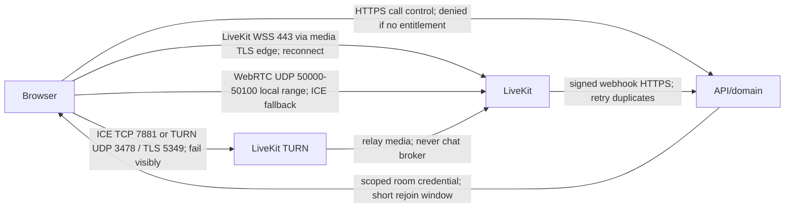

# Implementation plan — messaging and calling

**Latest status: Phases 00 and 01 verified locally in their recorded scope; resume Phase 02.**

This file is the implementation source of truth. The attached `Codex_Implementation_Prompt.md` remains unchanged. Status words have distinct meanings: **planned**, **implemented**, **verified**, **environment-blocked**. A phase is verified only when every acceptance gate has passed against the required environment. Documentation describes the intended system unless explicitly listed as implemented in the progress section.

## Repository inspection and assumptions

Inspected 2026-10-13 (Asia/Calcutta): the directory initially contained only the implementation brief, no package manifests, application source, Git repository, or applicable ancestor/root `AGENTS.md`. Initialized local Git; do not automatically commit or publish. Host: Windows, PowerShell, Node 22.15.0, npm 10.9.2, Docker CLI 29.7.2, Compose 5.5.0, Python 3.12.10. PowerShell blocks npm.ps1; use npm.cmd/pnpm.cmd. Docker initially had no reachable daemon; subsequently located and started the installed user-local Docker Desktop. Local engine and baseline services now verified; credential-file access is avoided with workspace-local Docker config and installed-plugin discovery. Use workspace-local package caches. Do not change machine-wide execution policy.

Local development only is authorized. No deployment, paid services, external accounts, or public listeners. Container dependency ports bind loopback. Local HTTP/cookies and single-node dependencies are explicit development exceptions; production must reject those defaults. A real browser and runnable Linux-container Docker engine are required for later integration gates. The repository is a substantial project; no phase-number advancement based solely on stubs.

## Scope and definition of done

Responsive web: auth/verification/reset/session management; profile/privacy/search; direct/group memberships and moderation; text/replies/edit/delete/reactions/receipts/attachments; replay/offline/multi-tab; consent-based push; reporting/blocking; retention/deletion; LiveKit voice/video/group calling/screen share. Each visible action must have a real authorized implementation, loading/error/recovery behavior, and tests. Final acceptance requires an integrated multi-user browser journey, failure drills, a clean local setup, measured evidence, accessibility review, and documented limitations.

Excluded: native clients, federation, E2EE, recording, transcription, AI, billing, enterprise SSO. TLS/WebRTC encryption is transport encryption. E2EE later would require client key distribution/recovery, membership rekeying, encrypted search/attachments, new moderation constraints and scanner policy; no claim that adding a flag provides it.

Initial configurable **product limits, not capacity claims**: 4,000 Unicode code points per message; 50 members/group; 8 attachments/message; 25 MiB/file; image JPEG/PNG/WebP, PDF, plain UTF-8 text only (no SVG/HTML/archive); 10 sessions/account; 4 connections/session; 12 participants/call; 120 minutes/call; 50 history items/page, hard maximum 100; 64 KiB socket payload; 256 live durable events/buffer; 30s authoritative session recheck; 30s presence TTL/10s heartbeat; 15–30s jittered connected reconciliation; 2 minute room token; 60s signed download; 15 minute upload; 1 GiB attachment reservation/account initially. Content retention defaults unlimited pending policy selection; durable events 90d then consistent snapshot; completed outbox/effects 180d with DLQ replay capped to the same horizon. Unpublished work has no TTL.

## Stack decisions and official references

Exact npm versions will be queried from the registry before installation and stored in manifests + pnpm lockfile; exact container tags go in Compose and `docs/architecture/versions.md`. Prefer Node 24 LTS for CI/production; the host Node 22 LTS may be used only where all selected engines permit it. Select a stable TypeScript release supporting Nest legacy decorators; validate this rather than assume the latest compiler supports them.

| Component | Decision / tradeoff | Official reference |
| --- | --- | --- |
| Web | React/Vite, Router, TanStack Query, Tailwind; native accessible controls initially, reusable primitives as screens arrive; no fabricated chat records | https://vite.dev/guide/ ; https://react.dev/ ; https://tanstack.com/query/latest/docs/framework/react/overview ; https://tailwindcss.com/docs/installation/using-vite |
| Server | Nest + Fastify, thin controllers; API/gateway/worker separately runnable with shared domain, same language/database | https://docs.nestjs.com/techniques/performance ; https://nodejs.org/en/about/previous-releases |
| Mongo | Official driver (one approach only): explicit transactions, BSON Long, collection validators/index migrations, no implicit ORM hooks | https://www.mongodb.com/docs/drivers/node/current/crud/transactions/ ; https://www.mongodb.com/docs/manual/core/transactions-production-consideration/ |
| Chat | Socket.IO, supported Redis adapter, WebSocket-only initially (no polling affinity requirement, excludes networks blocking WebSocket); REST replay is correctness mechanism | https://socket.io/docs/v4/delivery-guarantees/ ; https://socket.io/docs/v4/using-multiple-nodes/ ; https://socket.io/docs/v4/redis-adapter/ |
| Redis | Ephemeral routing/presence/cache/limits only; Pub/Sub loss repaired by Mongo replay | https://redis.io/docs/latest/develop/pubsub/ |
| RabbitMQ | Confirm channel, persistent publication, independent durable fanout/notification/media queues, manual ACK/prefetch, quorum production design | https://www.rabbitmq.com/docs/confirms ; https://www.rabbitmq.com/docs/quorum-queues |
| Objects | Garage S3-compatible private store, maintained downloadable Docker distribution and AGPLv3 reviewed; isolate behind S3 port. Single-node dev is not redundant; confirm required signing/checksum/version semantics in Phase 05 | https://garagehq.deuxfleurs.fr/ ; https://garagehq.deuxfleurs.fr/documentation/quick-start/ ; https://garagehq.deuxfleurs.fr/_releases.html |
| Inspection | ClamAV isolated container + signature detection + constrained transformation process; scanner failure never approves | https://docs.clamav.net/manual/Installing/Docker.html ; https://cheatsheetseries.owasp.org/cheatsheets/File_Upload_Cheat_Sheet.html |
| Calls | Self-hosted LiveKit, React/client and TS server SDK; optional Cloud env adapter; no media in chat broker | https://docs.livekit.io/transport/self-hosting/ ; https://docs.livekit.io/reference/ ; https://docs.livekit.io/transport/self-hosting/ports-firewall/ |
| Email/push | Email provider port + Mailpit; standards push/service worker/private VAPID in Phase 06 | https://mailpit.axllent.org/docs/ ; https://developer.mozilla.org/en-US/docs/Web/API/Push_API |
| Telemetry/test | Pino redaction, OTel, Prometheus; optional Grafana. Vitest/domain, real-service integration, Playwright/browser, load/fault harness | https://opentelemetry.io/docs/languages/js/ ; https://vitest.dev/ ; https://playwright.dev/docs/intro ; https://cheatsheetseries.owasp.org/cheatsheets/WebSocket_Security_Cheat_Sheet.html |

## Structure and ownership

| Path | Ownership |
| --- | --- |
| apps/web | Browser UI, IndexedDB queue/cursors, replay reducer, SDK call panels, service worker; imports contracts only (never config/domain server clients) |
| apps/api | REST transport, cookie/CSRF guards, service wiring, upload/call authorization, raw LiveKit webhook ingress |
| apps/gateway | Socket.IO origin/session guards, runtime validation, bounded routing, subscription entitlement, heartbeats/draining |
| apps/worker | Relay, separate broker subscriptions, notification adapter, retention/reconciliation; scanning in isolated process/container |
| packages/contracts | Browser-safe strict Zod DTOs, string sequence codec, versioned commands/events/errors |
| packages/domain | Auth/authorization rules, transaction orchestration, state machines, Mongo repositories/migrations, external ports; server-only |
| packages/config | Server-only validated env, limits/timeouts, production safety checks |
| packages/observability | Server-only log redaction, correlation, metrics, tracing bootstrap |
| infra/compose | Local pinned services, initialization, loopback bindings, health probes, optional profiles |
| infra/observability | Optional telemetry configs/dashboard/alerts |
| tests/integration, tests/e2e, tests/load | Real-service invariants, independent browsers, reproducible capacity/failure evidence |
| docs/architecture, docs/runbooks | ADRs, schemas/contracts, networking/security, incidents/restore/draining |

## Trust boundaries and network paths

```mermaid
flowchart LR
  B[Untrusted browser] -->|HTTPS assets/API; errors retried by command ID| E[Same-origin TLS edge]
  E -->|REST; bounded dependency timeout| A[API]
  E -->|chat WSS only; reconnect then replay| G[Gateways]
  A -->|authenticated commands; reject forbidden| D[Shared domain]
  G -->|same policy; room is no proof| D
  D -->|snapshot / majority+journal transaction; ACK after commit| M[(Mongo replica set)]
  M -->|outbox lease; expired lease reclaim| W[Relay/worker]
  W -->|persistent publish + confirm; duplicate on crash| Q[(RabbitMQ)]
  Q -->|fanout subscription; ACK after routing attempt| R[(Redis)]
  R -->|ephemeral hints; loss repaired by replay| G
  B -->|authorized replay through watermark; expired cursor snapshot| A
```





Production static/REST/chat WSS share origin and a TLS edge. LiveKit signaling uses separate host with TLS; direct media requires correctly advertised public IP and firewall UDP range (or configured UDP mux), ICE TCP, and TURN. TURN/TLS normally presents 443 publicly (map to configured server port with its own L4 endpoint/certificate); an ordinary HTTP CDN cannot forward UDP. Local Windows Docker NAT is not evidence of public/LAN/TURN connectivity. Phase 07 will verify real networking and certificates against selected LiveKit version. Never publish local config publicly. Production: single region, >=2 API/gateway/worker instances, 3 voting Mongo data nodes across failure zones, >=3 Rabbit quorum nodes, protected Redis HA, redundant private object service, separately budgeted LiveKit nodes. Region outage still unavailable; active rooms may fail and require rejoin on media node loss.

## Message send and recovery

```mermaid
sequenceDiagram
  participant B as Browser
  participant A as API/Gateway
  participant M as Mongo
  participant W as Relay/Broker/Fanout
  B->>B: Persist clientMessageId + payload; if local persistence fails disclose loss risk
  B->>A: send.v1 (cookie identity, command ID)
  A->>M: Transaction: entitlement guards, dedup, counter, message, event, outbox
  M-->>A: Majority journal commit OR explicit failure/ambiguous timeout
  A-->>B: Accepted canonical result; lost ACK reconciled with same ID
  W->>M: Lease outbox; recover expired claims
  W-->>B: Live hint may duplicate/disappear; not a delivery receipt
  B->>A: Replay after applied cursor through watermark, plus inbox discovery
  A-->>B: Ordered authorized events OR CURSOR_EXPIRED + snapshot procedure
  B->>B: Apply/dedup atomically with cursor; repair gaps even while connected
```

Sequences: signed positive BSON 64-bit Long counters, wire/IndexedDB canonical decimal strings (`0` allowed for initial cursor), browser comparison BigInt, max 9223372036854775807. Never Number conversion; reject overflow/noncanonical strings. Event offset differs from message creation position/count. Receipts point to visible message creation sequence, not edit events. Unread = visible new messages by other users with creation sequence > read cursor; edits/reactions do not add unread. Delivered is device acknowledgement of contiguous applied message positions, not maximum sparse observed offset. Read advances monotonically after visible messages applied/viewed; per-user aggregates distinguish group recipient status. Hidden events carry authorized sequence-only redacted envelopes so gaps are distinguishable without content leakage.

Command creation unique `(conversationId,senderId,clientMessageId)`; canonical normalized-payload digest includes reply and attachments. Repeated same digest returns original message even if current content edited; different digest returns conflict. Mongo driver convenient transaction API with deadline/commit timeout, primary snapshot reads, majority+journal writes, retries only through supported mechanisms; no external effects in callbacks. UUID event/command IDs allocated outside retry callback. Every recoverable edit/delete/reaction/receipt/membership mutation produces event+outbox atomically; deletions retain tombstones. Counter serializes bounded group mutations; do not claim arbitrary group throughput.

Authorization ordering: each mutation acquires a real write on conversation guard and active membership guard in transaction, then reads entitlement. Removal writes the same conversation/member guard before closing visibility interval. Direct send/block/call/download authorization additionally writes canonical sorted pair guard; block operation writes same guard. Thus overlapping operations serialize by committed guard writes; cached reads cannot prove ordering. Group blocks suppress directed invitations/calls/presence and notify UI that blocked users may remain in shared groups; block does not erase lawful shared-group history. Direct blocked pairs reject new messages/calls/download grants; prior history still available to existing participants per retention, presence hidden. Fanout rechecks current entitlement; strict sensitive reads/download grants use guard policy too. Already issued download/room bearer credentials have documented remaining validity windows. Rejoin starts a new visibility interval; no access during absence or before first membership. Group removal disables live subscriptions and credentials; later rejoin does not restore earlier expired download grants.

Replay: subscribe+bound live buffer, capture authorized watermark, replay ordered events to watermark, apply state and cursor in one IndexedDB transaction, then merge buffered events and repair gaps. Overflow disconnects/resets recovery, never advances cursor. Periodic jittered authoritative high-watermark/inbox checks repair Redis loss while connected. Per-user durable inbox event sequence discovers new conversations/removals; expiry triggers versioned authoritative inbox snapshot with snapshot watermark. Conversation snapshot uses consistent Mongo snapshot at watermark; page sessions bounded/expiring. IndexedDB keys scoped user; logout clears sensitive stores, BroadcastChannel conveys account-scoped invalidations/event IDs only, no credentials. Presence is approximate per device TTL; revalidate sessions 30s and on commands, fail closed for protected writes on Mongo outage. Socket per-session quotas, 64 KiB input, 256-event buffer, discard typing first, close slow consumers and recover. Gateway SIGTERM stops admission, announces reconnect, bounds drain time.

## Attachment flow/state

```mermaid
sequenceDiagram
  participant B as Browser
  participant A as API/domain
  participant S as Private S3
  participant W as Isolated scanner
  B->>A: Reserve quota; membership/pair guard; reject excess
  A-->>B: Generated quarantine key + short scoped upload; no read permission
  B->>S: Upload bounded bytes; failure leaves reservation for expiry
  B->>A: Finalize owned upload
  A->>S: HEAD/check immutable identity, size/checksum; failure rejects
  A->>A: Transaction uploaded + scan job/outbox (idempotent)
  W->>S: Copy immutable bytes to inaccessible work key; reject overwrite/checksum drift
  W->>W: Signature + ClamAV + parser limits; errors stay quarantined
  W->>S: Approved fresh key; never same upload key
  W->>A: Ready metadata + effect record transaction
  B->>A: Authorized download ready only; removal rejects new grants
  A-->>B: 60s private bearer URL; already issued URL persists up to expiry
```

States pending -> uploaded -> processing -> ready/rejected; pending/uploaded expire; any state -> deleting -> deleted through idempotent jobs. Reserve quota and scan-job commit in Mongo. Never approve based on Content-Type/extension. Worker streams capped bytes and validates digest; if backend cannot guarantee version identity, copy to new unwriteable key and hash before processing; signed PUT remains restricted to original quarantine key. PDF no active inline rendering, all downloads attachment; images pixel cap/transformation in sandbox, no arbitrary shell/parser paths. Scanner unavailable/errors/timeouts retain quarantine, no production bypass. Cleanup of reservations, abandoned/rejected files, original+derived objects, and orphan inventory uses reconciled manifests; download URL checks current visibility intervals and object readiness.

## Call control/state

Call state scheduled/ringing -> active -> ending -> ended; ringing -> cancelled/declined/timed_out. Participant invited -> accepted -> joining -> joined -> left/removed. Compare-and-set generation/state and transaction guard serialize accept/cancel/timeout; first eligible device acceptance wins lease while same user retries are idempotent. Use unique call UUID and room incarnation; never reuse names. Backend issues identity-bound minimal grants only to authorized accepted participants, enforces capacity/reservations/duration, session validity, moderator removal. Token expiry does not evict connected users: remove via provider + reconcile; old tokens may rejoin for remaining <=120s unless provider-supported stronger admission strategy is verified. Ending deletes room and blocks token issuance; cannot assert absolute prevention of old-token recreation until tested provider semantics/room admission policy. Webhook signature requires raw body; write unique provider inbox before ACK, reconcile duplicates/out-of-order against provider room and domain generation. User sees media/device/permission/autoplay/reconnect issues, camera and screenshare are separate tracks. Room-empty grace 30s then reconcile before end; worker duration enforcement. No media persistence; no recording. Metrics depend on exposed SDK stats, unexposed TURN counters are documented unavailable.

## Durable model, indexes, constraints, retention and migration ownership

All collection records have schemaVersion, createdAt, updatedAt where mutable; IDs are UUID strings unless external token hash. Validators reject unexpected critical types; application Zod is additional validation. Separate arrays only for explicitly bounded small fields, never messages/members/receipts/outbox. Indexes below are **design** until corresponding migration is implemented and integration-tested. Domain migrations run explicitly, idempotent tracked versions, create validators/indexes before routes start accepting relevant writes; no automatic destructive index drops. Additive expand/backfill/contract only after old version retirement; test old+new DTO compatibility.

| Collection | Fields / key indexes / retention | Phase |
| --- | --- | --- |
| users | emailCanonical + usernameCanonical unique, passwordHash, displayName, avatarId, verifiedAt, privacy, role, authVersion, deletionState; bounded indexed username prefix range (no unbounded regex). Soft deletion releases identifiers per documented tombstone policy; scrub PII in 06 | 01 |
| sessions | tokenHash unique, userId, expiresAt, revokedAt, csrfHash, authVersion, deviceLabel; `(userId,revokedAt,expiresAt)`, TTL expiresAt cleanup only (expiry enforced on read) | 01 |
| authTokens | hash unique, purpose, userId, expiresAt, usedAt; one-use CAS + password/session transaction; TTL expiry | 01 |
| conversations | kind, canonical directPair unique partial, title, nextEventSeq Long, messageCount, guardVersion, activeCallId; no messages array; no TTL | 02/03 |
| memberships | `(conversationId,userId)` unique, role, state, guardVersion, current interval, read cursor; visibilityIntervals separate indexed `(conversationId,userId,startSeq)`; no absence access | 02 |
| pairGuards / blocks | canonical pair guard ID/version; `(blockerId,blockedId)` unique; blocked state and guard transaction; retained until account removal | 02 |
| messages | conversationId, senderId, clientMessageId, originalDigest, creationSeq Long, text, replyId, bounded attachmentIds, editedAt, deletedAt; unique idempotency triple; unique `(conversationId,creationSeq)`; compound descending cursor; tombstone over retention | 03 |
| conversationEvents | eventId unique, conversationId, sequence Long, kind, actor, payload, visibility, createdAt; unique `(conversationId,sequence)`; 90d with explicit earliestAvailableSeq/snapshot protocol | 03/04 |
| inboxEvents | unique `(userId,sequence)`, user feed guard/counter, conversation reference, kind; bounded retention + snapshot | 02/04 |
| receipts | unique `(conversationId,userId,deviceId)`, delivered/read contiguous cursors; monotonic CAS; device purge keeps aggregate | 04 |
| reactions | unique `(messageId,userId,emoji)`; limited enum/count quota, event in same transaction | 04 |
| attachments | ownerId, conversationId, reservation, quarantineKey, approvedKey, byteSize, sha256, objectVersion, state, scanResult, expiresAt; `(state,expiresAt)`, objectKey unique; no automatic metadata TTL before object cleanup | 05 |
| outbox | eventId unique, topic/version, payload/reference, status, availableAt, leaseOwner, leaseUntil, attempts, publishedAt; `(status,availableAt,leaseUntil)`; only completed retention, no TTL pending | 03 |
| consumerEffects | unique `(consumer,eventId,effectVersion)`, result/completedAt; transaction with DB effect; 180d, replay requires retained effects | 03/06 |
| reports / audit | reporterId,target IDs, reason,status,assigned moderator; `(status,createdAt)`, append audit actor/action/target/correlation; access only protected moderation; configurable privacy retention | 06 |
| pushSubscriptions | `(userId,endpointHash)` unique, encrypted endpoint/auth/p256dh, expiry; delete 404/410/logout device/removal | 06 |
| calls / callParticipants | callId unique, conversationId, room incarnation unique, state, deadlines, version; participant unique `(callId,userId)`, invitation/action key unique; `(state,deadline)` worker reconciliation; history 90d initial | 07 |
| webhookInbox | provider/eventId unique, raw-body digest, validated payload, state, attempts, availableAt; persist before ACK, complete retention 180d | 07 |
| deletionJobs / migrations | unique account/job generation; scoped idempotent stages/manifests; migration ID unique, lease/checksum; retain evidence without PII | 00/06/08 |

## API, socket and event contracts

`/api/v1`; strict input schemas strip no attacker identity silently (reject unknown fields). Problem `{code,message,requestId,retryable}` without internal errors/PII; HTTP 401/403/409/413/429/503 distinctly. Browser mutations cookie + exact Origin + session-bound CSRF header; JSON only/payload cap. Request ID generated if invalid, never accept arbitrary log injection. Opaque random session stored hash only; HttpOnly Secure SameSite=Lax same-origin, local HTTP exception. Argon2id parameters benchmarked in Phase 01 against memory/time/concurrency budget; email/reset generic responses, one-use hashed tokens, quotas fail closed on Redis failure.

| Contract family | Planned endpoints / socket commands | Gate |
| --- | --- | --- |
| Foundation | GET health/live, health/ready, health/dependencies; no private payloads; readiness specific to process role | 00 |
| Identity | POST auth/register,login,logout,verify,reset/request,reset/confirm,password; GET auth/session, sessions; DELETE sessions/:id, sessions/all; GET/PATCH me | 01 |
| Social | GET users?prefix&cursor; POST conversations/direct,groups; GET inbox/sync, conversations/:id/messages; POST invite; PATCH role; DELETE member, leave; PUT/DELETE blocks/:user | 02 |
| Durable chat | POST conversations/:id/messages; GET command/:clientId, events?after&through, snapshot; PATCH/DELETE message; PUT receipt/reaction; send.v1, subscribe.v1; ACK canonical result only | 03/04 |
| Disposable chat | typing.v1 + approximate presence; rate bounded no durable delivery promise; event.v1 envelope `{v,eventId,conversationId,sequence,kind,payload}` runtime-validated | 04 |
| Media | POST attachments/reserve, :id/finalize; GET :id/download; state notifications through events | 05 |
| Safety/notification | POST push/subscribe, reports; moderation GET/PATCH report; DELETE me -> deletion job; visibility-safe notification payload | 06 |
| Calling | POST conversation calls, call accept/decline/cancel/join-token/end/remove; GET call history; POST webhooks/livekit raw verified; call events durable | 07 |

No placeholder success routes. Phase 00 defines only foundation and minimal send/event primitives; later endpoints are plans. Schema evolution v1 additive; incompatible commands use v2 and supported one-release overlap.

## Production challenge matrix

| Challenge | Concrete fix / owner / phase | Required failure test | Remaining limitation |
| --- | --- | --- | --- |
| Durable acceptance/idempotency | unique triple + original digest + majority transaction, domain 03 | concurrent retries, lost ACK after commit, changed-payload conflict | transport not exactly once |
| Counter precision/order | Long/string/BigInt codec + guarded counter, contracts/domain 00/03 | >2^53, overflow, concurrent events | bounded group contention |
| Membership/block races | shared write guard inside txn; gateway entitlement recheck, domain 02–04 | concurrent removal/block/send/download/subscription | prior bearer windows |
| Event replay/retention | every mutation event + watermark snapshots/inbox feed, domain/web 03–04 | edit/delete offline, expiry, unseen new group | expired history per policy |
| Browser durability/multi-tab | user-scoped IndexedDB + applied cursors + BroadcastChannel, web 04 | refresh pending, storage denied, live overlap/overflow, account switch | browser storage eviction possible |
| Connected live loss | periodic jittered watermark repair, gateway/web 04 | Redis interruption with socket connected | eventual display lag |
| Broker outage/duplicate pub | CAS leases, confirms, stable IDs, admission cap, worker 03 | confirm-before-mark crash, broker down/recovery | bounded backlog; accepts before fanout |
| Consumer effects/DLQ | independent queues, manual ACK, transaction effect dedup, bounded retry, worker 03/06 | poison payload/crash/replay-horizon | external provider ambiguous duplicates |
| Security/session/CSRF | hashed opaque session + origin/CSRF + authVersion + expiry checks, domain/API/gateway 01/04 | revoked/expired/forged origin/session, Mongo/Redis fail | revalidation bound for idle sockets |
| Secrets/privacy/moderation | server import boundary, redacted logs, CSP, privilege guards/audit, all/06 | leaked-bundle scan, horizontal/vertical attacks | abuse prevention needs operations |
| Attachment access/overwrite | private split keys, immutable verified bytes, ready-only URLs, domain 05 | expired/foreign upload, overwrite after approval | 60s issued-download revocation bound |
| Malicious files/scanner outage | signatures + ClamAV/resource isolation, worker 05 | EICAR/spoof/oversize/pixel bomb/scanner error | scanner not proof of harmlessness |
| Orphans/retention/deletion | idempotent manifests + reconciliation, worker 05/06 | failed object delete + retry/restore | backup PII retained to expiry |
| Call race/revocation | CAS lifecycle + identity/room incarnation + provider remove/reconcile, domain 07 | accept/cancel/timeout, reuse/end/rejoin/removal | issued token window/provider semantics |
| Webhooks | verified raw signatures + unique inbox + reconcile, API/worker 07 | duplicate/out-of-order/invalid signature | provider outage delays convergence |
| Actual media/TURN | official SDK + dedicated networking, web/infra 07 | 2-browser voice/video/screenshare and forced relay | NAT/hardware validation environment dependent |
| Device/media/node failure | denial/autoplay UX, visible reconnect/rejoin, web 07/08 | permission deny, screen stop, network/node loss | no transparent room migration claim |
| Overload/slow clients | limits, payload/buffer/pool budgets, jittered retry, all 04/08/09 | slow clients, reconnect storms, queue saturation | limits not benchmarks |
| Dependency failure/draining | role readiness/timeouts, no cascading liveness restart, all 00/08 | each dependency stop + SIGTERM | local single nodes not HA |
| Logs/traces/metrics | correlation/redaction, OTel, Prom alerts/dashboard, observability 00/08 | secret log negatives and alert fault drill | unexposed provider metrics unavailable |
| Schema upgrades | explicit additive migration, v1 overlap, domain/contracts 00/08 | old/new release concurrent run | breaking changes require staged retirement |
| Restore/RPO/RTO | snapshots/oplog/object inventory + application restore drill, infra 08 | auth/index/object/reconciliation check restored | majority doesn't cover region/destruction |
| Complete UI/product | real data, accessible states, virtualized history, all/09 | multi-user feature audit + keyboard/a11y | no production-ready claim without evidence |
| Cost | validated quotas, max call duration, storage/egress/queue alarms, config/08 | quota races + admission threshold | no budget/pricing inferred |

## Dependency failure, threat and operations policy

| Failure | Allowed / rejected behavior | Recovery / user experience |
| --- | --- | --- |
| Mongo | liveness and static page allowed; protected durable commands/read authorization fail closed | retry/reconcile ambiguous ID, readiness 503; never success on failed commit |
| Redis | durable authorized history remains available; approximate presence unavailable; critical limits fail closed (later measured conservative local fallback optional) | replay repairs fanout, authoritative session checks still active |
| RabbitMQ | accepted durable messages while admission backlog budget permits; notifications/live delayed | outbox leases recover, oldest-age alerts, explicit pending display |
| Objects | text messaging unaffected; reserve/finalize/download return unavailable | preserve reservations/jobs, exponential bounded retry/reconcile |
| Scanner | no ready transition/download for pending media | quarantine and job retry/DLQ; visible processing/error |
| LiveKit | text unaffected; reject room allocation/join with unavailable | persisted lifecycle reconciliation, visible rejoin, no claimed active-node survival |
| Email/push | durable account/notification jobs, generic auth responses; push optional | retry with provider ID if available, possible external duplicates, in-app fallback |
| IndexedDB | user may send only with explicit non-durable local queue disclosure | reconcile accepted command IDs; no refresh-safe promise |

Threat model covers hostile authenticated users, forged command identity, guessed IDs, CSRF/socket hijack, injection/XSS, quota abuse, stolen bearer URLs, malicious uploads, revoked users, privileged abuse, and compromised dependency identities. Controls: exact origin, session identity only, guard transactions, text rendering/no HTML, JSON schemas and query construction, CSP/security headers, quota/rate failures closed, split storage IAM, broker routing permissions, workload least privilege, hashed reset/session tokens, redact credentials/body/URLs. Production secrets provided at runtime, never VITE variables. Local default secrets rejected in production config. Security review gates feature tests; no complete-security claim.

Operational targets (not measured results): single-region service availability 99.9% monthly for authorized durable REST; p95 acceptance <300ms and replay catch-up <5s at benchmarked load excluding provider/email/media network. Report measurement boundary and injected outage time separately. Mongo majority acknowledgement RPO target 0 for single member loss; regional/destructive restore RPO determined by tested backup/PITR cadence (initial target <=15 minutes) and RTO target <=4h, neither yet proven. Daily encrypted snapshots + continuous oplog where supported, versioned private object backups/inventory; restore in isolated environment, validate indexes/permissions/auth revocation, message/event continuity, attachments, orphan/outbox replay and call reconciliations. Logs no bodies/tokens, short configurable retention. Account deletion removes sessions/tokens/push/profile, scrubs authorship according to shared-group history policy (keep redacted group text until configured retention; direct content removal policy communicated), schedules media/cache/projection removal; backup copies expire on backup schedule and deletion manifests reapply after restore.

Runbooks to deliver: setup, broker/DLQ replay (authenticated admin + audit + bounded horizon, never blindly expire dedup), revocation, scanner/attachments, LiveKit/TURN, draining, dependency incident, additive migrations, backup/restore, retention/deletion. Local minimum planning budget 4 CPUs/8 GiB free RAM, disk >=10 GiB; scanner/media/telemetry profiles add load. Measure rather than assert machine requirements suffice. Pools and timeouts: Mongo maxPoolSize 20/process (sum across replicas before scale); selection 3s, command 5s, txn deadline 10s; worker prefetch 16; bounded job concurrency 4; retries exponential jitter 1s–60s/max 5 then DLQ, outbox publication lease 30s; relay has no finite TTL and admission alerts before disk exhaustion.

## Ordered phases and acceptance gates

Run commands from root with pinned pnpm (`pnpm.cmd` on PowerShell). Only use scripts that exist for implemented phases; later phase-specific commands must be added with their tests. Standard gate: `pnpm lint`, `pnpm typecheck`, `pnpm test`, `pnpm build`. Real tests must fail on missing services rather than silently skip.

| Phase | Deliverables / prerequisite | Gate and exact validation command target |
| --- | --- | --- |
| 00 | Plan before application code; pinned workspace/strict TS/lint/build; foundation contracts/config/domain/observability; honest API/web foundation; separately runnable gateway/worker; Compose replica init/storage/broker/mail plus optional media/scanner profiles; CI skeleton | standard gate; `pnpm infra:config` (all-profile syntax); `pnpm infra:up`; `pnpm test:integration:foundation` (baseline Mongo/Redis/Rabbit/Garage/Mailpit health + real replica txn commit/rollback); `pnpm test:foundation:http` (live/ready); frozen clean lock install. Optional scanner/media runtime integration remains unverified until 05/07 |
| 01 | After 00 verified: auth, email flows, sessions/profile, CSRF/origin/rate guards, real auth UI | standard + `pnpm test:integration:auth` + `pnpm test:e2e:auth`; real browser auth, reset/verify Mailpit, revoked/expired negatives; hash budget recorded |
| 02 | After 01: direct/groups/roles/blocks, history index migration, real chat shell/inbox | `pnpm test:integration:conversations`, `pnpm test:e2e:conversations`; cross-user/guard races, bounded pagination/rejoin |
| 03 | After 02: atomic sends/events/outbox, relay, Rabbit queues/retry/DLQ, idempotent effects | `pnpm test:integration:messaging`, `pnpm test:failure:outbox`; concurrent duplicate sends, commit-before-ACK, confirm-before-mark duplicate, backlog recovery |
| 04 | After 03: Redis adapter multi-gateways, offline/replay/inbox, edits/reactions/receipts/presence | `pnpm test:integration:sync`, `pnpm test:e2e:sync`, `pnpm test:failure:gateway`; overlap/overflow/connected loss/multi-tab/cursors/slow consumer |
| 05 | After 04: private S3 upload/finalization, real scan/transforms/download/cleanup | `pnpm test:integration:attachments`, `pnpm test:e2e:attachments`; spoof/EICAR/quota/overwrite/scanner failure/revocation window |
| 06 | After 05: real push/privacy/report/moderation/retention/deletion | `pnpm test:integration:safety`, `pnpm test:e2e:safety`; privilege/fallback/effect/deletion reconciliation |
| 07 | After 06: LiveKit SDK room UI, lifecycle/token/webhook, direct/group media/screenshare | `pnpm test:integration:calls`, `pnpm test:e2e:calls`, `pnpm test:media:turn`; independent browsers, devices and real restrictive network; fake tracks labeled |
| 08 | After 07: full telemetry/alerts/draining, compatibility and restore | `pnpm test:failure:dependencies`, `pnpm test:upgrade`, `pnpm test:restore`; fault alerts and application-level restored consistency |
| 09 | After 08: polish/a11y/demo/benchmark/deploy docs/evidence audit | `pnpm test:e2e`, `pnpm test:a11y`, `pnpm test:load:chat`, `pnpm test:load:media`, `pnpm audit --prod`; clean setup audited, findings handled explicitly |

Capacity methodology: disclose hardware/OS/container/runtime versions and topology, independent generator location, warmup/duration, connections/users/msg rate/group mix/payload size/history depth, error classes and sample counts, p50/p95/p99 acceptance/delivery/replay, pool/saturation/event-loop/memory, broker oldest age. Separate chat and media trials, then combined; media tracks resolution/bitrate/participants/TURN fractions/RTT/jitter/loss/bandwidth where SDK exposes them. Increase until objectives fail, report observed knee only for tested configuration. Same-machine smoke is no production benchmark. No results yet.

## Progress and exact resume point

### 2026-10-13 — Phase 00 foundation verified

- Completed before application implementation: full brief/repository/ancestor instructions inspection, architecture/ordered phase plan, official documentation and registry checks. Original brief preserved; no existing application replaced, no public deployment, no account changes.
- Implemented: 9-project pnpm workspace (root + four apps + four packages), strict TypeScript 6.0.3, pinned packages/lockfile/build allowlist, lint/browser import boundaries; exact string/BigInt/BSON Long sequence codec; strict send/event/problem/readiness primitives; validated limits/types/production-safe config; Nest/Fastify foundation health/security headers; React/Router/Query/Tailwind foundation with real readiness request and error/loading states; gateway/worker liveness with honest 503 functional readiness; redacted Pino logs/process metrics/OTel API seam; pinned local services and optional media/scanner configuration; CI skeleton, README/versions/setup runbook/test ownership notes.
- Verified commands: `pnpm build`; `pnpm typecheck` including scripts and test sources; `pnpm lint`; `pnpm test` (**32 tests**); `pnpm test:foundation:http` (**3 tests**); `pnpm infra:config`; `pnpm infra:up` plus repeat initialization; `pnpm test:integration:foundation` (**6 tests**, repeated after digest-pinned container recreation); `pnpm install --frozen-lockfile --offline --state-dir .cache/pnpm-state` in populated checkout; `pnpm audit --prod --audit-level high` (**no known vulnerabilities returned**). Compiled gateway and worker entry points manually started and returned live 200 / ready 503, then stopped.
- Real-service evidence: Mongo writable replica primary, majority+journal transaction commit/rollback across two test collections, >2^53 Long persistence; Redis auth/TTL; Rabbit confirms/persistent publication to three independent quorum test queues/manual ACK; both private S3 areas write/read/delete and unauthenticated rejection; Mailpit HTTP/SMTP greeting; positive API readiness. All five baseline Docker probes healthy. Fresh containers retained replica/storage volumes; baseline Compose now pins observed image digests. These checks prove foundation only, not Phase 03 message dedup/crash guarantees or production HA.
- Clean-checkout check: frozen installation and application build PASS from an isolated copy without node_modules/dist, reusing a workspace-local package/metadata cache. Explicit Tailwind source scope gives matching final web asset hashes in both copies. See evidence file for corrected attempts. This is a Windows setup check, not a remotely executed Linux CI run.
- Corrected failed checks: Zod boolean output defaults; explicit Node type visibility; exported API return annotation; malformed sequence safeParse throwing due unchecked BigInt conversion; pnpm 12 `.npmrc`/allowlist changes; Docker plugin discovery under isolated config; idempotent approved-bucket setup; deprecated Prometheus client migration. No unresolved failure in the scoped Phase 00 gates.
- Status at the first session boundary: **Phase 00 verified (foundation scope)**; later phases were then planned. Latest status is below; the full application is not complete.
- Unverified/deferred: remote CI execution; actual browser rendering/a11y; optional LiveKit/ClamAV runtime and media/scanning integration; exported traces/dashboard/alerts; auth/messaging/calls/retention/notification features; production target/version/networking/security/capacity/restore behavior. Their later gates remain required. OTel API without SDK/exporter is explicitly not exported tracing.
- Local state: Docker Desktop and five loopback baseline containers running; persistent development volumes retained. App servers from HTTP/process tests stopped. No `.env` with real secrets created. pnpm CLI in `.cache/pnpm-cli`; store/cache inside repository. pnpm's machine operation-lock access still needs sandbox escalation despite local caches. No current feature blocker; later browser/media environment capability must be checked when needed.

### Phase 01 - verified locally (2026-10-13)

Implemented: browser-safe auth/profile/session contracts; bounded Argon2id pool; opaque hash-only sessions, session-bound HMAC CSRF, exact Origin/JSON/runtime guards; Redis atomic expiring limits/deadlines/queue bounds/fail-closed mutations; guarded Mongo registration/session quota/rotation/revocation/password/token/profile mutations; DB-enforced normalized unique identities; one-use hashed verification/reset tokens; dedicated AES-GCM-encrypted durable email jobs and leased SMTP worker; explicit 001_auth validators/indexes; shared verified/moderator authorization; functional register/login/verify/reset/profile/privacy/session/password UI, account-cache clearing and credential-free BroadcastChannel invalidation; ordinary development fixtures; real Chromium suite and CI/setup/runbook updates.

Unverified login permits profile/session management only. Future messaging/calls must invoke requireVerified; protected moderation also invokes requireModerator. Generic registration/reset responses avoid account-existence responses; public username conflicts are explicit. Mutations write user/session guards in transactions; login compares the earlier verified hash again under the guard. Reset/password change increments authVersion and revokes every device. Read-only requests already overlapping revocation can complete under earlier authorization; subsequent authoritative reads reject revoked sessions. Future gateway consumes hints and shares authoritative policy in 04.

Token collection contains hashes only. Related mutation, encrypted email payload and durable job commit together. Separate worker sends after commit under CAS owner lease, then marks completion/clears payload after provider acceptance. SMTP acceptance-before-mark crash can duplicate email; fixed Message-ID is not provider idempotency. Expired/exhausted jobs become dead. No broker atomicity claim for this Mongo job path; 03 adds broker/outbox projection. Keyring/replay/retention/alerts and fault drills remain 06/08. Applied 001 migration now returns before replacing a later validator; real additive-validator regression test passes. Global coordinated migration runner/upgrade drills remain next/later phases.

Evidence: docs/phase-01-evidence.md and docs/runbooks/auth.md. Passed all-app build, all-source typecheck, lint/import boundaries, 35 unit tests, 3 HTTP regressions, 6 baseline real-service regressions, 14 auth real-service tests, 2 actual Chromium tests, explicit local migration, development seed smoke and production dependency audit (no known vulnerabilities returned). Desktop/mobile screenshots visually inspected; complete a11y/browser matrix is still 09. Original brief/foundation preserved; no public deployment, paid service or external provider used.

Argon2id measurement: Windows, Node 22.15.0, i5-13450HX, 16 logical CPUs, 15.78 GiB RAM; m=64 MiB/t=3/p=1, five hashes 165.13-191.75ms after one warmup, two-hash batch 184.84ms, report-time RSS 131.88 MiB. Cap 2 concurrent hashes/API process (theoretical hash working-memory budget 128 MiB); reject overload instead of unbounded queuing. Not an auth throughput/SLO benchmark; remeasure on deployment hardware.

Current local state: five baseline containers loopback/healthy; chat has 001_auth and ordinary alice_dev/bob_dev fixture registrations/pending verification jobs. Initial seed password was process-only; use actual Mailpit reset to choose your own. Test DBs cleaned, synthetic Mailpit messages retained locally, browser test API/worker/Vite stopped. CLI/store/browsers remain workspace-local. Production HTTPS/SMTP, remote CI, gateway/messaging/attachment/call/retention/restore/capacity behavior unverified. Privacy preferences are saved; presence/search effects await 02/04. Avatar remains null until 05.

### Exact next actions for Continue - Phase 02

1. Read latest progress, inspect git status/current source and preserve both verified phases/brief. Put pinned pnpm on PATH; check existing services; rerun startup/migration only if needed. Do not regenerate scaffolding or relabel planned messaging as implemented.
2. Add a coordinated migration runner/lease and additive 002_conversations validators/indexes: conversations (unique canonical direct pair, exact Long sequence/guard), memberships (unique conversation/user, owner/admin/member/invited), visibility intervals, durable per-user inbox feed/counter, blocks/canonical pair guards. Preserve 001 indexes/validators and old/new compatible fields; rerunning 001 must not undo 002.
3. Implement one shared transactional authorization policy: derive actor from AuthService.authenticate(token, transaction) and requireVerified; write conversation/member guards before mutations. Removal/leave writes the same guards. Direct create/block and later send/call/download share canonical pair guard. Bounded supported driver retries, no external callback effects. Test actual serialization rather than pre-transaction reads.
4. Add bounded indexed username-prefix search honoring saved allowSearch privacy and limits; no regex/skip/fabricated users. Direct creation uses DB-enforced unique pair/idempotency; groups have invitations/acceptance, roles, remove/leave/owner transfer and 50-member quota races. Durable membership/inbox changes commit with state, ready for 03/04 recovery.
5. Enforce rejoining visibility intervals from actual Long conversation positions; no absent/before-first-join access. Add compound cursor history and authoritative inbox/snapshot endpoint. Messages arrive in 03: a genuinely empty authorized history is acceptable; fake send success is not. Membership/visibility/inbox changes must be durable, never socket-only.
6. Add block/unblock ordering for direct commands/calls/download grants/presence and shared-group semantics, preserving documented prior-history policy. Test concurrent block/direct creation/authorization/removal. Real socket eviction is 04, but permission contract must be fixed now.
7. Build functional responsive real-data inbox/sidebar, user search/direct and group controls, authorized selected history/empty/error/loading states and account access. Composer/send/status stays absent or explicitly unavailable until durable sends in 03; no decorative call/attachment buttons. Hide private contents before authorization; maintain keyboard/focus behavior.
8. Add test:integration:conversations and test:e2e:conversations. Real Mongo gates: guessed IDs/cross-user/role escalation denied; invitation/group quotas/unique-direct concurrency; shared-guard removal/block ordering; leave/owner transfer; stable cursor/visibility queries; privacy/search bounds/inbox discovery. Real multi-user browser creates direct/group/manages members/checks removal. Development fixtures use authorized domain flows, never privileged production seeds.
9. Run standard gates and relevant auth/foundation regressions plus new conversation integration/browser gates. Update evidence/plan with actual failures/unverified scope. Only after 02 passes begin 03 durable sends/events/outbox/relay and commit-before-ACK/confirm-before-mark tests. Remaining tasks stay in ordered phase table/challenge matrix.
