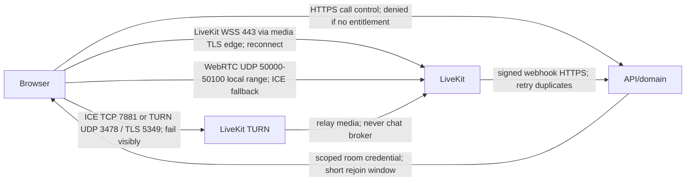

# Implementation plan — messaging and calling

**Latest status: Phases 00-05 verified locally; Phase 06 core workflows committed at 511fcb7 with native positive push/provider delivery still unverified. User authorized Phase 07 with that limitation. Phase 07 calling is implemented; 163 backend and 18 browser checks passed in recorded scope. Forced TURN media still fails, so Phase 07 is not fully verified. Resume the exact Phase 07 tasks at the end of this file; 08/09 have not started. All Phase 07 work is uncommitted.**

This file is the implementation source of truth. The attached `Codex_Implementation_Prompt.md` remains unchanged. Status words have distinct meanings: **planned**, **implemented**, **verified**, **environment-blocked**. A phase is verified only when every acceptance gate has passed against the required environment. Documentation describes the intended system unless explicitly listed as implemented in the progress section.

## Repository inspection and assumptions

Inspected 2026-10-13 (Asia/Calcutta): the directory initially contained only the implementation brief, no package manifests, application source, Git repository, or applicable ancestor/root `AGENTS.md`. Initialized local Git; do not automatically commit or publish. Host: Windows, PowerShell, Node 22.15.0, npm 10.9.2, Docker CLI 29.7.2, Compose 5.5.0, Python 3.12.10. PowerShell blocks npm.ps1; use npm.cmd/pnpm.cmd. Docker initially had no reachable daemon; subsequently located and started the installed user-local Docker Desktop. Local engine and baseline services now verified; credential-file access is avoided with workspace-local Docker config and installed-plugin discovery. Use workspace-local package caches. Do not change machine-wide execution policy.

Local development only is authorized. No deployment, paid services, external accounts, or public listeners. Container dependency ports bind loopback. Local HTTP/cookies and single-node dependencies are explicit development exceptions; production must reject those defaults. A real browser and runnable Linux-container Docker engine are required for later integration gates. The repository is a substantial project; no phase-number advancement based solely on stubs.

## Scope and definition of done

Responsive web: auth/verification/reset/session management; profile/privacy/search; direct/group memberships and moderation; text/replies/edit/delete/reactions/receipts/attachments; replay/offline/multi-tab; consent-based push; reporting/blocking; retention/deletion; LiveKit voice/video/group calling/screen share. Each visible action must have a real authorized implementation, loading/error/recovery behavior, and tests. Final acceptance requires an integrated multi-user browser journey, failure drills, a clean local setup, measured evidence, accessibility review, and documented limitations.

Excluded: native clients, federation, E2EE, recording, transcription, AI, billing, enterprise SSO. TLS/WebRTC encryption is transport encryption. E2EE later would require client key distribution/recovery, membership rekeying, encrypted search/attachments, new moderation constraints and scanner policy; no claim that adding a flag provides it.

Initial configurable **product limits, not capacity claims**: 4,000 Unicode code points per message; 50 members/group; 8 attachments/message; 25 MiB/file; image JPEG/PNG/WebP, PDF, plain UTF-8 text only (no SVG/HTML/archive); 10 sessions/account; 4 connections/session; 12 participants/call; 120 minutes/call; 50 history items/page, hard maximum 100; 64 KiB socket payload; 256 live durable events/buffer; 30s authoritative session recheck; 30s presence TTL/10s heartbeat; 15–30s jittered connected reconciliation; 2 minute room token; 60s signed download; 15 minute upload; 1 GiB attachment reservation/account initially. Content retention defaults unlimited pending policy selection; durable events 90d then consistent snapshot; completed outbox/effects 180d with DLQ replay capped to the same horizon. Unpublished work has no TTL.

## Stack decisions and official references

Exact npm versions will be queried from the registry before installation and stored in manifests + pnpm lockfile; exact container tags go in Compose and `docs/architecture/versions.md`. Prefer Node 24 LTS for CI/production; the host Node 22 LTS may be used only where all selected engines permit it. Select a stable TypeScript release supporting Nest legacy decorators; validate this rather than assume the latest compiler supports them.

| Component | Decision / tradeoff | Official reference |
| --- | --- | --- |
| Web | React/Vite, Router, TanStack Query, Tailwind; native accessible controls initially, reusable primitives as screens arrive; no fabricated chat records | https://vite.dev/guide/ ; https://react.dev/ ; https://tanstack.com/query/latest/docs/framework/react/overview ; https://tailwindcss.com/docs/installation/using-vite |
| Server | Nest + Fastify, thin controllers; API/gateway/worker separately runnable with shared domain, same language/database | https://docs.nestjs.com/techniques/performance ; https://nodejs.org/en/about/previous-releases |
| Mongo | Official driver (one approach only): explicit transactions, BSON Long, collection validators/index migrations, no implicit ORM hooks | https://www.mongodb.com/docs/drivers/node/current/crud/transactions/ ; https://www.mongodb.com/docs/manual/core/transactions-production-consideration/ |
| Chat | Socket.IO, supported Redis adapter, WebSocket-only initially (no polling affinity requirement, excludes networks blocking WebSocket); REST replay is correctness mechanism | https://socket.io/docs/v4/delivery-guarantees/ ; https://socket.io/docs/v4/using-multiple-nodes/ ; https://socket.io/docs/v4/redis-adapter/ |
| Redis | Ephemeral routing/presence/cache/limits only; Pub/Sub loss repaired by Mongo replay | https://redis.io/docs/latest/develop/pubsub/ |
| RabbitMQ | Confirm channel, persistent publication, independent durable fanout/notification/media queues, manual ACK/prefetch, quorum production design | https://www.rabbitmq.com/docs/confirms ; https://www.rabbitmq.com/docs/quorum-queues |
| Objects | Garage S3-compatible private store, maintained downloadable Docker distribution and AGPLv3 reviewed; isolate behind S3 port. Single-node dev is not redundant; confirm required signing/checksum/version semantics in Phase 05 | https://garagehq.deuxfleurs.fr/ ; https://garagehq.deuxfleurs.fr/documentation/quick-start/ ; https://garagehq.deuxfleurs.fr/_releases.html |
| Inspection | ClamAV isolated container + signature detection + constrained transformation process; scanner failure never approves | https://docs.clamav.net/manual/Installing/Docker.html ; https://cheatsheetseries.owasp.org/cheatsheets/File_Upload_Cheat_Sheet.html |
| Calls | Self-hosted LiveKit, React/client and TS server SDK; optional Cloud env adapter; no media in chat broker | https://docs.livekit.io/transport/self-hosting/ ; https://docs.livekit.io/reference/ ; https://docs.livekit.io/transport/self-hosting/ports-firewall/ |
| Email/push | Email provider port + Mailpit; standards push/service worker/private VAPID in Phase 06 | https://mailpit.axllent.org/docs/ ; https://developer.mozilla.org/en-US/docs/Web/API/Push_API |
| Telemetry/test | Pino redaction, OTel, Prometheus; optional Grafana. Vitest/domain, real-service integration, Playwright/browser, load/fault harness | https://opentelemetry.io/docs/languages/js/ ; https://vitest.dev/ ; https://playwright.dev/docs/intro ; https://cheatsheetseries.owasp.org/cheatsheets/WebSocket_Security_Cheat_Sheet.html |

## Structure and ownership

| Path | Ownership |
| --- | --- |
| apps/web | Browser UI, IndexedDB queue/cursors, replay reducer, SDK call panels, service worker; imports contracts only (never config/domain server clients) |
| apps/api | REST transport, cookie/CSRF guards, service wiring, upload/call authorization, raw LiveKit webhook ingress |
| apps/gateway | Socket.IO origin/session guards, runtime validation, bounded routing, subscription entitlement, heartbeats/draining |
| apps/worker | Relay, separate broker subscriptions, notification adapter, retention/reconciliation; scanning in isolated process/container |
| packages/contracts | Browser-safe strict Zod DTOs, string sequence codec, versioned commands/events/errors |
| packages/domain | Auth/authorization rules, transaction orchestration, state machines, Mongo repositories/migrations, external ports; server-only |
| packages/config | Server-only validated env, limits/timeouts, production safety checks |
| packages/observability | Server-only log redaction, correlation, metrics, tracing bootstrap |
| infra/compose | Local pinned services, initialization, loopback bindings, health probes, optional profiles |
| infra/observability | Optional telemetry configs/dashboard/alerts |
| tests/integration, tests/e2e, tests/load | Real-service invariants, independent browsers, reproducible capacity/failure evidence |
| docs/architecture, docs/runbooks | ADRs, schemas/contracts, networking/security, incidents/restore/draining |

## Trust boundaries and network paths

```mermaid
flowchart LR
  B[Untrusted browser] -->|HTTPS assets/API; errors retried by command ID| E[Same-origin TLS edge]
  E -->|REST; bounded dependency timeout| A[API]
  E -->|chat WSS only; reconnect then replay| G[Gateways]
  A -->|authenticated commands; reject forbidden| D[Shared domain]
  G -->|same policy; room is no proof| D
  D -->|snapshot / majority+journal transaction; ACK after commit| M[(Mongo replica set)]
  M -->|outbox lease; expired lease reclaim| W[Relay/worker]
  W -->|persistent publish + confirm; duplicate on crash| Q[(RabbitMQ)]
  Q -->|fanout subscription; ACK after routing attempt| R[(Redis)]
  R -->|ephemeral hints; loss repaired by replay| G
  B -->|authorized replay through watermark; expired cursor snapshot| A
```





Production static/REST/chat WSS share origin and a TLS edge. LiveKit signaling uses separate host with TLS; direct media requires correctly advertised public IP and firewall UDP range (or configured UDP mux), ICE TCP, and TURN. TURN/TLS normally presents 443 publicly (map to configured server port with its own L4 endpoint/certificate); an ordinary HTTP CDN cannot forward UDP. Local Windows Docker NAT is not evidence of public/LAN/TURN connectivity. Phase 07 will verify real networking and certificates against selected LiveKit version. Never publish local config publicly. Production: single region, >=2 API/gateway/worker instances, 3 voting Mongo data nodes across failure zones, >=3 Rabbit quorum nodes, protected Redis HA, redundant private object service, separately budgeted LiveKit nodes. Region outage still unavailable; active rooms may fail and require rejoin on media node loss.

## Message send and recovery

```mermaid
sequenceDiagram
  participant B as Browser
  participant A as API/Gateway
  participant M as Mongo
  participant W as Relay/Broker/Fanout
  B->>B: Persist clientMessageId + payload; if local persistence fails disclose loss risk
  B->>A: send.v1 (cookie identity, command ID)
  A->>M: Transaction: entitlement guards, dedup, counter, message, event, outbox
  M-->>A: Majority journal commit OR explicit failure/ambiguous timeout
  A-->>B: Accepted canonical result; lost ACK reconciled with same ID
  W->>M: Lease outbox; recover expired claims
  W-->>B: Live hint may duplicate/disappear; not a delivery receipt
  B->>A: Replay after applied cursor through watermark, plus inbox discovery
  A-->>B: Ordered authorized events OR CURSOR_EXPIRED + snapshot procedure
  B->>B: Apply/dedup atomically with cursor; repair gaps even while connected
```

Sequences: signed positive BSON 64-bit Long counters, wire/IndexedDB canonical decimal strings (`0` allowed for initial cursor), browser comparison BigInt, max 9223372036854775807. Never Number conversion; reject overflow/noncanonical strings. Event offset differs from message creation position/count. Receipts point to visible message creation sequence, not edit events. Unread = visible new messages by other users with creation sequence > read cursor; edits/reactions do not add unread. Delivered is device acknowledgement of contiguous applied message positions, not maximum sparse observed offset. Read advances monotonically after visible messages applied/viewed; per-user aggregates distinguish group recipient status. Hidden events carry authorized sequence-only redacted envelopes so gaps are distinguishable without content leakage.

Command creation unique `(conversationId,senderId,clientMessageId)`; canonical normalized-payload digest includes reply and attachments. Repeated same digest returns original message even if current content edited; different digest returns conflict. Mongo driver convenient transaction API with deadline/commit timeout, primary snapshot reads, majority+journal writes, retries only through supported mechanisms; no external effects in callbacks. UUID event/command IDs allocated outside retry callback. Every recoverable edit/delete/reaction/receipt/membership mutation produces event+outbox atomically; deletions retain tombstones. Counter serializes bounded group mutations; do not claim arbitrary group throughput.

Authorization ordering: each mutation acquires a real write on conversation guard and active membership guard in transaction, then reads entitlement. Removal writes the same conversation/member guard before closing visibility interval. Direct send/block/call/download authorization additionally writes canonical sorted pair guard; block operation writes same guard. Thus overlapping operations serialize by committed guard writes; cached reads cannot prove ordering. Group blocks suppress directed invitations/calls/presence and notify UI that blocked users may remain in shared groups; block does not erase lawful shared-group history. Direct blocked pairs reject new messages/calls/download grants; prior history still available to existing participants per retention, presence hidden. Fanout rechecks current entitlement; strict sensitive reads/download grants use guard policy too. Already issued download/room bearer credentials have documented remaining validity windows. Rejoin starts a new visibility interval; no access during absence or before first membership. Group removal disables live subscriptions and credentials; later rejoin does not restore earlier expired download grants.

Replay: subscribe+bound live buffer, capture authorized watermark, replay ordered events to watermark, apply state and cursor in one IndexedDB transaction, then merge buffered events and repair gaps. Overflow disconnects/resets recovery, never advances cursor. Periodic jittered authoritative high-watermark/inbox checks repair Redis loss while connected. Per-user durable inbox event sequence discovers new conversations/removals; expiry triggers versioned authoritative inbox snapshot with snapshot watermark. Conversation snapshot uses consistent Mongo snapshot at watermark; page sessions bounded/expiring. IndexedDB keys scoped user; logout clears sensitive stores, BroadcastChannel conveys account-scoped invalidations/event IDs only, no credentials. Presence is approximate per device TTL; revalidate sessions 30s and on commands, fail closed for protected writes on Mongo outage. Socket per-session quotas, 64 KiB input, 256-event buffer, discard typing first, close slow consumers and recover. Gateway SIGTERM stops admission, announces reconnect, bounds drain time.

## Attachment flow/state

```mermaid
sequenceDiagram
  participant B as Browser
  participant A as API/domain
  participant S as Private S3
  participant W as Isolated scanner
  B->>A: Reserve quota; membership/pair guard; reject excess
  A-->>B: Generated quarantine key + short scoped upload; no read permission
  B->>S: Upload bounded bytes; failure leaves reservation for expiry
  B->>A: Finalize owned upload
  A->>S: HEAD size/type/owner metadata; mismatch rejects (not approval)
  A->>A: Transaction uploaded + durable Mongo scan job/action (idempotent)
  W->>S: Bounded GET into captured buffer; check exact SHA/length
  W->>W: Signature + actual ClamAV + isolated decoder; failure stays private
  W->>S: Approved fresh key; never same upload key
  W->>A: Guarded ready metadata + lease/quota transaction
  B->>A: Authorized download ready only; removal rejects new grants
  A-->>B: 60s private bearer URL; already issued URL persists up to expiry
```

States pending -> uploaded -> processing -> ready/rejected; pending/uploaded expire; any state -> deleting -> deleted through idempotent jobs. Reserve quota and scan-job commit in Mongo. Never approve based on Content-Type/extension. Garage has no object versioning. Worker captures capped bytes, verifies the reserved SHA, scans/transforms those captured bytes, and writes a fresh server-only approved key per lease; signed PUT remains restricted to the original quarantine key. Finalize only queues checks. Association commits the message event/outbox transaction; file status uses bounded owner polling. PDF no active inline rendering, all downloads attachment; images pixel cap/transformation in sandbox, no arbitrary shell/parser paths. Scanner unavailable/errors/timeouts retain quarantine, no production bypass. Cleanup of reservations, abandoned/rejected files, original+derived objects, and orphans uses bounded metadata and prefix inventory; download URL checks current visibility intervals and object readiness.

## Call control/state

Call state scheduled/ringing -> active -> ending -> ended; ringing -> cancelled/declined/timed_out. Participant invited -> accepted -> joining -> joined -> left/removed. Compare-and-set generation/state and transaction guard serialize accept/cancel/timeout; first eligible device acceptance wins lease while same user retries are idempotent. Use unique call UUID and room incarnation; never reuse names. Backend issues identity-bound minimal grants only to authorized accepted participants, enforces capacity/reservations/duration, session validity, moderator removal. Token expiry does not evict connected users: remove via provider + reconcile; old tokens may rejoin for remaining <=120s unless provider-supported stronger admission strategy is verified. Ending deletes room and blocks token issuance; cannot assert absolute prevention of old-token recreation until tested provider semantics/room admission policy. Webhook signature requires raw body; write unique provider inbox before ACK, reconcile duplicates/out-of-order against provider room and domain generation. User sees media/device/permission/autoplay/reconnect issues, camera and screenshare are separate tracks. Room-empty grace 30s then reconcile before end; worker duration enforcement. No media persistence; no recording. Metrics depend on exposed SDK stats, unexposed TURN counters are documented unavailable.

## Durable model, indexes, constraints, retention and migration ownership

All collection records have schemaVersion, createdAt, updatedAt where mutable; IDs are UUID strings unless external token hash. Validators reject unexpected critical types; application Zod is additional validation. Separate arrays only for explicitly bounded small fields, never messages/members/receipts/outbox. Indexes below are **design** until corresponding migration is implemented and integration-tested. Domain migrations run explicitly, idempotent tracked versions, create validators/indexes before routes start accepting relevant writes; no automatic destructive index drops. Additive expand/backfill/contract only after old version retirement; test old+new DTO compatibility.

| Collection | Fields / key indexes / retention | Phase |
| --- | --- | --- |
| users | emailCanonical + usernameCanonical unique, passwordHash, displayName, avatarId, verifiedAt, privacy, role, authVersion, deletionState; bounded indexed username prefix range (no unbounded regex). Soft deletion releases identifiers per documented tombstone policy; scrub PII in 06 | 01 |
| sessions | tokenHash unique, userId, expiresAt, revokedAt, csrfHash, authVersion, deviceLabel; `(userId,revokedAt,expiresAt)`, TTL expiresAt cleanup only (expiry enforced on read) | 01 |
| authTokens | hash unique, purpose, userId, expiresAt, usedAt; one-use CAS + password/session transaction; TTL expiry | 01 |
| conversations | kind, canonical directPair unique partial, title, nextEventSeq Long, messageCount, guardVersion, activeCallId; no messages array; no TTL | 02/03 |
| memberships | `(conversationId,userId)` unique, role, state, guardVersion, current interval, read cursor; visibilityIntervals separate indexed `(conversationId,userId,startSeq)`; no absence access | 02 |
| pairGuards / blocks | canonical pair guard ID/version; `(blockerId,blockedId)` unique; blocked state and guard transaction; retained until account removal | 02 |
| messages | conversationId, senderId, clientMessageId, originalDigest, creationSeq Long, text, replyId, bounded attachmentIds, editedAt, deletedAt; unique idempotency triple; unique `(conversationId,creationSeq)`; compound descending cursor; tombstone over retention | 03 |
| conversationEvents | eventId unique, conversationId, sequence Long, kind, actor, payload, visibility, createdAt; unique `(conversationId,sequence)`; 90d with explicit earliestAvailableSeq/snapshot protocol | 03/04 |
| inboxEvents | unique `(userId,sequence)`, user feed guard/counter, conversation reference, kind; bounded retention + snapshot | 02/04 |
| conversationReceipts | unique `(conversationId,userId)`, exact delivered/read message positions and deliveredFrom applied range; monotonic guarded account-level aggregate across devices, bounded rows | 04 |
| messageReactions | unique `(messageId,userId,reaction)`; six-type enum/current-member count bound, event in same transaction | 04 |
| mutationCommands / replayFloors / syncSnapshots | unique user/action digest/result; exact conversation/inbox floors with explicit expiry reset; owner-bound pinned snapshots with 120s TTL/read expiry, four live tickets/user | 04 |
| attachments | ownerId, conversationId, reservedBytes, sourceKey, approvedKey, size/approvedSize, sha256/approvedSha256, state/error, sourceCleaned, messageId, uploadExpiresAt/expiresAt; `(state,expiresAt)`, objectKey unique; no automatic metadata TTL before object cleanup | 05 |
| attachmentQuotas / attachmentCommands / attachmentJobs | guarded logical byte reservation/account, user/action digest/reference, one job/file with server-time leaseOwner/leaseUntil/attempts/candidateKey; unique indexed generated keys, bounded claim/expiry/cleanup; no metadata/command TTL before later retention policy | 05 |
| outbox | eventId unique, topic/version, payload/reference, status, availableAt, leaseOwner, leaseUntil, attempts, publishedAt; `(status,availableAt,leaseUntil)`; only completed retention, no TTL pending | 03 |
| consumerEffects | unique `(consumer,eventId,effectVersion)`, result/completedAt; transaction with DB effect; 180d, replay requires retained effects | 03/06 |
| reports / audit | reporterId + commandId unique, input digest, visible conversation/message reference, enum reason, open/dismissed/removed; daily per-user admission; append-only queue-read/decision audit; no body copies; pseudonymous reference retention | 06 |
| pushSubscriptions / pushJobs | endpointHash globally unique and `(userId,sessionId)` unique; encrypted endpoint/auth/p256dh, max 30d expiry; device jobs unique event/device, current authority checks, 30s leases, five attempts, five-minute expiry, inspectable outcomes; 404/410/revocation cleanup | 06 |
| calls / callParticipants | callId unique, conversationId, room incarnation unique, state, deadlines, version; participant unique `(callId,userId)`, invitation/action key unique; `(state,deadline)` worker reconciliation; history 90d initial | 07 |
| webhookInbox | provider/eventId unique, raw-body digest, validated payload, state, attempts, availableAt; persist before ACK, complete retention 180d | 07 |
| deletionJobs / migrations | unique account/job generation; scoped idempotent stages/manifests; migration ID unique, lease/checksum; retain evidence without PII | 00/06/08 |

## API, socket and event contracts

`/api/v1`; strict input schemas strip no attacker identity silently (reject unknown fields). Problem `{code,message,requestId,retryable}` without internal errors/PII; HTTP 401/403/409/413/429/503 distinctly. Browser mutations cookie + exact Origin + session-bound CSRF header; JSON only/payload cap. Request ID generated if invalid, never accept arbitrary log injection. Opaque random session stored hash only; HttpOnly Secure SameSite=Lax same-origin, local HTTP exception. Argon2id parameters benchmarked in Phase 01 against memory/time/concurrency budget; email/reset generic responses, one-use hashed tokens, quotas fail closed on Redis failure.

| Contract family | Planned endpoints / socket commands | Gate |
| --- | --- | --- |
| Foundation | GET health/live, health/ready, health/dependencies; no private payloads; readiness specific to process role | 00 |
| Identity | POST auth/register,login,logout,verify,reset/request,reset/confirm,password; GET auth/session, sessions; DELETE sessions/:id, sessions/all; GET/PATCH me | 01 |
| Social | GET users?prefix&cursor; POST conversations/direct,groups; GET inbox/sync, conversations/:id/messages; POST invite; PATCH role; DELETE member, leave; PUT/DELETE blocks/:user | 02 |
| Durable chat | POST conversations/:id/messages; GET command/:clientId, events?after&through, snapshot; PATCH/DELETE message; PUT receipt/reaction; send.v1, subscribe.v1; ACK canonical result only | 03/04 |
| Disposable chat | typing.v1 + approximate presence; rate bounded no durable delivery promise; event.v1 envelope `{v,eventId,conversationId,sequence,kind,payload}` runtime-validated | 04 |
| Attachments | POST attachments (reserve), :id/finalize,retry,delete,download; GET attachments?conversationId; strict action IDs + CSRF, owner polling, ready refs through existing message snapshots/events | 05 |
| Safety/notification | GET/PATCH safety/notifications; POST/DELETE safety/subscriptions; POST safety/reports; GET safety/moderation/access,reports; POST safety/moderation/reports/:id; POST safety/deletion (password + DELETE); generic notifications | 06 |
| Calling | POST conversation calls, call accept/decline/cancel/join-token/end/remove; GET call history; POST webhooks/livekit raw verified; call events durable | 07 |

No placeholder success routes. Phase 00 defines only foundation and minimal send/event primitives; later endpoints are plans. Schema evolution v1 additive; incompatible commands use v2 and supported one-release overlap.

## Production challenge matrix

| Challenge | Concrete fix / owner / phase | Required failure test | Remaining limitation |
| --- | --- | --- | --- |
| Durable acceptance/idempotency | unique triple + original digest + majority transaction, domain 03 | concurrent retries, lost ACK after commit, changed-payload conflict | transport not exactly once |
| Counter precision/order | Long/string/BigInt codec + guarded counter, contracts/domain 00/03 | >2^53, overflow, concurrent events | bounded group contention |
| Membership/block races | shared write guard inside txn; gateway entitlement recheck, domain 02–04 | concurrent removal/block/send/download/subscription | prior bearer windows |
| Event replay/retention | every mutation event + watermark snapshots/inbox feed, domain/web 03–04 | edit/delete offline, expiry, unseen new group | expired history per policy |
| Browser durability/multi-tab | user-scoped IndexedDB + applied cursors + BroadcastChannel, web 04 | refresh pending, storage denied, live overlap/overflow, account switch | browser storage eviction possible |
| Connected live loss | periodic jittered watermark repair, gateway/web 04 | Redis interruption with socket connected | eventual display lag |
| Broker outage/duplicate pub | CAS leases, confirms, stable IDs, admission cap, worker 03 | confirm-before-mark crash, broker down/recovery | bounded backlog; accepts before fanout |
| Consumer effects/DLQ | independent queues, manual ACK, transaction effect dedup, bounded retry, worker 03/06 | poison payload/crash/replay-horizon | external provider ambiguous duplicates |
| Security/session/CSRF | hashed opaque session + origin/CSRF + authVersion + expiry checks, domain/API/gateway 01/04 | revoked/expired/forged origin/session, Mongo/Redis fail | revalidation bound for idle sockets |
| Secrets/privacy/moderation | server import boundary, redacted logs, CSP, privilege guards/audit, all/06 | leaked-bundle scan, horizontal/vertical attacks | abuse prevention needs operations |
| Attachment access/overwrite | private split keys, immutable verified bytes, ready-only URLs, domain 05 | expired/foreign upload, overwrite after approval | 60s issued-download revocation bound |
| Malicious files/scanner outage | signatures + ClamAV/resource isolation, worker 05 | EICAR/spoof/oversize/pixel bomb/scanner error | scanner not proof of harmlessness |
| Orphans/retention/deletion | idempotent manifests + reconciliation, worker 05/06 | failed object delete + retry/restore | backup PII retained to expiry |
| Call race/revocation | CAS lifecycle + identity/room incarnation + provider remove/reconcile, domain 07 | accept/cancel/timeout, reuse/end/rejoin/removal | issued token window/provider semantics |
| Webhooks | verified raw signatures + unique inbox + reconcile, API/worker 07 | duplicate/out-of-order/invalid signature | provider outage delays convergence |
| Actual media/TURN | official SDK + dedicated networking, web/infra 07 | 2-browser voice/video/screenshare and forced relay | NAT/hardware validation environment dependent |
| Device/media/node failure | denial/autoplay UX, visible reconnect/rejoin, web 07/08 | permission deny, screen stop, network/node loss | no transparent room migration claim |
| Overload/slow clients | limits, payload/buffer/pool budgets, jittered retry, all 04/08/09 | slow clients, reconnect storms, queue saturation | limits not benchmarks |
| Dependency failure/draining | role readiness/timeouts, no cascading liveness restart, all 00/08 | each dependency stop + SIGTERM | local single nodes not HA |
| Logs/traces/metrics | correlation/redaction, OTel, Prom alerts/dashboard, observability 00/08 | secret log negatives and alert fault drill | unexposed provider metrics unavailable |
| Schema upgrades | explicit additive migration, v1 overlap, domain/contracts 00/08 | old/new release concurrent run | breaking changes require staged retirement |
| Restore/RPO/RTO | snapshots/oplog/object inventory + application restore drill, infra 08 | auth/index/object/reconciliation check restored | majority doesn't cover region/destruction |
| Complete UI/product | real data, accessible states, virtualized history, all/09 | multi-user feature audit + keyboard/a11y | no production-ready claim without evidence |
| Cost | validated quotas, max call duration, storage/egress/queue alarms, config/08 | quota races + admission threshold | no budget/pricing inferred |

## Dependency failure, threat and operations policy

| Failure | Allowed / rejected behavior | Recovery / user experience |
| --- | --- | --- |
| Mongo | liveness and static page allowed; protected durable commands/read authorization fail closed | retry/reconcile ambiguous ID, readiness 503; never success on failed commit |
| Redis | durable authorized history remains available; approximate presence unavailable; critical limits fail closed (later measured conservative local fallback optional) | replay repairs fanout, authoritative session checks still active |
| RabbitMQ | accepted durable messages while admission backlog budget permits; notifications/live delayed | outbox leases recover, oldest-age alerts, explicit pending display |
| Objects | text unaffected; reservation may succeed with quota held, upload/finalize/checks/download fail when storage is unavailable | preserve reservations/jobs, exponential bounded retry/reconcile |
| Scanner | no ready transition/download for pending media | quarantine and bounded Mongo job retries/failed ledger; visible processing/error |
| LiveKit | text unaffected; reject room allocation/join with unavailable | persisted lifecycle reconciliation, visible rejoin, no claimed active-node survival |
| Email/push | durable account/notification jobs, generic auth responses; push optional | retry with provider ID if available, possible external duplicates, in-app fallback |
| IndexedDB | user may send only with explicit non-durable local queue disclosure | reconcile accepted command IDs; no refresh-safe promise |

Threat model covers hostile authenticated users, forged command identity, guessed IDs, CSRF/socket hijack, injection/XSS, quota abuse, stolen bearer URLs, malicious uploads, revoked users, privileged abuse, and compromised dependency identities. Controls: exact origin, session identity only, guard transactions, text rendering/no HTML, JSON schemas and query construction, CSP/security headers, quota/rate failures closed, split storage IAM, broker routing permissions, workload least privilege, hashed reset/session tokens, redact credentials/body/URLs. Production secrets provided at runtime, never VITE variables. Local default secrets rejected in production config. Security review gates feature tests; no complete-security claim.

Operational targets (not measured results): single-region service availability 99.9% monthly for authorized durable REST; p95 acceptance <300ms and replay catch-up <5s at benchmarked load excluding provider/email/media network. Report measurement boundary and injected outage time separately. Mongo majority acknowledgement RPO target 0 for single member loss; regional/destructive restore RPO determined by tested backup/PITR cadence (initial target <=15 minutes) and RTO target <=4h, neither yet proven. Daily encrypted snapshots + continuous oplog where supported, versioned private object backups/inventory; restore in isolated environment, validate indexes/permissions/auth revocation, message/event continuity, attachments, orphan/outbox replay and call reconciliations. Logs no bodies/tokens, short configurable retention. Account deletion removes sessions/tokens/push/profile, scrubs the deleting user's authored bodies/files equally in direct and group history, preserving pseudonymous tombstones and other members' content, schedules media/cache/projection removal; backup copies expire on backup schedule and deletion manifests reapply after restore.

Runbooks to deliver: setup, broker/DLQ replay (authenticated admin + audit + bounded horizon, never blindly expire dedup), revocation, scanner/attachments, LiveKit/TURN, draining, dependency incident, additive migrations, backup/restore, retention/deletion. Local minimum planning budget 4 CPUs/8 GiB free RAM, disk >=10 GiB; scanner/media/telemetry profiles add load. Measure rather than assert machine requirements suffice. Pools and timeouts: Mongo maxPoolSize 20/process (sum across replicas before scale); selection 3s, command 5s, txn deadline 10s; worker prefetch 16; bounded job concurrency 4; retries exponential jitter 1s–60s/max 5 then DLQ, outbox publication lease 30s; relay has no finite TTL and admission alerts before disk exhaustion.

## Ordered phases and acceptance gates

Run commands from root with pinned pnpm (`pnpm.cmd` on PowerShell). Only use scripts that exist for implemented phases; later phase-specific commands must be added with their tests. Standard gate: `pnpm lint`, `pnpm typecheck`, `pnpm test`, `pnpm build`. Real tests must fail on missing services rather than silently skip.

| Phase | Deliverables / prerequisite | Gate and exact validation command target |
| --- | --- | --- |
| 00 | Plan before application code; pinned workspace/strict TS/lint/build; foundation contracts/config/domain/observability; honest API/web foundation; separately runnable gateway/worker; Compose replica init/storage/broker/mail plus optional media/scanner profiles; CI skeleton | standard gate; `pnpm infra:config` (all-profile syntax); `pnpm infra:up`; `pnpm test:integration:foundation` (baseline Mongo/Redis/Rabbit/Garage/Mailpit health + real replica txn commit/rollback); `pnpm test:foundation:http` (live/ready); frozen clean lock install. Optional scanner/media runtime integration remains unverified until 05/07 |
| 01 | After 00 verified: auth, email flows, sessions/profile, CSRF/origin/rate guards, real auth UI | standard + `pnpm test:integration:auth` + `pnpm test:e2e:auth`; real browser auth, reset/verify Mailpit, revoked/expired negatives; hash budget recorded |
| 02 | After 01: direct/groups/roles/blocks, history index migration, real chat shell/inbox | `pnpm test:integration:conversations`, `pnpm test:e2e:conversations`; cross-user/guard races, bounded pagination/rejoin |
| 03 | After 02: atomic sends/events/outbox, relay, Rabbit queues/retry/DLQ, idempotent effects | `pnpm test:integration:messaging`, `pnpm test:failure:outbox`; concurrent duplicate sends, commit-before-ACK, confirm-before-mark duplicate, backlog recovery |
| 04 | After 03: Redis adapter multi-gateways, offline/replay/inbox, edits/reactions/receipts/presence | `pnpm test:integration:sync`, `pnpm test:e2e:sync`, `pnpm test:failure:gateway`; overlap/overflow/connected loss/multi-tab/cursors/slow consumer |
| 05 | After 04: private S3 upload/finalization, real scan/transforms/download/cleanup | `pnpm test:integration:attachments`, `pnpm test:e2e:attachments`; spoof/EICAR/quota/overwrite/scanner failure/revocation window |
| 06 | After 05: real push/privacy/report/moderation/retention/deletion | `pnpm test:integration:safety`, `pnpm test:e2e:safety`; privilege/fallback/effect/deletion reconciliation |
| 07 | After 06: LiveKit SDK room UI, lifecycle/token/webhook, direct/group media/screenshare | `pnpm test:integration:calls`, `pnpm test:e2e:calls`, `pnpm test:e2e:calls:relay`; independent browsers, devices and real restrictive network; fake tracks labeled |
| 08 | After 07: full telemetry/alerts/draining, compatibility and restore | `pnpm test:failure:dependencies`, `pnpm test:upgrade`, `pnpm test:restore`; fault alerts and application-level restored consistency |
| 09 | After 08: polish/a11y/demo/profile-avatar privacy and upload/benchmark/deploy docs/evidence audit | `pnpm test:e2e`, `pnpm test:a11y`, `pnpm test:load:chat`, `pnpm test:load:media`, `pnpm audit --prod`; clean setup audited, findings handled explicitly |

Capacity methodology: disclose hardware/OS/container/runtime versions and topology, independent generator location, warmup/duration, connections/users/msg rate/group mix/payload size/history depth, error classes and sample counts, p50/p95/p99 acceptance/delivery/replay, pool/saturation/event-loop/memory, broker oldest age. Separate chat and media trials, then combined; media tracks resolution/bitrate/participants/TURN fractions/RTT/jitter/loss/bandwidth where SDK exposes them. Increase until objectives fail, report observed knee only for tested configuration. Same-machine smoke is no production benchmark. No results yet.

## Progress and exact resume point

### 2026-10-13 — Phase 00 foundation verified

- Completed before application implementation: full brief/repository/ancestor instructions inspection, architecture/ordered phase plan, official documentation and registry checks. Original brief preserved; no existing application replaced, no public deployment, no account changes.
- Implemented: 9-project pnpm workspace (root + four apps + four packages), strict TypeScript 6.0.3, pinned packages/lockfile/build allowlist, lint/browser import boundaries; exact string/BigInt/BSON Long sequence codec; strict send/event/problem/readiness primitives; validated limits/types/production-safe config; Nest/Fastify foundation health/security headers; React/Router/Query/Tailwind foundation with real readiness request and error/loading states; gateway/worker liveness with honest 503 functional readiness; redacted Pino logs/process metrics/OTel API seam; pinned local services and optional media/scanner configuration; CI skeleton, README/versions/setup runbook/test ownership notes.
- Verified commands: `pnpm build`; `pnpm typecheck` including scripts and test sources; `pnpm lint`; `pnpm test` (**32 tests**); `pnpm test:foundation:http` (**3 tests**); `pnpm infra:config`; `pnpm infra:up` plus repeat initialization; `pnpm test:integration:foundation` (**6 tests**, repeated after digest-pinned container recreation); `pnpm install --frozen-lockfile --offline --state-dir .cache/pnpm-state` in populated checkout; `pnpm audit --prod --audit-level high` (**no known vulnerabilities returned**). Compiled gateway and worker entry points manually started and returned live 200 / ready 503, then stopped.
- Real-service evidence: Mongo writable replica primary, majority+journal transaction commit/rollback across two test collections, >2^53 Long persistence; Redis auth/TTL; Rabbit confirms/persistent publication to three independent quorum test queues/manual ACK; both private S3 areas write/read/delete and unauthenticated rejection; Mailpit HTTP/SMTP greeting; positive API readiness. All five baseline Docker probes healthy. Fresh containers retained replica/storage volumes; baseline Compose now pins observed image digests. These checks prove foundation only, not Phase 03 message dedup/crash guarantees or production HA.
- Clean-checkout check: frozen installation and application build PASS from an isolated copy without node_modules/dist, reusing a workspace-local package/metadata cache. Explicit Tailwind source scope gives matching final web asset hashes in both copies. See evidence file for corrected attempts. This is a Windows setup check, not a remotely executed Linux CI run.
- Corrected failed checks: Zod boolean output defaults; explicit Node type visibility; exported API return annotation; malformed sequence safeParse throwing due unchecked BigInt conversion; pnpm 12 `.npmrc`/allowlist changes; Docker plugin discovery under isolated config; idempotent approved-bucket setup; deprecated Prometheus client migration. No unresolved failure in the scoped Phase 00 gates.
- Status at the first session boundary: **Phase 00 verified (foundation scope)**; later phases were then planned. Latest status is below; the full application is not complete.
- Unverified/deferred: remote CI execution; actual browser rendering/a11y; optional LiveKit/ClamAV runtime and media/scanning integration; exported traces/dashboard/alerts; auth/messaging/calls/retention/notification features; production target/version/networking/security/capacity/restore behavior. Their later gates remain required. OTel API without SDK/exporter is explicitly not exported tracing.
- Local state: Docker Desktop and five loopback baseline containers running; persistent development volumes retained. App servers from HTTP/process tests stopped. No `.env` with real secrets created. pnpm CLI in `.cache/pnpm-cli`; store/cache inside repository. pnpm's machine operation-lock access still needs sandbox escalation despite local caches. No current feature blocker; later browser/media environment capability must be checked when needed.

### Phase 01 - verified locally (2026-10-13)

Implemented: browser-safe auth/profile/session contracts; bounded Argon2id pool; opaque hash-only sessions, session-bound HMAC CSRF, exact Origin/JSON/runtime guards; Redis atomic expiring limits/deadlines/queue bounds/fail-closed mutations; guarded Mongo registration/session quota/rotation/revocation/password/token/profile mutations; DB-enforced normalized unique identities; one-use hashed verification/reset tokens; dedicated AES-GCM-encrypted durable email jobs and leased SMTP worker; explicit 001_auth validators/indexes; shared verified/moderator authorization; functional register/login/verify/reset/profile/privacy/session/password UI, account-cache clearing and credential-free BroadcastChannel invalidation; ordinary development fixtures; real Chromium suite and CI/setup/runbook updates.

Unverified login permits profile/session management only. Future messaging/calls must invoke requireVerified; protected moderation also invokes requireModerator. Generic registration/reset responses avoid account-existence responses; public username conflicts are explicit. Mutations write user/session guards in transactions; login compares the earlier verified hash again under the guard. Reset/password change increments authVersion and revokes every device. Read-only requests already overlapping revocation can complete under earlier authorization; subsequent authoritative reads reject revoked sessions. Future gateway consumes hints and shares authoritative policy in 04.

Token collection contains hashes only. Related mutation, encrypted email payload and durable job commit together. Separate worker sends after commit under CAS owner lease, then marks completion/clears payload after provider acceptance. SMTP acceptance-before-mark crash can duplicate email; fixed Message-ID is not provider idempotency. Expired/exhausted jobs become dead. No broker atomicity claim for this Mongo job path; 03 adds broker/outbox projection. Keyring/replay/retention/alerts and fault drills remain 06/08. Applied 001 migration now returns before replacing a later validator; real additive-validator regression test passes. Global coordinated migration runner/upgrade drills remain next/later phases.

Evidence: docs/phase-01-evidence.md and docs/runbooks/auth.md. Passed all-app build, all-source typecheck, lint/import boundaries, 35 unit tests, 3 HTTP regressions, 6 baseline real-service regressions, 14 auth real-service tests, 2 actual Chromium tests, explicit local migration, development seed smoke and production dependency audit (no known vulnerabilities returned). Desktop/mobile screenshots visually inspected; complete a11y/browser matrix is still 09. Original brief/foundation preserved; no public deployment, paid service or external provider used.

Argon2id measurement: Windows, Node 22.15.0, i5-13450HX, 16 logical CPUs, 15.78 GiB RAM; m=64 MiB/t=3/p=1, five hashes 165.13-191.75ms after one warmup, two-hash batch 184.84ms, report-time RSS 131.88 MiB. Cap 2 concurrent hashes/API process (theoretical hash working-memory budget 128 MiB); reject overload instead of unbounded queuing. Not an auth throughput/SLO benchmark; remeasure on deployment hardware.

Current local state: five baseline containers loopback/healthy; chat has 001_auth and ordinary alice_dev/bob_dev fixture registrations/pending verification jobs. Initial seed password was process-only; use actual Mailpit reset to choose your own. Test DBs cleaned, synthetic Mailpit messages retained locally, browser test API/worker/Vite stopped. CLI/store/browsers remain workspace-local. Production HTTPS/SMTP, remote CI, gateway/messaging/attachment/call/retention/restore/capacity behavior unverified. Privacy preferences are saved; presence/search effects await 02/04. Avatar remains null until 05.

### Phase 02 - design decisions

Repository and existing phases inspected; Git worktree initially clean. Existing Docker Desktop restarted because the daemon was stopped. Decisions: verified accounts only for conversations/search/blocks. New contact/invitation requires discoverable verified target; overlapping privacy changes use transaction snapshot eligibility (no instant privacy-cutoff claim). Strict member-removal ordering uses actual conversation/member guard writes; direct block/contact permission uses canonical pair guard. Rejoining restores earlier legitimately visible intervals plus new interval, never absence/before-first-join history. Pending invitations reserve group capacity for 72 hours; expiry enforced on accept/queries and cleaned durably by worker. Owners must transfer before leaving a nonempty group; last-owner leave archives it. Metadata mutations create ordered conversation events and reference-only outbox records in the same transaction, even though relay/Socket.IO is still Phase 03/04. Inbox is a per-user Long feed plus indexed authoritative snapshot; no unbounded membership arrays. Initial inbox/contact/block quotas are validated product bounds, not capacity claims. Chat shell exposes actual conversation/member controls and authorized history; no send/call/attachment success before corresponding phases.

### Phase 02 - verified locally (2026-10-16)

Implemented: strict shared conversation DTOs and extracted sequence primitives; explicit coordinated migration runner and additive 002 validators/indexes; transactional verified-account search/direct/group/role/invitation/block policy; canonical pair uniqueness; client-keyed group creation with original digest; guard-serialized ownership/removal/block changes; separate historical visibility intervals; exact Long history/inbox pagination and durable per-user discovery feed; atomic metadata event/outbox/inbox effects; expiry maintenance in the worker; real responsive inbox/search/group/member/block controls and authorized history/empty states. Shared account state was extracted without changing the login destination. Seed and browser setup now use the coordinated runner. No new dependencies, no replacement of existing work, no commit or deployment.

Phase-specific policies and observed limitations are in docs/runbooks/conversations.md; check-by-check results and corrections are in docs/phase-02-evidence.md. Outbox rows are reference-only and pending until 03. The current admission count is a soft threshold under independent concurrent transactions; 03 must strengthen it before claiming bounded overload admission. Browser polls authoritative inbox/detail every 10 seconds; 04 owns socket eviction, IndexedDB replay and consistent multi-page snapshot reconciliation. Each inbox page has a transaction watermark, not one pinned snapshot across arbitrary pages. No feed retention/expiry protocol yet. History uses compound keysets/visibility lookup and a 3-second query budget; large invisible-gap scan capacity has not been measured. Migration lease has server time/renewal/preflights and owner/epoch release, but DDL itself is not fenced; paused-process and mixed-release drills remain 08.

Initial product bounds: 50 active/unexpired-pending group members, 500 active/unexpired-pending conversations per account, 500 outbound blocks; configuration maxima 50/1,000/1,000. Invitation default 72h, maximum 168h. Unverified accounts remain confined to account/session management. Hidden usernames cannot receive new contact/invitations, while existing authorized relationships remain. Direct blocked history remains readable; new direct commands and directed invitations are guarded. Shared-group authorization is preserved. Rejoin restores legitimate earlier intervals and a new interval, excluding absence/before-first-join. Current state reconciliation is required after ambiguous control responses; only direct creation and keyed group creation have the specific replay guarantees described above.

Verified gates: final all-app build, all-source typecheck, lint/browser import boundaries; 37 unit tests; 16 conversation real-service tests; 14 auth real-service regressions; 3 HTTP and 6 baseline service regressions; 1 three-user Chromium conversation journey including actual rename/role/ownership/removal/block controls and mobile, plus 2 auth Chromium regressions. Final loaded desktop/mobile captures visually inspected. Explicit development migration succeeded; real tests exercise migration rerun/lease conflict/expiry and strict validation. Remote CI is configured but not executed. No new dependencies were added; no new audit result claimed.

Current local state: existing baseline containers remain available on loopback, development chat DB has 001_auth/002_conversations and prior ordinary account fixtures preserved. Isolated test databases dropped and Playwright API/worker/Vite stopped on successful teardown; synthetic Mailpit mail and ignored .cache browser/screenshots remain. Changes are uncommitted. No unresolved failing Phase 02 gate. Earlier review quota interruption of one migration attempt was resolved through the normal approval path on continuation. Phase 03 has not begun; phases 03-09 (seven phases) remain.

### Phase 03 - verified locally (2026-10-16)

Preserving all uncommitted Phase 02 changes. Baseline services healthy on explicit infra:up. Implementation decisions before code: additive 003 migration; global outbox admission guard serializes exact indexed pending/claimed counts with all new event writers and publication completion (no counter backfill drift). This initial bounded global contention is intentional, not a throughput claim. Upgrade must quiesce pre-003 writers; mixed-release deployment drills remain 08. ACK is stable identity/sequence/event reference, without a retained original message body. Original normalized digest and unique command persist independently of later text edits. Validate the raw hard limit, normalize NFC and CRLF to LF, then apply the configured limit and digest. Reply targets must belong to the conversation and a caller-visible interval; attachments fail explicitly until 05.

Broker envelopes carry versioned immutable event references only, never message bodies. Namespace includes database name to isolate dev/tests. Relay claims with server-time CAS lease and unique claim owner, validates committed event, publishes persistent/mandatory with bounded confirms, then marks published under admission guard. Fanout and notification queues are independent quorum subscriptions. Consumers validate canonical references, commit effect marker plus local reference job atomically, then ACK. Retry handoff is confirmed before ACK into bounded TTL quorum retry queues with at-least-once dead-letter routing; exhausted/malformed work goes to independent DLQs. Local effect dedup does not mean exactly-once broker/external delivery. Markers and unpublished work have no TTL; replay rejects older-than-effect-horizon events and requires authenticated moderator/audit via explicit operator CLI. Worker reconnection/backoff and shutdown bound pending work. Phase 04 consumes fanout references into live gateways; Phase 06 sends notifications after consent/current-authorization checks.

Verified implementation: additive 003 preserves existing pending 002 control records and optional later validators; MessageService/REST accepts text/replies with stable command references/digest, guards and exact Long positions; strict transactional global outbox admission and per-subscription projection admission; server-time leased persistent/mandatory confirmed relay; body-free versioned broker references; separate quorum subscriptions, transactional effect/job markers, confirmed TTL retry/DLQ handoff; verified moderator/audit/horizon-limited replay CLI; worker messaging readiness and outbox/consumer metrics; independent account maintenance and broker reconnect, interruptible sleeps/10-second shutdown deadline; real text/reply composer with in-page stable-ID ambiguous-result retry and polled persisted history. Existing authentication, social UI, development fixtures and original brief preserved. Only dependency change: link existing pinned/cached amqplib 2.2.0 into server domain and update lockfile.

Passed: baseline infra health, explicit 001/002/003 development migration, cached lock update/install, all-app build, all-source typecheck, lint/import boundaries, 39 unit tests, 8 messaging integration, 12 broker/worker fault, 16 conversation integration, 14 auth integration, 3 HTTP, 6 baseline real-service, 1 two-user messaging Chromium journey, 1 three-user conversation Chromium journey, 2 auth Chromium tests. Total 102 tests in the final scoped suites. Production dependency audit returned no known vulnerabilities. Final desktop/mobile messaging captures visually inspected. See docs/phase-03-evidence.md and docs/runbooks/messaging.md for exact boundaries/corrections. Remote CI configured, not executed.

Fault scope: actual child exit after broker confirm/before outbox mark; stale lease fencing/reclaim; duplicate publication and effect-commit-before-ACK disconnect; mandatory unroutable; malformed/forged/expired references; transient schema-fault recovery and bounded exhausted TTL retries/DLQ; audited moderator/horizon replay; concurrent projection admission; actual quorum pressure NACK with durable retention/recovery; local Rabbit stop/restart with continued bounded Mongo acceptance and real compiled-worker SMTP maintenance plus live 200/ready 503. Quorum queue threshold permits documented in-flight overshoot; Mongo admission is strict. The earlier soft Phase 02 outbox admission limitation is superseded for upgraded writers.

Corrections: strict collection metadata/ID typing, type-only imports and browser-safe test crypto; local cold-start allowance 60s and post-migration functional-worker check. A quorum pressure test initially assumed strict max+1 rejection; corrected to require actual NACK and recovery. A sequential conversation browser email timeout exposed maintenance/broker-backoff coupling; independent loops plus real Rabbit-stopped/Mailpit check and all final browser regressions passed. Two automatic approval timeouts happened before execution, then authorized normal-path retries succeeded. No bypass or unresolved environment block.

Current local state: baseline services remain healthy/available on loopback (Rabbit restored after faults); development chat DB has 001/002/003 and prior ordinary accounts preserved. Browser/API/worker test processes stopped, isolated DBs/topologies removed; final Rabbit queue inventory empty. Synthetic Mailpit messages and ignored caches/screenshots remain. No commit, deployment, real account/provider action or privileged default seed. Fanout/notification reference jobs await 04/06. Global admission guards intentionally contend; no load/SLO claim. No event/effect/command retention or production cluster/partition/restore/drain proof. Upgrade requires pre-003 writers quiesced. Browser draft/retry is in-page only, history is polling; no live socket/offline/delivered/read claim yet. Full product is incomplete. Six phases (04-09) remain.

### Phase 04 implementation checklist (historical start; completed below)

1. Read latest plan, docs/phase-03-evidence.md and docs/runbooks/messaging.md; inspect Git status and preserve all existing uncommitted work/brief. Put pinned pnpm on PATH; check existing services before starting anything. Do not recreate the workspace, reset volumes, discard prior changes or deploy. Use explicit migrations and additive 004_sync; applied 001/002/003 must remain immutable as upgrade history.
2. Verify current official Socket.IO/client/Redis-adapter and IndexedDB APIs/versions; pin required new packages and update lockfile. Replace gateway foundation with a real independently runnable Socket.IO gateway, WebSocket-only, exact WEB_ORIGIN and cookie sessions, strict browser-safe schemas/payload caps and shared domain authorization. Add same-origin Vite/edge websocket proxy. Do not put credentials in socket URLs or browser storage. Document WebSocket-only compatibility tradeoff. Handshake/commands use session-bound CSRF/Origin and verified identity; no actor/member claims from payloads.
3. Implement shared session/membership/pair authorization for subscriptions and commands. A room name is never proof of access. Enforce distributed per-session connection quotas, authoritative session checks at most every configured 30s and on protected commands; fail closed on critical dependency errors. Revocation/removal/block invalidations are hints plus authoritative recheck. Ensure blocked direct new commands remain denied while allowed prior history is preserved; shared-group policy stays explicit. Add least-privilege fanout routes across two actual gateway processes using supported Redis adapter; Redis is ephemeral, not durable truth.
4. Add additive schemas/indexes for replay retention floors/snapshot versions, edits/deletes/reactions/receipts, worker fanout leases/state and durable client reconciliation as required. Existing conversationEvents are ordered metadata/reference records; preserve all prior event kinds/Long precision and messageCommands original digest/reference results. Implement authorized ordered event replay through a captured watermark, including safe body hydration and visibility windows. Invisible positions during absence/before first join must not leak bodies or cause infinite gap repair. Explicit cursor progress/retention-expiry/reset semantics are required.
5. Implement bounded/expiring consistent conversation snapshots and authoritative inbox snapshot + feed reconciliation. Current per-page inbox snapshot is not one pinned multi-page snapshot: replay from the first watermark to discover concurrent earlier-key inserts/removals, or implement a bounded pinned snapshot protocol. Apply membership/role/block changes and newly discovered conversations durably; never rely only on socket notifications. Retention/cursor-expiry tests use isolated fixtures, not host clock changes. Large invisible gaps/history query capacity is still unmeasured; do not claim a large-history SLO.
6. Extend Phase 03 fanoutJobs additively with CAS leases/completion/retry and current entitlement checks, publish bounded reference hints through Redis to both gateways, and preserve local effect dedup. Redis publish-before-mark can duplicate, disconnected/connected PubSub can lose hints: client REST replay/high-watermark/inbox repair is the correctness mechanism. Reconcile while still connected, not just on reconnect. Pending notificationJobs stay for 06 consent/current-authorization handling; do not send provider notifications prematurely or silently delete pending work to free limits.
7. Implement user-scoped IndexedDB pending commands, messages/projections and applied cursors; persist a client message UUID/payload before first send, and apply event data + cursor atomically. Subscribe with bounded live buffer, capture watermark, replay through it, apply and merge deduplicated buffered events in sequence. Overflow/disconnect resets recovery without advancing cursor. Periodic jittered authoritative reconciliation repairs missed Redis delivery. Storage-denied/evicted mode must clearly disclose non-durable local drafts; logout/account switch clears sensitive stores. BroadcastChannel carries only scoped invalidations/event references, never credentials; coordinate multi-tab pending sends/replay without duplicate logical effects.
8. Implement guarded transactional edit/delete tombstones, reactions and monotonic delivery/read receipts with stable retry IDs/version checks and event/outbox/inbox records committed together. Preserve original send digest/accepted result after edits/deletion. Define delivered as the tested client-applied boundary and read as deliberate visible read progress, separate from accepted. Add bounded typing and approximate per-device TTL presence, privacy/block rules, rate limits, multi-device aggregation and honest reconnect UI. No fake online/delivery/read indicators. Keep DOM/history/live buffers bounded; add appropriate windowing for growing history.
9. Add test:integration:sync, test:e2e:sync and test:failure:gateway. Required real gates: two gateways/Redis adapter and independent users; malformed/forged socket/Origin/CSRF/session/role inputs; quotas/revocation/expiry/removal/block races; subscribe/replay/live overlap, duplicate/out-of-order/gap handling and no cursor-before-state; overflow recovery; Redis loss while clients remain connected; new-conversation/removal inbox discovery; expired cursor/snapshot reconciliation; offline edit/delete/reaction/receipt repair; refresh-safe pending send and lost ACK; simultaneous tabs/account switch; storage denial; slow consumer bounds and graceful gateway restart. Reuse real API/Mongo/Rabbit paths, never present a fake socket/provider as working.
10. Run standard build/typecheck/lint/unit, all relevant 00-03 regressions, actual sync/failure/browser gates and inspect desktop/mobile states. Record exact results/limits in docs/phase-04-evidence.md and update this plan only after acceptance passes. Then Phase 05 is private upload/finalize/scanner/attachment work, followed by 06 safety/notifications/retention, 07 actual LiveKit calling, 08 ops/restore/upgrade/faults, 09 polish/a11y/capacity/deployment evidence. Never mark those planned features verified early.


### Phase 04 - verified locally (2026-10-16)

Git starts clean at 0f7555c; phases 00-03 preserved. Baseline services healthy. Plan before code: implement 004_sync additively; body-free ordered replay hints with explicit scan cursor across invisible intervals, retention-floor/reset protocol, user-bound expiring materialized inbox/conversation snapshots (bounded latest 100 messages and at most configured 1,000 inbox entries). Older history remains separately authorized; do not claim an unbounded pinned full-history snapshot. Mongo snapshots capture each bounded projection and watermark together. Socket.IO WebSocket-only, exact Origin + cookie/CSRF, Redis adapter and per-session expiring connection leases; body-free hints trigger authorized HTTP reconciliation, never push private bodies based on room membership alone. Fanout job CAS leases publish hints to a database-scoped Redis channel; each gateway revalidates current per-user entitlement, and periodic authoritative inbox/watermark reconciliation repairs PubSub loss. No transport recovery claim from the Redis adapter itself.

Client plan: bounded live-hint buffer, durable user-scoped IndexedDB projections/cursors applied together, per-command expiring transaction leases across tabs, credential-free invalidation broadcasts, persistent pending sends/mutations before first attempt, visible storage-unavailable fallback and account-cache purge. Initial UI retains at most 100 visible messages per window rather than growing the DOM without bound. Queued commands survive reload, but offline account authorization failure does not expose private caches before reconnect. Durable edits/deletes/reactions/monotonic receipts use shared guards and events/outbox/inbox. Presence/typing remain ephemeral, bounded and privacy-aware. The completion below records the executed gates for this implemented policy.


Phase 04 complete: real cookie/CSRF/Origin-authenticated Socket.IO gateways with Redis adapter; shared connection leases, four-command in-flight bound and session-scoped rates; authoritative membership/session checks, inbox counter hints and graceful drain; leased real Redis fanout; reference replay with invisible-position cursor progress and explicit floor reset; owner-bound expiring materialized inbox/conversation snapshots; atomic IndexedDB latest projections/cursors, persistent actions, multi-tab claims and credential-free invalidations; bounded current/older history, unread counts and guarded edit/delete/reaction/receipt actions; disposable privacy/block-aware typing and per-device TTL presence. Receipts use a bounded account-level aggregate with applied delivery ranges and explicit read-through progress, superseding the earlier per-device receipt table design. Latest projections are capped at ten/user; visible messages at 100/window and inbox entries at 50/page. The public browser hint budget is validated 1..256 (default 256); the pressure browser fixture tests eight.

Verified: build, all-source typecheck, ESLint/browser import boundary, 39 unit tests, 13 sync integration tests, 7 gateway failure tests, 14 auth + 16 conversation + 8 messaging + 6 foundation + 3 HTTP regressions, 12 broker fault tests, 6 sync + 2 auth + 1 conversation + 1 messaging browser journeys: **128 tests total**. Invalid browser-buffer settings rejected; production dependency audit passed. Cross-process Redis fanout, restart/drain, Redis loss, stale fanout leases, protected-command pressure, lost HTTP acceptance, offline send/edit/delete/reaction/read repair, connected publication loss, cursor expiry, stale-tab snapshot ordering, logout store purge and different-account isolation, storage denial, live removal and actual buffer overflow/recovery are covered. Desktop/mobile captures were opened and inspected. Details, earlier failed attempts and corrections: docs/phase-04-evidence.md. Product/operational boundaries: docs/runbooks/synchronization.md. CI gates configured; no remote CI run claimed.

Current state: development DB has 001/002/003/004 and both prior ordinary accounts; baseline Mongo/Redis/Rabbit/Garage/Mailpit healthy and loopback-only. Rabbit restored after the fault drill. Checked isolated test DB prefixes are empty; test app/fault-proxy listeners stopped. Synthetic Mailpit messages and ignored caches/screenshots remain. No commit, deployment, real external provider action or default privileged account. All Phase 04 changes remain uncommitted for review. No private media, scanner approval, provider notifications, safety/deletion/retention or LiveKit calling claim; those are not implemented yet. No offline authenticated-history/installable-app, production HA/security/capacity, restore, rolling-upgrade, TLS/edge or broad-browser guarantee. Five phases (05-09) remain.

### Phase 05 implementation checklist (historical; latest status below)

1. Read this latest plan, Codex_Implementation_Prompt.md, docs/phase-04-evidence.md and docs/runbooks/synchronization.md. Inspect Git status first and preserve all uncommitted Phase 04 changes and user work. Put workspace-pinned pnpm on PATH; verify/reuse the five existing local services and 001-004 schema. Do not reset volumes, rewrite applied migrations, create a privileged seed, commit or deploy without user instructions.
2. Inspect current private Garage buckets/SDK and optional ClamAV profile. Verify the current official S3/Garage, scanner and image-transform APIs and supported stable versions before pinning new dependencies. Start the actual local scanner with the existing infra command and verify its readiness/signatures/isolation; no scanner bypass or clean-file placeholder. Record environment limitations honestly.
3. Add explicit additive 005 attachment validators/indexes, account reservation counters/guards, idempotent reservation/finalization commands, object identities and durable scan/cleanup jobs with unique claim owners, bounded retries and recovery. Define pending -> uploaded -> processing -> ready/rejected -> deleting/deleted states and quotas (8/message, 25 MiB/file, 1 GiB/account), enforcing resource admission atomically.
4. Implement verified-member authorized upload reservations and narrowly scoped private quarantine uploads with unique non-reused keys, expiry and byte/type limits. Bind immutable object bytes before scan/finalize; verify object version/checksum semantics against Garage, or copy to a separate client-unwriteable processing key and hash it. Do not treat declared Content-Type, extension, ETag or upload completion as approval.
5. Implement authorized, idempotent finalize that validates actual object identity/bytes and commits a durable scan job. A still-valid upload URL must not overwrite approved/processing bytes. Recheck shared membership/pair guards and ownership, coordinate competing finalize/delete/expiry and release reservations exactly once through durable state transitions.
6. Implement real isolated scanning, MIME/magic verification, capped streaming/hash checks, pixel/decode limits and safe image transforms. Deny SVG/HTML/archive and spoofed/disallowed files; images only JPEG/PNG/WebP, plus PDF and UTF-8 plain text. Preserve originals in private quarantine as policy requires; produce approved immutable objects only after actual clean validation. PDFs use forced attachment download, not active inline preview.
7. Integrate only ready attachments into transactional send/reply state and outbox/replay/snapshots. Validate same-conversation ownership/visibility and attachment count/size; serialize deletion and message association. Preserve original send digest/idempotency and existing text/reply/edit/delete behavior. Add actual responsive upload/progress/processing/rejected/download UI; no decorative success path before ready.
8. Implement authenticated current-authorized download grants and at most 60s narrowly scoped signed URLs, with explicit bearer-window limitation after removal/block/logout. Apply history visibility/rejoin policy and private approved bucket rules. Downloads must never expose quarantine, unscanned, rejected, foreign, expired or deleted objects.
9. Add bounded durable cleanup for abandoned reservations, rejected/orphaned objects and deletion stages; do not TTL-delete metadata before object cleanup. Test restart/lease expiry, quota recovery, missing objects and storage/scanner failures. Keep pending work/markers durable and observable; retain exact failure/retry policy.
10. Add/run test:integration:attachments and test:e2e:attachments with actual private S3, scanner and browser paths. Required negatives include guessed/foreign IDs, pre-join/removed/blocked access, MIME spoofing, EICAR, over-quota/oversized uploads, overwrite after finalize, scanner/storage outages, retry duplicates, image decompression limits, cleanup and the documented signed-URL revocation window. Run standard checks and all relevant 00-04 regressions, inspect desktop/mobile states, update docs/phase-05-evidence.md/runbook/README and this plan after verified gates. If incomplete, record exact failed/remaining tasks; then 06 is safety/notifications/retention, 07 LiveKit calls, 08 operations/restore/upgrades/faults, 09 polish/a11y/capacity/deployment evidence.


### Phase 05 - implementation decisions (historical)

Started clean at c1a9ba5; preserved 001-004 and the existing five healthy local services. Attachment architecture before code: reservation binds exact byte length and SHA-256; narrow signed PUT targets only a generated quarantine key and its original expiry. Garage has no object versioning, so processing reads bounded bytes, verifies the expected digest, scans those captured bytes, then writes a new server-only approved key unique to its lease. No approved/download path reads mutable quarantine. Finalization is a durable queued acceptance, never clean-file approval. Mongo guards serialize quota, ready-file association, owner removal and deletion. Separate bounded scan jobs use server-time leases and retain transient scanner/storage failures; expired/abandoned/deleting records remain until object cleanup and reservation release finish. Orphan reconciliation is bounded and database-prefix scoped. Signed downloads are ready/current-authorized only and force safe attachment disposition with a documented <=60s bearer window.

Images will be transformed in a dedicated resource-limited container using a one-job-at-a-time child process, no storage/database credentials, a private internal network, read-only root, dropped capabilities and bounded input/pixels/output/time. Worker and API event loops do no image decode. ClamAV is real, loopback-only and separately resource bounded; failure leaves quarantine inaccessible. Planned checks include actual signed PUT conditions/CORS, immutable approved bytes after quarantine overwrite, EICAR/spoof/pixel/quota negatives, scanner/storage outage and lease retry, visibility/removal/block/download windows, cleanup and browser upload/send/download journeys. Existing 00-04 regressions remain gates. The checks below supersede this initial unverified implementation checkpoint.


### Phase 05 - verified locally (2026-10-16)

Implemented private attachments end to end: strict contracts and additive 005 validators/indexes; guarded quota reservations and user/action digests; narrow exact-byte/type/owner signed quarantine PUT/CORS; durable idempotent finalize/scan jobs; captured SHA-bound bytes, actual isolated ClamAV and resource-limited Sharp image container plus fixed-route proxy; immutable per-lease approved keys; guarded ready-only message association with existing command/event/outbox; authorized history/snapshot file references and forced downloads; message-delete cleanup; bounded retries/failed ledger/lease recovery, source/deletion/orphan reconciliation, exact-once quota release and backlog metrics; real upload/progress/processing/rejection/select/send/download browser flow and server-side staged-file recovery. Text, auth, broker and live loops remain independent of attachment dependency outages. Uploads accept JPEG/PNG/WebP, PDF and UTF-8 plain text; image output WebP, safe .pdf/.txt names, no inline PDF/active preview.

Passed all-app build, all-source typecheck, lint/import boundaries, frozen offline lock installation, all-profile Compose config, baseline/CORS initialization, actual scanner/image build/start and eight healthy containers, explicit/repeated development migration and preservation of both ordinary fixture accounts. **143 tests passed in the final scoped suites:** 39 unit, 3 HTTP, 6 baseline integration, 14 auth, 16 conversation, 8 messaging, 13 sync, 7 gateway failure, 12 outbox failure, 14 attachment integration, 11 Chromium tests (2 auth/1 conversation/1 messaging/6 sync/1 attachment). Workspace production audit: no known vulnerabilities returned; standalone processor audit: zero vulnerabilities. CI updated, not remotely run. Final desktop/mobile attachment captures visually inspected, with no horizontal overflow in the measured 390px viewport. Evidence: docs/phase-05-evidence.md; operational policy: docs/runbooks/attachments.md.

Verified fault scope includes actual signed PUT size/type/key rejection and CORS, clean real formats/EICAR/spoof/active/archive/hash/pixel checks, logical quota and association/delete races, prejoin/removed/blocked/foreign access, approved bytes unchanged after quarantine overwrite, real scanner/storage connection failures, explicit exhausted retry, actual child exit after approved PUT followed by fenced reclaim and orphan cleanup, ready-source/late-upload/abandoned/deleted cleanup, missing approved object, actual short signed-URL expiry and the already-issued bearer window. Fixture deadlines/leases are advanced in isolated test databases; host time is never changed. Scanner signature/version observed 1.5.4/28155, 2026-10-16; fresh signatures and future malware detection are not guaranteed by this observation. Default URLs are at most 60s from signing; revocation cannot recall downloaded bytes or a grant already authorized before a racing revocation.

Corrections and boundaries are recorded in the evidence. Initial failed processor lock/build, host access to internal-only Docker networking, old unsupported-attachment assertion and Garage expiry status were corrected and retested. Final scanner has a separate Docker network with signature-update egress; decoder remains on internal-only networking without DB/storage credentials. Local API/worker still share the development S3 identity; production least-privilege IAM, TLS/kernel isolation, container OS scanning, saturation, restore/upgrades and remote CI remain 08/09 gates. Logical quota does not claim a physical provider hard cap during orphan/crash reconciliation. Metadata/action/tombstone retention and account-deletion integration are 06/08. Profile avatar upload remains unimplemented and is explicitly assigned to 09 with its own visibility policy; the historical 01 'until 05' note is superseded. Midstream upload cancellation and every UI control branch are implemented but not separately browser-certified; broaden coverage in 09. No calling or notification-provider success is claimed.

Current state: Phase 05 changes are uncommitted; original brief/applied 001-004 migrations and user work preserved. Development schema is 001-005; ordinary Alice/Bob fixtures retained. Eight local dependency containers healthy with persistent volumes preserved; browser app processes stopped. Workspace pnpm/browser caches remain .cache. There is no outstanding failed Phase 05 acceptance gate and no production deployment. Continue with Phase 06 below.

### Exact next actions for Continue - Phase 06

1. Inspect Git status and preserve all current Phase 05 work; read the brief, latest plan, docs/phase-05-evidence.md and docs/runbooks/attachments.md. Use workspace-pinned pnpm, reuse local service volumes/schema 001-005, and stop any user dev servers only if needed for isolated browser ports. Do not rewrite 001-005 or commit/deploy without instructions.
2. Inspect current notificationJobs, authEmailJobs, user/privacy/deletion/session models, moderator guards/audit/replay, sync snapshots/IndexedDB purge and attachment cleanup. Verify current official Web Push/service-worker/notification APIs and maintained library versions before choosing pinned additions. Define the provider acceptance/duplicate boundary and unsupported/denied/unavailable browser fallback; never send real external notifications without authorized consent.
3. Design and implement additive 006 safety/notification/retention validators/indexes and validated product limits. Add authenticated per-device push subscriptions with bounded quota/expiry, user preferences and explicit browser permission opt-in. Keep secrets and message bodies out of provider payload/logs; use generic/reference notifications with current recipient/member/pair/privacy revalidation and click-time authoritative fetch. Use the existing durable notification intents with transactional effect/job markers, server-time leases, bounded attempts/backoff, expiry and inspectable failed outcomes; preserve in-app unread/fallback when push is unavailable.
4. Implement visible reports against currently authorized conversation/message references, bounded abuse admission and protected moderator report/audit workflow. Enforce verified moderator authority in the backend, append auditable decisions/references and test ordinary-user/forged-ID/removed-member privilege negatives. Do not expose bodies to arbitrary reporters/moderators without an explicit documented policy. User blocking already exists; preserve its direct/group and signed-download semantics.
5. Define configurable message/event/tombstone/object/action retention and account-deletion group-history policy before destructive work. Implement authenticated deletion request + immediate session/version revocation and durable resumable cleanup. Cover PII/identity release, sessions/tokens/email/push subscriptions/preferences, reports/audit privacy policy, message bodies/reactions/receipts, sync snapshot/cache invalidation, pending jobs and attachment source/approved/orphan reconciliation. Used attachment expiresAt is the unused staging deadline, not permission to delete live message files. Never TTL/drop metadata or release bytes before object cleanup; keep dedup/replay horizons consistent and document backup retention/restore limitations for 08.
6. Add real browser notification preference/permission/error/fallback and report/moderation/deletion UI. Use actual API state; test at least two independent users, revoked access, generic notification privacy, provider retry ambiguity, duplicate job/effect handling, explicit consent denial and in-app fallback. A deterministic local notification-provider fault fixture is allowed if clearly labeled; do not claim actual public push-provider delivery without executing it.
7. Add test:integration:safety and test:e2e:safety plus deletion/restart/failure coverage on real Mongo/Redis/S3/current workers. Verify cleanup/quota resumes after dependency failure, no privilege escalation, stale sessions/URLs behave within the documented boundary, group history follows policy and local private stores clear. Run build/typecheck/lint/unit, relevant 00-05 regressions and audits. Record exact counts/results/limits in docs/phase-06-evidence.md/runbook/README and this plan; leave incomplete work explicitly unverified with precise resume tasks.
8. After verified 06: 07 is actual LiveKit direct/group calls, screenshare/lifecycle/webhooks/TURN; 08 is telemetry/alerts/drain/upgrade/restore/faults and production isolation; 09 is polish, profile avatars with appropriate authorization, accessibility, full feature/browser audit, clean setup, demo, capacity and deployment evidence. No later phase is verified early.


### CI follow-up - Phase 04 messaging test (2026-10-17)

User-provided GitHub Actions log fails at tests/e2e/messaging.spec.ts waiting for the transient composer notice containing 'original IDs'. The shared sync notice can be replaced by automatic receipt acceptance or the successful send retry, so that text is not a durable assertion of message retry behavior. The EPIPE proxy warnings are separate from the reported assertion failure.

The messaging browser test now verifies the first real POST committed with HTTP 200, discard that response, record all transmitted clientMessageIds, wait for the retried POST's actual HTTP 200 response and require its full canonical result to match the original. Require at least two attempts, one unchanged ID, removal of that send from the pending queue, exactly one visible message, and persisted history after reload. No sleeps, retry-setting changes, security-limit relaxation or production messaging changes were added. Fresh-navigation history assertions now allow a bounded 25-second recovery window while retaining exact counts. Existing Phase 05 work is preserved; Phase 06 has not started.

Validation: **five consecutive repetitions passed**, exit 0 (2.8m), of `pnpm exec playwright test --config tests/e2e/messaging.config.ts --repeat-each=5`, with the existing retry count of zero. Real local Mongo/Redis/Rabbit/S3 and a disposable Mailpit instance were used; SMTP_PORT=1026/MAILPIT_URL=http://127.0.0.1:8026 avoided changing the existing mail store. Full workspace typecheck, lint/import boundaries, final tools/test-source typecheck, targeted ESLint and all-profile Compose config passed. Earlier verification-email setup failures and the exposed five-second cold-navigation timeout are recorded honestly in docs/phase-04-evidence.md; those attempts are not counted as passing suites. Temporary setup diagnostics were restored exactly, both disposable mail containers were removed, and all eight original dependencies remain healthy. Phase 05 work is preserved; this follow-up is uncommitted and locally verified. GitHub Actions has not been rerun, so remote CI success remains unverified. Next implementation: Phase 06, using the exact tasks above.

### Phase 06 implementation in progress - 2026-10-17

Starting from a clean tree at 59c8390. Architecture: additive 006 migration; shared SafetyService with guarded report/moderation/device consent APIs; encrypted, session-bound push subscriptions and per-device delivery records expanded transactionally from existing notificationJobs; separate bounded worker with server-time fenced leases, current entitlement rechecks, generic payloads and documented external duplicate window. Browser opt-in/service worker always opens the authorized inbox and never caches private API data. Existing unread counts are the fallback. Push defaults off; public provider delivery requires explicit consent and private VAPID configuration.

Deletion policy: immediate auth-version/session revocation and durable resumable account job; remove the deleting user's authored bodies/files/reactions/receipts in both direct and group history, retain pseudonymous message/command/event tombstones and other members' messages. Transfer group ownership deterministically to an active remaining member or archive an empty group. Remove private identity/subscription/token/email data; object cleanup must finish after outstanding upload grants expire before final completion or quota release. Reports contain references/reason enums only, with moderator audited dismissal/removal, no copied message bodies or reporter free text. Retain restricted pseudonymous report/audit references for abuse accountability. Backups/downloaded copies and already issued credentials have explicit separate boundaries.

Ordered gates: (1) schemas/policies and API domain invariants; (2) durable notification worker and consent UI/service worker; (3) reporting/moderation UI and authorization tests; (4) resumable deletion/content retention and object-failure tests; (5) independent browser journeys and relevant regressions/build/lint/audit; (6) evidence/runbooks/status update. Each gate remains unverified until executed; exact remaining tasks will be recorded before stopping.

### Phase 06 implementation and verified scope - 2026-10-17

Implemented additive 006, SafetyService/API, notification intent expansion/device worker, permission/preferences/service worker UI, reports/protected moderation/audits, password-confirmed immediate account revocation plus resumable content/file cleanup, group ownership transfer/archive, content retention/replay floors/physical completed-event retention and operator inspection/retry. Runbook: docs/runbooks/safety.md; evidence: docs/phase-06-evidence.md. No change to the original brief or applied 001-005 migrations. Development schema is 001-006, and both ordinary Alice/Bob fixture accounts are preserved. Everything added in this phase is uncommitted.

Final safety integration: 19 tests passed on actual Mongo/Redis/Rabbit/private S3/ClamAV, including an actual worker child exiting after its persisted claim, fenced reclaim, real failed object-store connection/quota retention, operator-CLI retry, group-owner transfer/archive, prejoin/removal/block/CSRF/moderator negatives, duplicate effects/jobs, admission rollback and snapshot/retention continuity. Public provider sends are injected deterministic fixtures. Four safety browser journeys passed: independent users/report/moderator removal/account deletion/all-session/private-store purge; real native denial/in-app fallback; unsupported environment; explicitly simulated positive permission/enrollment with an actual registered service worker and real API subscription/disable. Native positive permission remains denied on this host even after a context grant; no public push request was made. **These checks verify their recorded scope, not native provider delivery.**

Earlier failed fixture/typecheck/native-positive-permission attempts and a sync test scheduling race are documented in the evidence. The expired-replay browser test now blocks snapshot recovery until it observes an actual server CURSOR_EXPIRED, avoiding a valid in-flight snapshot racing ahead of that assertion. Auth browser mail helpers honor MAILPIT_URL, matching other suites. Application retry settings/security limits were not relaxed.

### Exact next actions for Continue - Phase 06 verification boundary, then 07

1. Preserve all uncommitted Phase 06 work. Read docs/phase-06-evidence.md and docs/runbooks/safety.md; inspect Git status before modifying files. Do not rewrite migrations 001-006, reinitialize infrastructure or commit/publish without instructions. Use the workspace-pinned pnpm and preserve development fixture accounts/volumes.
2. Native positive push permission, standards-provider enrollment/acceptance/display, real background delivery/notification clicks, browser restart and Safari/iOS remain unverified. This host reports native denial even after a scoped permission grant. Do not weaken the application or silently relabel the permission/subscription fixture as native success. Keep push disabled by default and preserve real unread fallback. A consented compatible browser/provider setup or a local standards-compatible TLS/provider harness is needed to close this boundary; no external sends or new credentials are authorized by an implementation-only continuation. Progress on the local harness/review/testing is authorized without asking permission.
3. If further 06 work is needed, cover additional concurrent deletion/mutation and UI failure branches; current tests already cover actual process exit, expired lease, storage failure, exhausted retry/operator CLI and owner-only archival. Keep tombstones/command digests/restricted pseudonymous reports/audit and attachment reconciliation metadata per documented policy. Account completion does not certify global orphan inventory completion or backup erasure. Production IAM/TLS/admin provisioning, richer alerts/capacity, backup expiry/restore deletion reapplication and finite metadata compaction remain 08/09; do not claim them now.
4. Keep the Phase 06 native-provider gate open until executed. At the next explicit Phase 07 request, it can be carried as an unverified limitation while implementing 07: inspect current call placeholder/config, verify current official LiveKit client/server/React APIs and pinned versions, design additive 007 validators/indexes/events, durable call/participant lifecycle with membership/pair/session guards and idempotency, room incarnation/capacity/duration/token and webhook raw-signature/inbox reconciliation. Then actual direct/group voice/video/screenshare UI with error/reconnect/permission/autoplay state and real media/network tests. Calling and TURN are not implemented or verified. No paid service/deployment/public listener or external messages without authorization.
5. 08 remains telemetry/alerts, drains, least privilege, upgrade/restore/failure drills; 09 remains polish/a11y/profile avatar privacy, full integrated audit, clean setup, capacity and deployment evidence. Never count local fixtures or unexecuted production gates as verified features.

Final scoped verification includes 39 unit, 3 HTTP, 6 foundation, 14 auth, 16 conversation, 8 messaging, 13 sync, 14 attachment, 12 outbox-failure, 7 gateway-failure and 19 safety integration tests. Browser: 4 safety, 2 auth, 1 conversation, 1 messaging, 6 sync and 1 attachment passed. Total: 166 distinct passing tests in scoped suites. Disposable mail receiver removed; eight original dependencies healthy, test app listeners stopped, original volumes/mail preserved. Full build/typecheck/lint/import boundaries, frozen offline installation, Compose syntax, workspace/processor production audits and secret-name bundle scan passed. Byte-equivalence check preserved the brief/applied 001-005 migrations. Development schema 001-006 and both ordinary fixtures preserved. Remote CI and production/native-provider gates remain unverified.

Concrete next local Phase 06 test task: add a trusted test-only HTTPS agent seam to the Web Push adapter and a loopback TLS standards-provider fixture, while retaining the production endpoint allowlist with no public configuration bypass. Validate actual VAPID/encrypted generic request bytes and HTTP acceptance/gone/retry/timeout behavior. Keep it labeled as a local provider harness. Then verify native positive permission/enrollment/click/background/restart delivery only in a consented compatible environment; this host remains denied and that gate is open. All current Phase 06 work is uncommitted; do not restart the phase or repeat passing suites without new changes.

### Phase 07 implementation in progress - 2026-10-18

User explicitly requested the next phase, carrying Phase 06 native positive push/provider verification as unverified. Clean starting commit 511fcb7; Phase 06 is committed. Phase 07 is not verified. Architecture before code: additive 007 calls/participants/commands/room-incarnations/webhook-inbox validators and indexes; shared guarded CallService and thin same-origin/CSRF API; independent leased reconciliation worker; actual self-hosted LiveKit SDK adapter with bounded timeouts; integrated React call panel using the client SDK with distinct microphone/camera/screenshare controls and real provider state. Call invites/history/events remain in Mongo/outbox; media never enters Mongo/Rabbit.

Call creation has an idempotent command digest, one open call/conversation, initial active-member roster (<=50), <=12 accepted participants, first-device session binding, 45-second ringing deadline and fixed <=120-minute duration. Accept/cancel/decline/end/leave/remove serialize through conversation+call+member+pair/session/user writes. Credentials require accepted session/current authority, ready current room incarnation and bounded issuance rate; no client room/identity/grant selection. Room creation/deletion uses durable uniquely leased reconciliation and per-incarnation records; failure retains pending cleanup.

Self-hosted token refresh invalidates a naive initial-TTL revocation claim. Configure room.auto_create=false; only the trusted backend creates rooms. After a participant loses membership/session/account authority or a moderator removes them, close the old room, mark it deleting durably and allocate a fresh unpredictable incarnation for eligible remaining users. Do not issue new-room tokens until previous incarnations are deleted. Old bearer tokens may remain usable against the old room until provider deletion succeeds, but cannot recreate its deleted incarnation when auto-create is disabled. Verify this against the actual pinned server; provider outage is explicitly a delayed-revocation condition. Pair blocks end the call to prevent directed/shared call contact.

Webhook ingress must verify exact raw bytes and signature before durably deduplicating an inbox record. Treat webhook order as a hint: worker reconciles current provider state/current incarnation rather than trusting stale joins/leaves. Independent periodic reconciliation covers lost webhooks, room-empty grace (30 seconds), duration and stale sessions. UI polls authoritative call state/invitations in addition to ordinary inbox events, exposes pending provider/outage/permission/autoplay/reconnect/rejoin status and never caches tokens outside component memory.

Ordered acceptance: (1) additive schemas, authorization/idempotency/state-race integration; (2) real room/token/grant/old-token/cleanup/revocation/webhook failure checks; (3) two/three-browser actual WebRTC calls using explicitly labeled generated test media, separate screen-share path, device denial/reconnect and responsive UI; (4) TURN/forced-relay and restrictive-network evidence, marking environment gaps explicitly; (5) relevant regressions/build/lint/audits, evidence/runbooks/exact resume update. No deployment, paid service, public listener or external messages are authorized. Local media ports bind loopback; production TLS/TURN/public networking cannot be claimed from loopback tests.


### Phase 07 checkpoint and exact remaining work - 2026-10-18

Implemented the architecture above: additive 007, guarded durable call lifecycle/device binding/capacity/commands, actual LiveKit provider and leased room-incarnation reconciliation, strict raw-byte signed/deduplicated webhook inbox, media-aware account completion, call API and integrated lazy SDK UI with microphone/camera/screen/device/rejoin/error/autoplay controls and local SDK connection details. Calling defaults disabled; enable on API and worker after infra:media and migration. Runbook: docs/runbooks/calls.md; detailed passing and failed evidence: docs/phase-07-evidence.md. Node >=22.22 or Node 24 required; this workspace uses ignored .cache/node24/node_modules/node-win-x64/bin (24.21.0), then .cache/pnpm-cli/node_modules/.bin (12.11.2) on PATH, using pnpm.cmd in PowerShell.

Development schema is now 001-007. Both ordinary fixture accounts remained byte-identical after repeated migration. Do not edit applied 001-007 or the original brief. All Phase 07 changes are uncommitted. Original eight dependency containers/volumes/mail remain preserved; added loopback-only LiveKit. No deployment/public listener/paid provider action/commit. The disposable browser-test Mailpit receiver must be removed after verification, preserving the original mail container.

Passing backend scope: 163 tests (39 unit, 3 HTTP, 6 foundation, 14 auth, 16 conversations, 8 messaging, 13 sync, 14 attachment, 19 safety, 12 outbox failure, 7 gateway failure, 12 calls). Stable call browser suite: three passed, including actual generated-media RTP/decoded frames, native generated screen path, real signed provider webhooks, group removal/rotation and native camera denial. Final updated browser/connection-stat and ordinary regression results follow when complete. Do not use these counts to mark TURN or all of Phase 07 verified.

1. Finish/check any active verification processes and read the final result entry below first. Inspect Git status and preserve this work. Current Phase 07 is implemented but **not fully verified** because forced TURN fails. Carry Phase 06 native positive push/provider gate as unverified. Resume Phase 07, not 08, until its remaining gate is addressed or explicitly carried by the user.
2. Debug `pnpm.cmd test:e2e:calls:relay` using the actual local SFU. Normal calls pass; relay credentials return 200 but no media connection forms. Latest diagnostics: relay policy, one ICE server with credential/username present, ICE state new/no report candidates at eight seconds. STUN binding UDP to 127.0.0.1:3478 succeeds. Server enables TURN UDP3478, allocation range50000-50050 and exact allowed peer127.0.0.1/32; rtc advertises127.0.0.1 without enabling loopback candidates. The explicit-loopback-candidate experiment broke ordinary calls and was reverted. Do not silently broaden restricted-peer access, weaken ICE assertions, claim native/TLS success, or turn the test into a direct connection. The supported dual-PC SDK path also failed and was reverted. Inspect initial offer/answer/gathering state and real authenticated TURN allocation next, with counter-only diagnostics and no credential/SDP/address logging.
3. Provide/verify the restrictive-network fallback, including a scoped local TLS/TURN harness or an explicitly authorized compatible environment. Current TURN/UDP configuration is implemented but not working in the forced-relay test. Public NAT, blocked-UDP TURN/TLS, hardware devices, additional browsers, native picker cancellation/termination, tab suspension/Wi-Fi switches and some autoplay/device-switch branches remain unverified. Keep precise distinctions between actual generated native API paths and manual hardware/browser certification.
4. Complete portable private webhook routing for Linux-hosted local/CI runs. Docker Desktop host.docker.internal delivery was positively verified; Linux host-gateway cannot be assumed to reach an API bound to 127.0.0.1. Keep all application/dependency listeners private. CI currently adds real media startup/authenticated readiness and backend call integration only; add call browser/relay gates once that environment actually passes. No remote CI result exists.
5. After any repair, rerun affected call integration/browser/relay plus appropriate regressions/build/typecheck/lint/audits, update docs/phase-07-evidence.md/runbook/README and this latest status. Browser tests must use stable source during execution; development hot changes contaminated one failed run. Use disposable Mailpit 1026/8026 if needed, preserve original mail. Never mark a new branch/metric verified solely because earlier tests passed.
6. Actual killed call-worker/SFU process, node drain/restart/rejoin, comprehensive setup/QoS aggregation/alerting and production TLS/IAM/isolation/capacity remain 08/09 drills; current provider-create interruption is an injected exception after a real provider result, not a killed process. Local diagnostics expose available SDK samples, not fleet telemetry. Retain incarnation/command/webhook/deletion ledgers until a safe compaction/restore policy exists. Phase 08 remains telemetry/drains/upgrade/restore/faults; Phase 09 remains polish/a11y/profile avatars/full feature-browser audit/clean setup/demo/capacity/deployment evidence.


TURN investigation refinement: after restoring the SFU configuration, the full three-test call browser suite passed again, including connection-stat assertions. A separate actual RTCPeerConnection authenticated TURN allocation probe passed (gathering complete, relay candidate, zero ICE errors) using SDK-provided ephemeral credentials; its disposable room was removed. Therefore the remaining gate is end-to-end relayed SFU media/SDK negotiation, not simply whether the local listener can allocate. Reuse ignored .cache/phase07-turn-probe.mjs with PLAYWRIGHT_BROWSERS_PATH set to workspace .cache/ms-playwright **before** Node loads Playwright. Do not claim allocation success as media success. Final ordinary browser regressions are still running; check the final entry below.


### Final Phase 07 session checkpoint - resume here

Final sequential browser verification passed 18 tests: calls 3, auth 2, conversations 1, messaging 1, sync 6, attachments 1, safety 4. Combined with 163 backend checks, 181 distinct tests passed in recorded scope. Build/typecheck/lint/import boundaries, frozen offline installation, Compose syntax, production audits and secret-name scan passed. Actual SDK connection-detail setup/received-byte assertions passed, and final desktop/mobile call captures were visually inspected. Evidence includes failures and corrective reruns; see docs/phase-07-evidence.md. Do not mark forced TURN or the whole phase verified.

Temporary test mail removed; all eight original dependencies healthy and preserved, real LiveKit API healthy, Rabbit restored, no calling/browser isolated databases or test app listeners remain. Development schema 001-007 and two ordinary accounts preserved. Local pnpm/Node/browser caches and ignored evidence remain. No commit or deployment. 007 is now applied: preserve its bytes too.

The next implementation task is item 2 above: diagnose end-to-end forced-relay SFU media/SDK negotiation. Authenticated native TURN allocation succeeds separately; relayed calls do not. Keep normal working configuration (no explicit SFU loopback ICE candidate; SDK default connection mode). Then private Linux webhook/browser CI routing and the remaining restrictive-network/native-device gates. Phase 06 native push remains an independent carried gap. Do not proceed automatically to 08 or count the standalone allocation probe as a relayed call.
